<h1 align="center">
  
  Open Office
</h1>

一个工作台，九种创作方式。

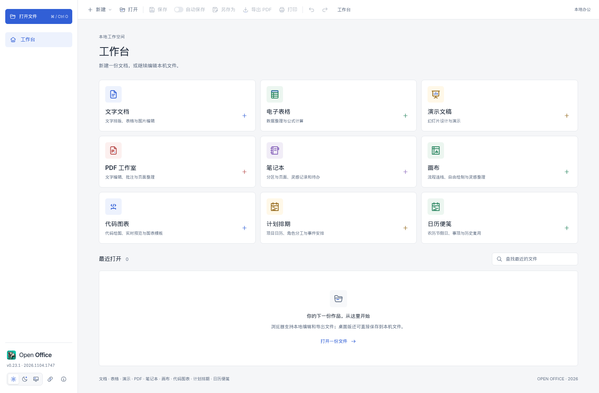

九种工具均支持「全屏编辑」：打开文档后点击右上角按钮，隐藏全局导航、文件工具、标签、MCP 设置和底部状态栏，保留当前工具的编辑操作。排期还会收起项目设置，PDF 收起图章署名设置。右上角始终保留「退出全屏」；保存快捷键、自动保存和已开启的 MCP 服务继续工作，编辑内容与撤销记录保留。这是应用窗口内的主体全屏，与系统全屏、幻灯片放映分别使用。

九种工具的文件名与单份文档名称统一：排期文件对应项目名称，日历文件对应日历本名称，笔记文件对应整个笔记本名称。双击标签标题或聚焦后按 F2 可改名，保存时同步文件名，扩展名保持不变。[查看名称与保存说明](docs/document-names.md)。

## 文字文档

撰写报告、方案与日常文档。支持文字与段落格式、标题、列表、表格、图片、页面排版和审阅，打开与保存 DOCX，并可导出 PDF。

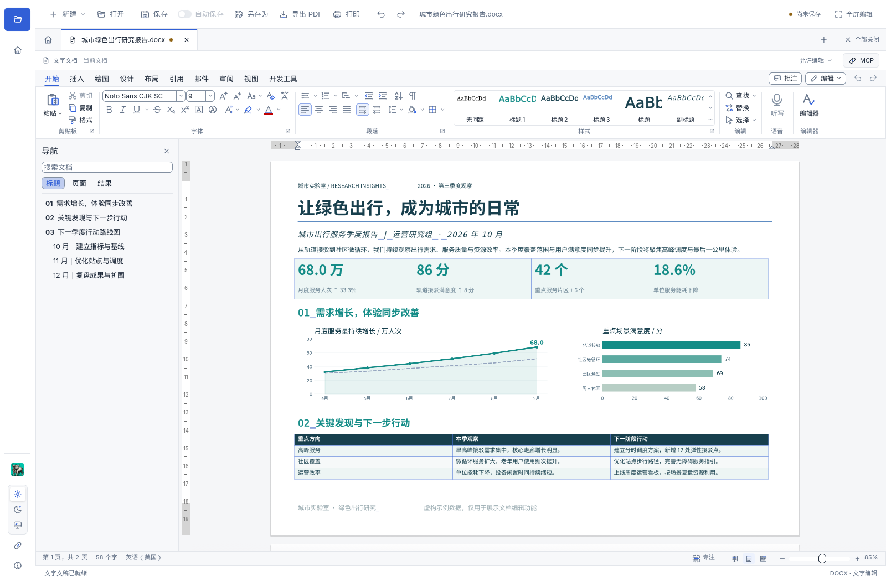

## 电子表格

整理数据、编制预算、分析经营表现。支持公式计算、单元格格式、图表和多工作表，打开 XLSX、CSV、TSV，保存为工作簿或导出 PDF。

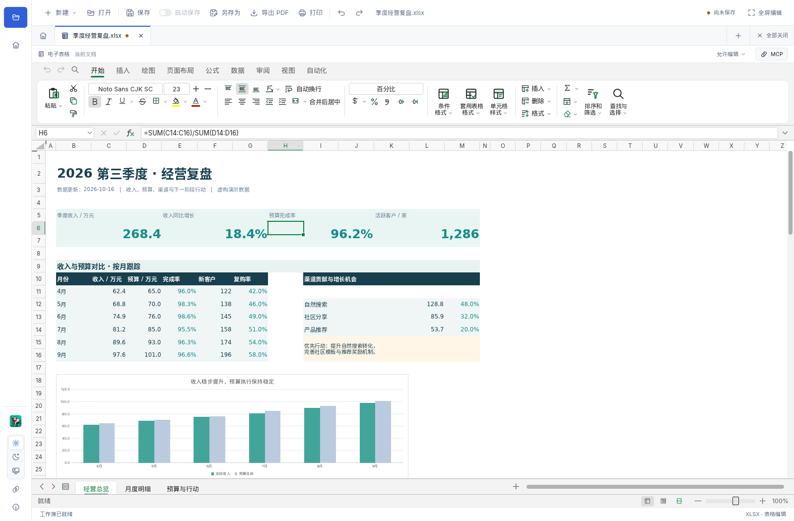

## 演示文稿

制作汇报、提案与课程演示。组合文本、图片、形状和布局，添加备注并放映；内置 100 套不同风格与行业的模板，支持名称搜索，也可将当前文稿存为自定义模板。

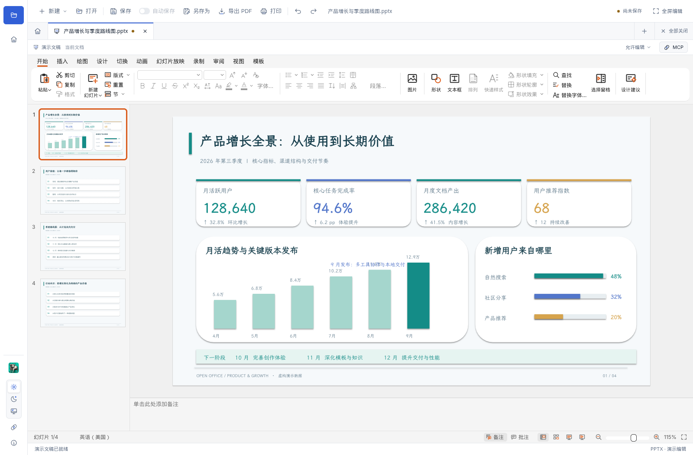

## PDF 工作室

阅读、编辑和审阅 PDF。支持文字编辑、高亮、批注、签名、图章、表单填写、搜索和页面整理，把阅读、标记与交付放在同一个工作区。

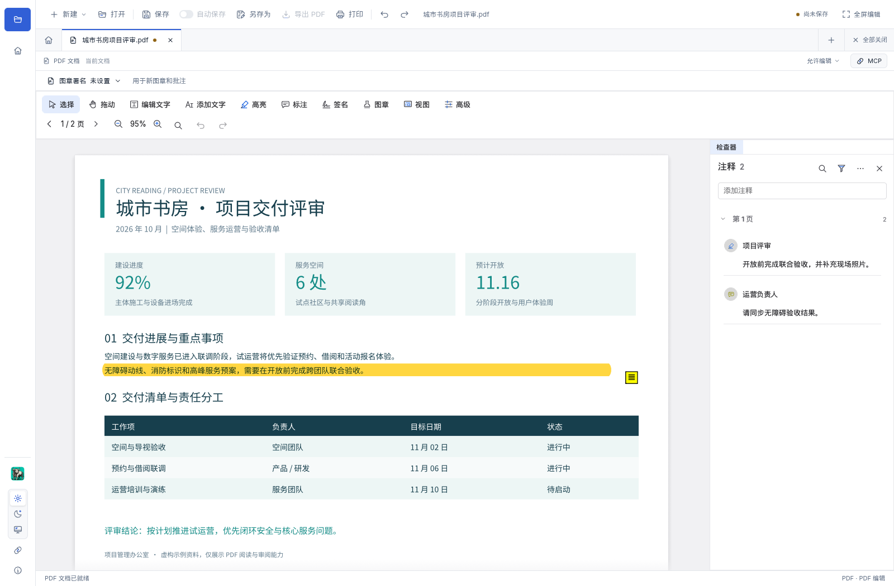

## 笔记本

用分区、页面与子页面组织知识。文字、待办和图片以独立区域自由排布，支持图片缩放、拖动对齐与网格吸附；搜索结果会在页面中持续高亮，便于回到思路所在的位置。

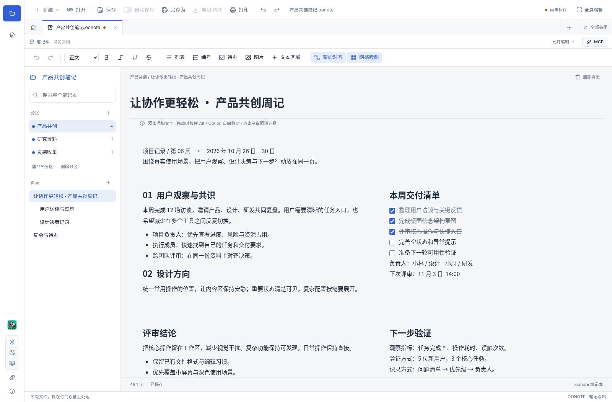

## 画布

把想法画成流程、架构或视觉笔记。支持图形、连线、便笺、自由笔触、圆角设置、分组对齐和图层管理，配合吸附与连续绘制完成布局，并可导出 SVG、PNG。

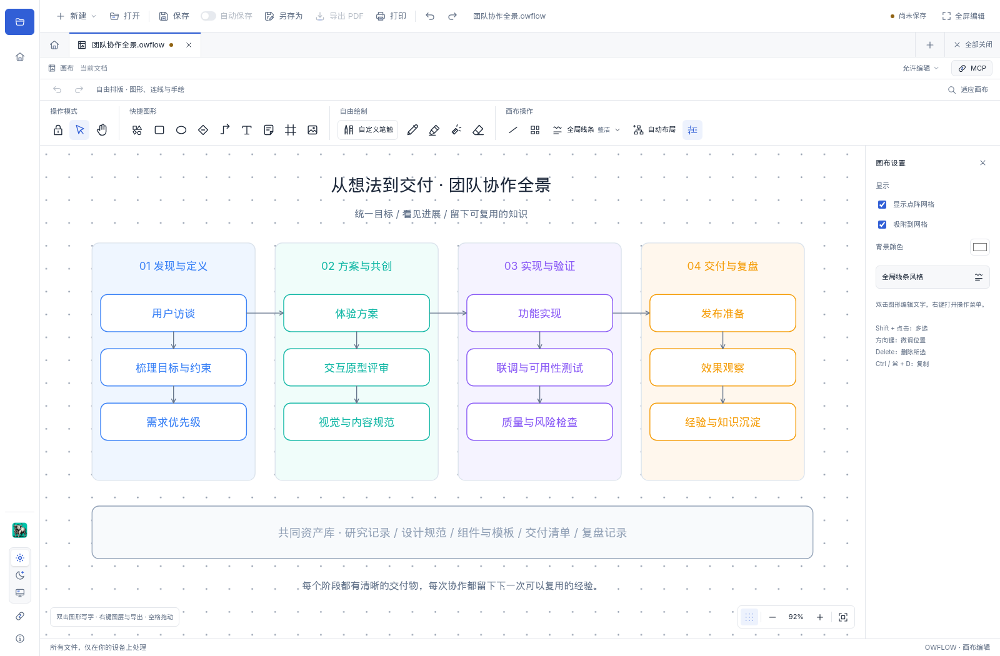

## 代码图表

用文本描述关系，让图表随代码变化。支持时序图、流程图、类图、甘特图等 22 类图表，提供 46 个示例与 10 种样式；源码与预览联动，支持鼠标缩放及 SVG、PNG、源码导出。

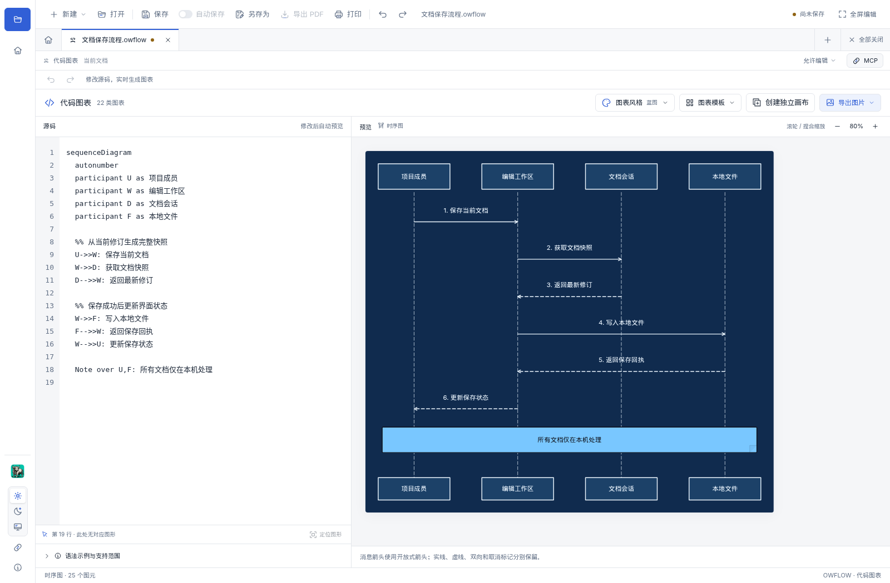

## 计划排期

为项目选择日期范围，添加人员、角色和颜色，周号支持「按年」ISO 周序号（如 W40、W41）和「按项目」从 W1 递增，可在「视图」切换并随排期保存。人员视图每人一条轨道，事件视图按开始日期混排所有人的事件；整体计划独立位于顶部，空间足够时保持固定。拖动事件可更换人员，左右拉伸按整天吸附，底边高度吸附到 100% 或 50%；半高事件可吸附到上半部「上午」或下半部「下午」，同一人员同一天仍只允许一个事件。支持 Ctrl＋滚轮以鼠标位置为中心缩放时间轴。

默认隐藏周末和中国大陆法定假日，按项目年份自动获取假日安排、定期更新并缓存，断网使用已有数据，也可手动调整。排期保存在本地 `.ooschedule` 文件，支持撤销、重做、自动保存和多标签编辑；联网只请求假日年份，不上传排期内容。

顶部工具栏集中常用操作，轨道高度支持按 28px 刻度独立调整并保存。人员姓名与角色同行，下方用两列胶囊按百分比显示月度工时，隐藏零工时月份；全天计 1 天、半天计 0.5 天，同时统计人员及项目总人天。项目设置可填写人天单价，悬停总工时即可查看预算。支持完整排期 JSON 导入／导出，以及包含全部日期、轨道、总工时和月度胶囊的 PNG 导出；图片不显示事件数量。排期 MCP 覆盖读取、批量编辑、工时预算、日历、视图与导入导出，修改与界面及撤销历史同步。

事件无需先选中即可从边缘直接拉伸；普通拖动移动，按住 Ctrl 拖动复制，保留原事件并支持一次撤销。

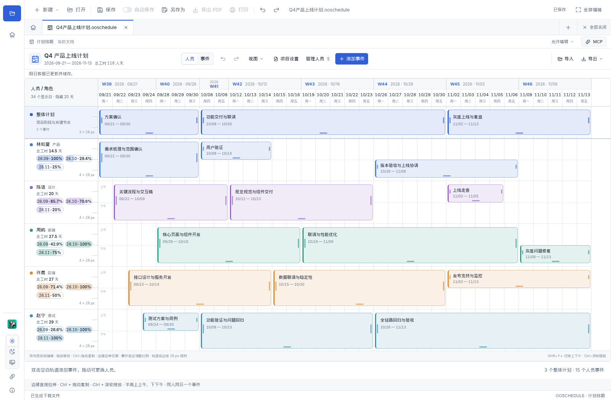

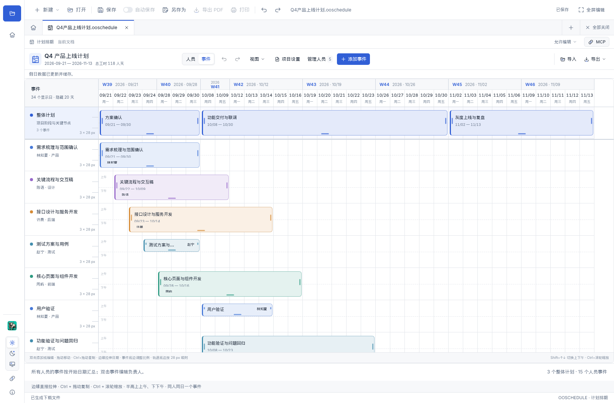

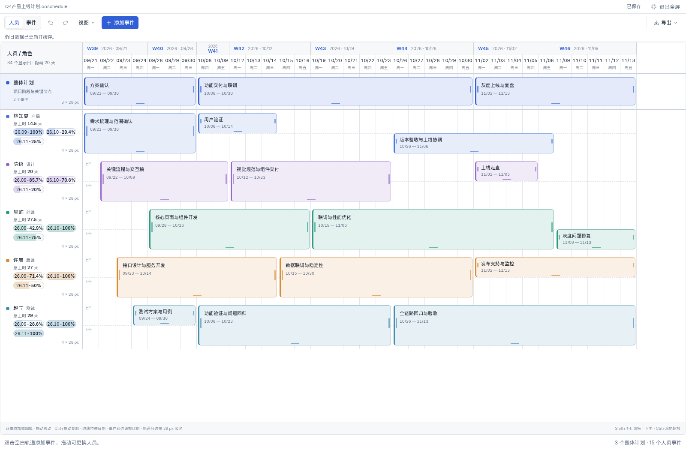

[查看排期使用说明](docs/project-scheduling.md)

## 日历便笺

把工作事项、请假和日常记录放进月历，查看农历、节气和中国大陆法定假日。单击日期只选中，通过「日期详情」按钮或右键菜单查看黄历；右键日期可添加自定义事项、年假或病假。自定义时可搜索并复用跨月历史事项的名称、颜色和是否需要上班，正文由你填写。

工具栏「设置」集中调整每天工时、Week／Work 和百分比／小时显示，作用于当前日历本的所有日期并随文件保存。Week 显示周一至周日，Work 保持月历结构、只显示周一至周五；隐藏周末保留原有事项和完整月度统计，法定假日不另行过滤。

同一天的工作事项组合成工时胶囊，默认每天 7 小时：首项占满整天，添加或拖入更多事项时平均分配。拖动中间边界以 10%／0.5 小时为步长调整；修改每天工时会保留已分配比例。请假等非工作事项单独显示，不占工作时长，月度统计按实际分配计算。

拖动事项调整日期，Ctrl／⌘ 拖动复制；支持搜索、编辑、删除、清除当月和撤销重做。所有月份、工时设置与历史事项一起保存在本地 `.oocalendar` 文件中，接入统一保存、自动保存、打印、全屏编辑与 MCP。

参考并适配 [CalendarNote](https://github.com/ecojust/CalendarNote)，保留原作者的 MIT 许可与出处。[查看日历便笺使用说明](docs/calendar-notes.md)。

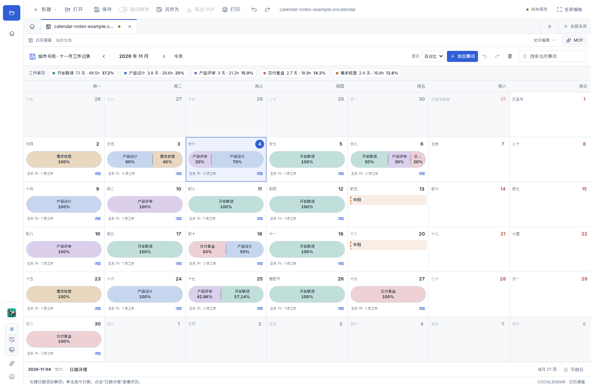

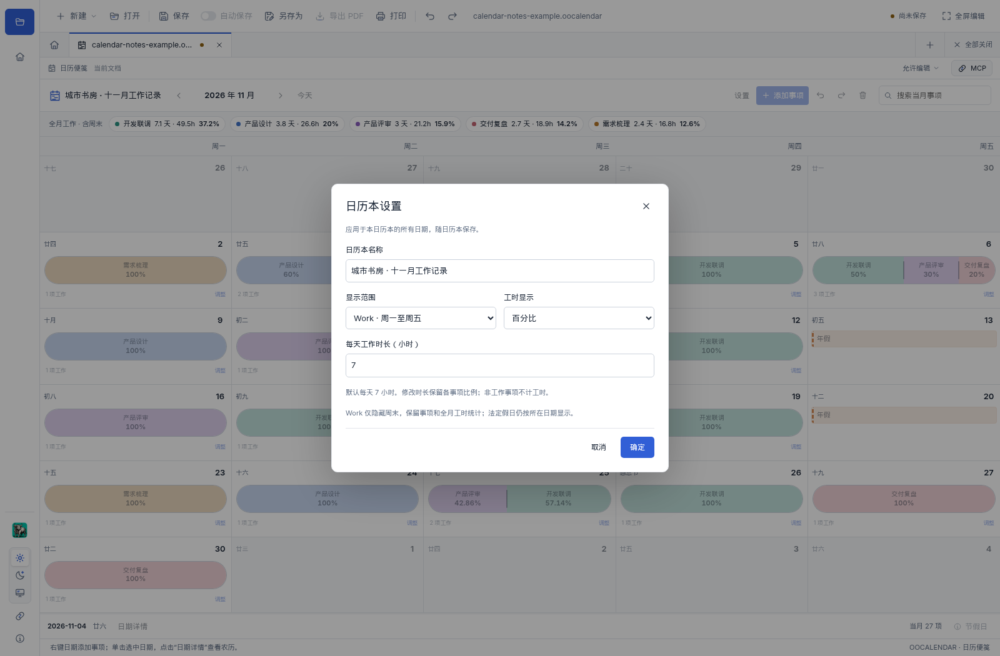

主页与日历便笺预览分别来自 `feat/calendar-notes`、`feat/calendar-week-work` 开发分支的实际运行界面，拍摄时尚未公开发布。[查看开发版截图来源](docs/screenshots/readme-calendar-preview.md)。其余预览来自 0.23.0 的实际运行界面；所有示例资料均为虚构。[查看 0.23.0 截图来源](docs/screenshots/readme-0.23.0.md)。
