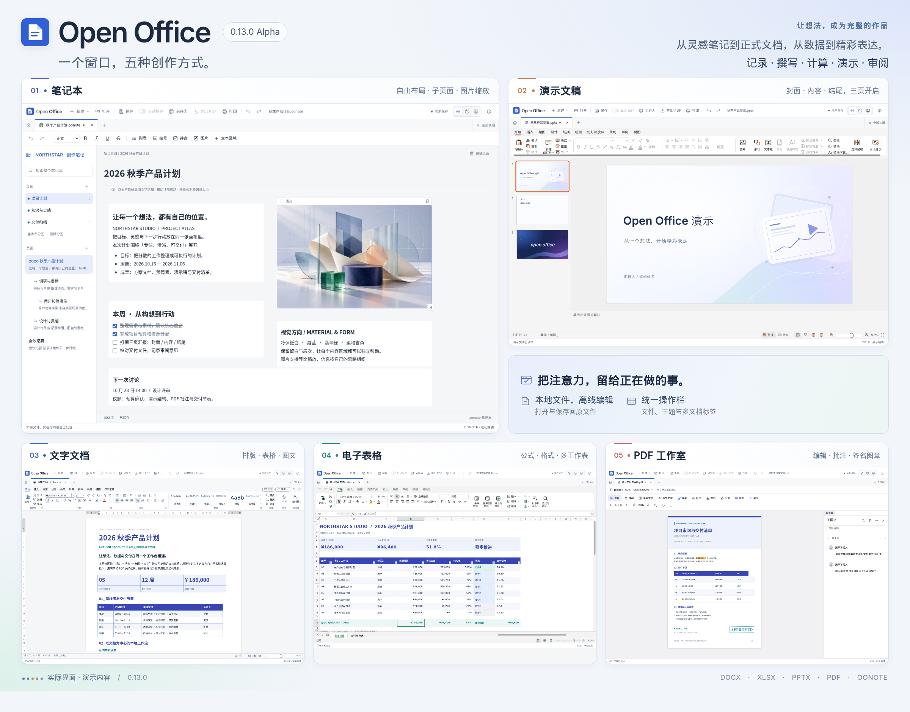

# Open Office

一个窗口，处理文字文档、电子表格、演示文稿、PDF、笔记本、画布与代码图表。中文工作台、多文档标签；文件在本机打开、编辑和保存，无需账户，安装后可离线使用。

[下载安装包](https://github.com/ecojust/open-office/releases) · [构建记录](https://github.com/ecojust/open-office/actions/workflows/desktop-release.yml) · [开发与构建](docs/development.md)

当前源码版本为 **0.15.0 Alpha**，新增画布、代码图表和自动保存倒计时，并改进演示操作、笔记对齐与品牌图标，见[更新说明](docs/releases/0.15.0.md)。安装包通过原生验收后发布，下载及逐平台状态以[发布页](https://github.com/ecojust/open-office/releases)为准。封面展示 0.13.0 的实际工作区。

本次更新：

- 新增[画布与代码图表](docs/workflow.md)，共用文件操作、多标签、主题和自动保存。
- 自动保存旁显示真实倒计时，以及保存中、已保存和等待输入等状态。
- PPT 模板入口放在演示操作栏“视图”右侧；选中缩略图后按回车复制当前页。
- 笔记区域移动时提供对齐参考线和网格吸附，按住 Alt／Option 可临时绕过吸附。
- 顶部品牌、应用安装图标和浏览器图标统一为青牛图案。

## 工作区

| 工作区 | 支持格式 | 主要功能 |
| --- | --- | --- |
| 文字文档 | DOCX；导出 PDF | 文字和段落格式、列表、表格、图片、页面与审阅工具 |
| 电子表格 | XLSX、CSV、TSV；导出 PDF | 工作簿与公式计算、单元格格式、公式栏、工作表编辑 |
| 演示文稿 | PPTX；导入 POTX、PPSX；导出 PDF | 幻灯片、文本与形状、图片、布局与样式、备注、放映；[内置和自定义模板](docs/presentation-templates.md) |
| PDF 工作室 | PDF | 阅读、文字编辑、批注、表单、搜索与页面整理；[集成边界](docs/pdf-capabilities.md) |
| 笔记本 | OONOTE | 分区与页面、富文本、列表、待办、PNG/JPEG 图片、搜索及当前页面打印；[格式与边界](docs/notebook.md) |
| 画布 | OWFLOW；导入图形 XML、白板 JSON；导出 SVG、PNG | 图形连线、文字便笺、六种画笔、模板、分组对齐、图层与缩放 |
| 代码图表 | OWFLOW、MMD；导出 SVG、PNG、源码 | 22 类图表、46 个示例、10 种样式、源码与预览联动；[功能与格式](docs/workflow.md) |

新建、打开、保存、另存为、导出、打印、撤销和重做集中在顶部，作用于当前文档。浅色／深色／跟随系统主题同步所有工作区；操作栏采用自行绘制的 SVG 图标。支持最近文件、多标签、未保存关闭确认与外部文件修改检测。

桌面版保存按钮旁的“自动保存”开关每 30 秒保存已选择本机位置的当前文档。到期时如正在输入或操作弹窗，会暂缓并在完成后自动继续；开关旁显示真实倒计时，并显示等待输入、保存中、已保存或重试倒计时。新建或需要转换格式的文档需先手动保存；后台保存不会弹出文件对话框，不提交尚未确认的输入草稿，也不会用旧回执清除保存期间的新修改。

桌面版打开 DOCX、XLSX、PPTX、PDF、OONOTE 或 OWFLOW 后，“保存”写回原文件，不再自动生成副本；“另存为”由用户选择新位置。CSV／TSV 编辑后默认转换另存为 XLSX，POTX／PPSX 转换另存为 PPTX，原始文件保留。另行导出 CSV／TSV 只包含活动工作表的显示值，不包含格式和公式。当前不支持旧 DOC、RTF、ODT、XLS、ODS、PPT 和 ODP，需先转换为支持的格式。失败打开不会切换到其他内核。

## 架构与兼容性

文字、表格、演示和 PDF 均由仓库内固定版本的 Rust 源码构建为本地 WASM。四套引擎实际负责解析、编辑、排版和导出，Vue/Tauri 统一管理文件、主题和标签生命周期。代码标识与运行日志使用 Open Office 命名；原始版权、依赖身份及文档兼容标识保留，真实来源见[第三方清单](THIRD_PARTY_NOTICES.md)。

笔记本使用本地 TypeScript 结构化模型，`.oonote` 保存分区、页面、文本格式、待办和内嵌图片，不保存任意 HTML。它共享顶部文件操作、主题和保存回执机制，不承诺读取其他笔记软件的专有文件。

画布与代码图表直接使用本地 TypeScript 模型和 SVG 渲染，编辑器与主界面共享会话和文件生命周期。兼容导入会提示转换保存，不覆盖原格式文件。

旧办公兼容运行时、早期文档引擎和 PDF 子进程后台已移除。应用不加载远程办公网页，PDF 也直接在本地工作区编辑。

编辑器仍处于 Alpha。上游功能数量不等于本应用已经验收的数量，复杂对象、特殊字体、分页、公式与格式往返可能有差异。请保留重要文档原件并核对导出结果。完整 Office 兼容、扫描件 OCR 和证书数字签名编辑不在当前承诺范围内。

验证包括真实画布编辑、导出和重开，以及独立 ZIP/XML/PDF 读取检查。浏览器测试不能代替安装包的原生 WebView 验收；各平台发布结果以对应 Actions 为准。`docs/` 中旧内核报告是历史记录，不代表当前新引擎的验证结果。

## 安装与开发

在[发布页](https://github.com/ecojust/open-office/releases)选择 Windows x64、Mac M 系列或 Mac Intel 安装包。新架构将四套文档引擎与字体一起打包。当前未配置商业代码签名；macOS 使用本地签名，尚未进行开发者公证。校验文件见发布附件 `SHA256SUMS`。

开发需要 Node.js 24、Rust stable（至少 1.95）、`wasm32-unknown-unknown`、`wasm-bindgen-cli 0.2.129` 和本机原生构建工具。独立导出验收另需 Python 3.12，它不进入应用安装包。见[开发与构建](docs/development.md)、[图标说明](src/icons/README.md)。

## 许可

本仓库保留原始 MIT 许可；集成发行包包含多种许可组件。原始版权和开源来源保留在法律资料中。见 [LICENSE](LICENSE)、[集成分发许可](DISTRIBUTION_LICENSE.md)及[第三方清单](THIRD_PARTY_NOTICES.md)。
