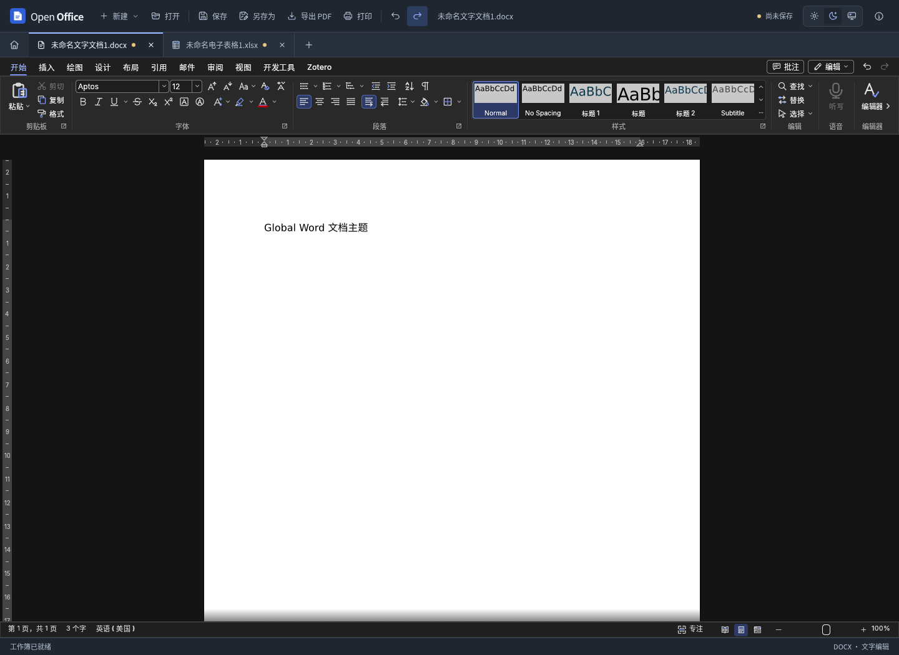
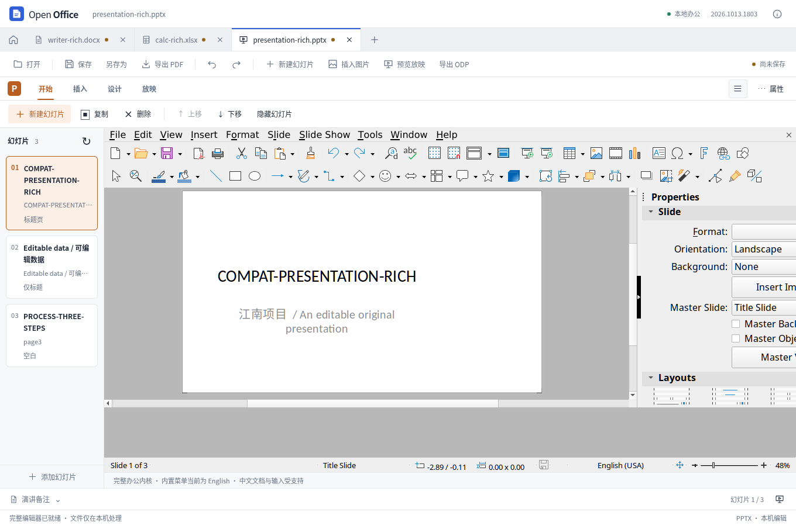
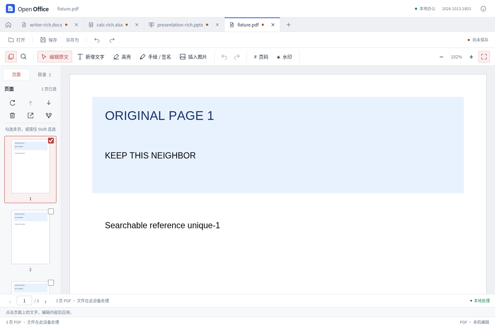

# Open Office

一个窗口，处理文字文档、电子表格、演示文稿和 PDF。中文工作台、扁平界面、多文档标签；文件在本机打开、编辑和保存，无需账户，安装后可离线使用。

[下载安装包](https://github.com/ecojust/open-office/releases) · [构建记录](https://github.com/ecojust/open-office/actions/workflows/desktop-release.yml) · [开发与构建](docs/development.md)

**0.7.0 · Rust 文字功能预览**：默认文字入口新增 Rust 基础 DOCX 编辑链。安装包可用状态以发布页为准，发布流程要求本次构建与原生运行检查通过。0.6.2 安装包不包含此迁移。[0.7.0 更新说明](docs/releases/0.7.0.md)

## 软件功能

| 工作区 | 常用格式 | 主要功能 |
| --- | --- | --- |
| 文字文档（Rust 预览） | 基础 DOCX | Rust 解析、文档模型、编辑与撤销、字形布局与分页；中英文正文、基础文字格式与段落对齐 |
| 文字兼容编辑器 | DOCX、ODT | 文字与段落排版、普通列表与编号、上下标与高亮、超链接、标题大纲、表格、页眉页脚、查找替换、批注与修订、导出 PDF |
| 电子表格 | XLSX、ODS | 单元格与公式、混合格式提示与富文本格式设置、向下/向右填充、选区汇总、工作表管理、排序筛选、冻结、条件格式、数据验证、基础图表与透视汇总 |
| 演示文稿 | PPTX | 独立画布、局部文字与段落排版、文本框布局、图片、可编辑表格和图表、备注、页面切换、本地音视频与放映 |
| PDF 工作室 | PDF | 原文替换、新增文字与图片、高亮与便签、批注备注管理、简单表单填写、手绘签名、搜索、合并与页面整理、页码和水印 |

支持最近文件、撤销重做、保存与另存为；另存为可以选择当前工作区支持的格式，跨格式转换生成副本，保留原文稿继续编辑。未保存退出确认、未应用草稿检查和外部文件修改检测，帮助保留编辑结果。旧版 DOC、RTF、XLS 可导入并另存现代格式副本。演示文稿目前支持标准 PPTX，旧 PPT 与 ODP 需要先转换。

演示工作区现已采用独立文档模型、SVG 画布和 PPTX 读写模块，不加载原办公引擎。文件操作与幻灯片工具各一行，属性收在侧栏；支持拖动、缩放、组合、表格与图表数据编辑，以及可检索中文的 PDF 导出。[功能与验证范围](docs/standalone-presentation.md)

0.7.0 的默认文字入口由自研 Rust 内核完成新建、DOCX 打开、编辑、排版与保存：桌面调用原生 Rust，浏览器运行同一代码编译的 WASM，界面显示 Rust 的字形路径与分页结果。支持基础文字格式、左中右对齐、撤销重做和多标签；每份文档最多 10,000 个 UTF-16 单元（含段落分隔）、500 段，同时最多 4 个 Rust 文档会话。该路径使用通用 XML、字体塑形与轮廓读取库；目前没有证明相对旧引擎的性能提升。[实现范围与验证记录](docs/rust-word-engine.md)

第一阶段导入范围严格受限，表格、图片、编号、语言等未支持的有效语义会明确拒绝，导入文件首次保存生成副本。复杂文字文档可从“兼容编辑器”入口打开，失败导入不会自动换用其他引擎。旧轻量文字、表格、独立演示和 PDF 工作区继续保留各自实现。

0.6.0 新增“轻量文字文档（预览）”入口，采用独立正文模型、编辑界面与 DOCX 读写，支持基础文字格式、单／双下划线及独立线条颜色、上下标、单／双删除线、字符间距与字偶距、大写与小型大写显示、标准色高亮、自定义文字背景色、标题、段落对齐、左右与首行／悬挂缩进、段前段后与行距、纸张尺寸、方向和页边距，以及撤销重做，并保留空段及独立段落标记的文字格式。桌面路径的 DOCX 解压、压缩与校验已接入 Rust 后台模块，并增加真实 LibreOffice 文件的往返测试。尚未支持复杂分页、表格和图片，DOCX 导入限于已实现的格式子集。[使用方式与验证范围](docs/independent-word.md) · [Rust 实现与性能记录](docs/word-rust-performance.md) · [导入性能对照](docs/word-import-performance.md)

## 兼容性测试

- 使用固定样例验证“打开 → 编辑 → 保存 → 重开”，并独立读取实际导出文件；检查正文、格式、公式、图表、链接、批注与页面信息。[文档兼容报告](docs/compatibility-results.md)
- 演示专项覆盖 12 份复杂原件，分别检查原始内容保留、可编辑功能与画面差异；对尚未支持的动画、图示和排版明确提示。[复杂演示文稿测试](docs/presentation-complex-compatibility.md)
- 持续修复四个工作区的编辑与保存问题。每轮记录源码指纹、实际操作、失败原因和已知限制；测试结果不会替代未完成的功能。[当前实现与验证进展](docs/rea-compatibility-progress.md)
- 界面检查覆盖桌面和窄窗；具体工具的 390、320 像素操作、键盘交互与实际截图见各专项记录。
- 历史发布记录包含 Windows x64、macOS ARM64 和 macOS Intel 安装包检查；Intel 使用 Rosetta，尚未在真实 Intel 显卡上完整实测。0.7.0 发布要求本次安装包与 Rust 文字原生 IPC 检查通过，不能沿用历史结果。

测试只证明报告中的样例与检查项。复杂版式、特殊字体、部分公式和嵌入附件仍可能存在差异；完整对象动画、扫描件 OCR 和证书数字签名编辑尚未支持。发现已知导入风险时会提示另存副本，重要文档请保留原件并核对导出结果。[PDF 功能边界](docs/pdf-capabilities.md) · [内存测试记录](docs/memory-optimization.md)

## 界面预览

以下为实际运行的浏览器预览截图，内容为测试文档；桌面版另提供原生文件保存与本地后台处理。演示工作区采用独立扁平界面，截图中的文字兼容编辑器和表格工作区仍保留内置高级菜单的原有外观，尚未展示新 Rust 预览。

文字文档

电子表格

演示文稿

PDF 工作室

## 安装与开发

在[发布页](https://github.com/ecojust/open-office/releases)选择 Windows x64 安装程序、Mac M 系列 DMG 或 Mac Intel DMG。安装包自带文档引擎、中文字体与 PDF 后端。当前编辑引擎内存占用较高，建议至少 8 GB 内存。

当前安装包未配置商业代码签名；macOS 包使用本地签名，尚未进行开发者公证。首次打开请按系统安全提示处理，校验文件见发布附件 `SHA256SUMS`。

**0.7.0** 包含 Rust 文字内核第一阶段。开发验收已通过 36 项 Rust 测试、899 项 Node 和 83 项 PDF 测试，以及 8 组真实浏览器验收；Linux 原生编译通过，但本地 WebKit 子进程缺失，尚未完成该环境的 Tauri IPC 运行验收。安装包可用状态及本次 CI 结果以 [0.7.0 更新说明](docs/releases/0.7.0.md)和发布记录为准。[上一版 0.6.2 更新说明](docs/releases/0.6.2.md)

开发需要 Node.js 24、Python 3.12、Rust stable 和对应系统的原生构建工具，步骤见[开发与构建](docs/development.md)。

## 许可

本仓库保留原始 MIT 许可；集成发行包包含多种许可证组件，不能仅按 MIT 二进制软件分发。完整许可与对应源码说明见 [LICENSE](LICENSE)、[集成分发许可](DISTRIBUTION_LICENSE.md)和[第三方许可清单](THIRD_PARTY_NOTICES.md)。
