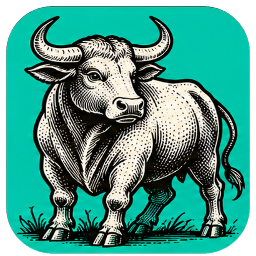
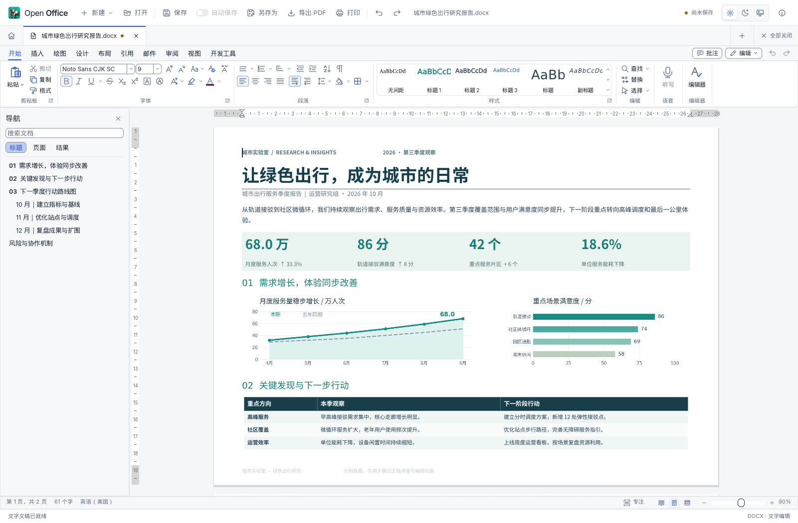
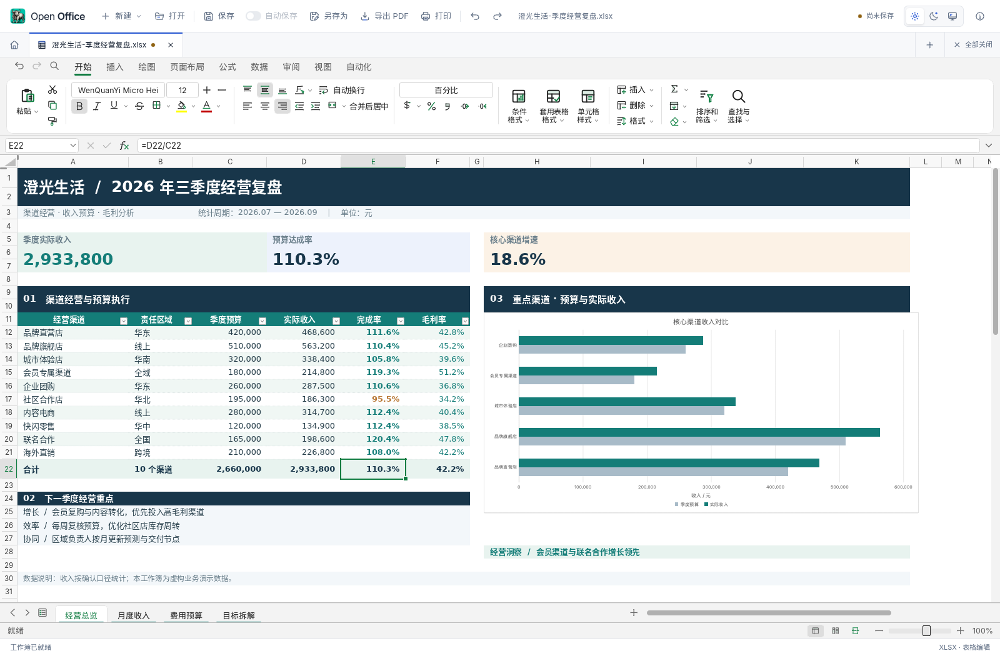
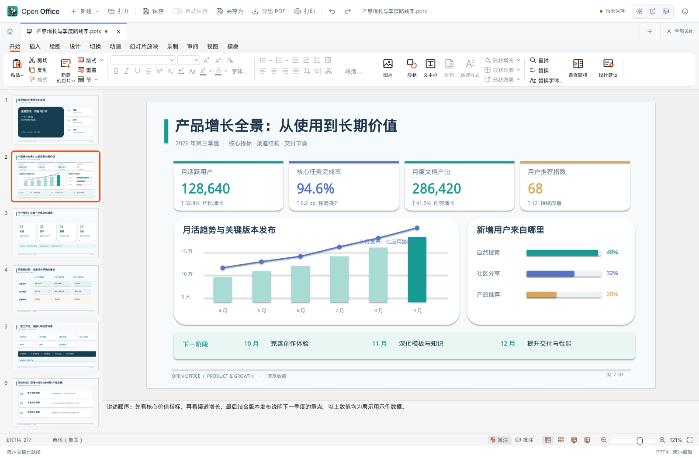
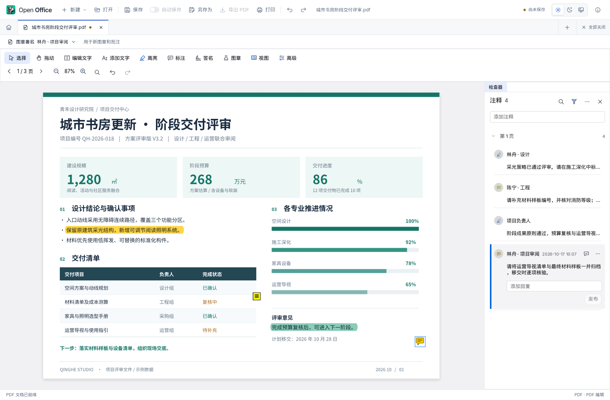
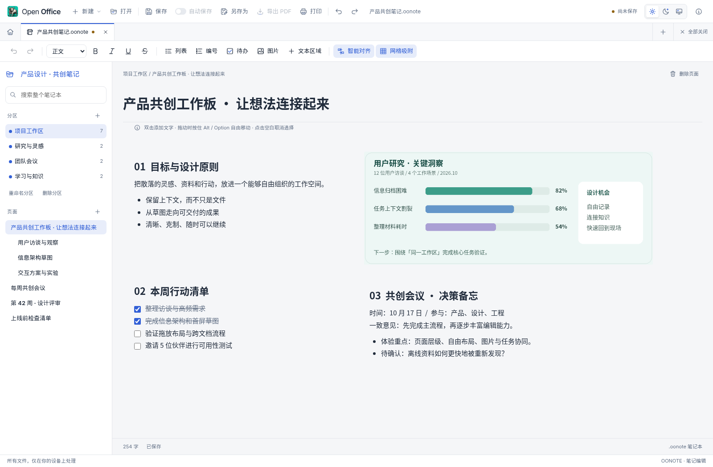
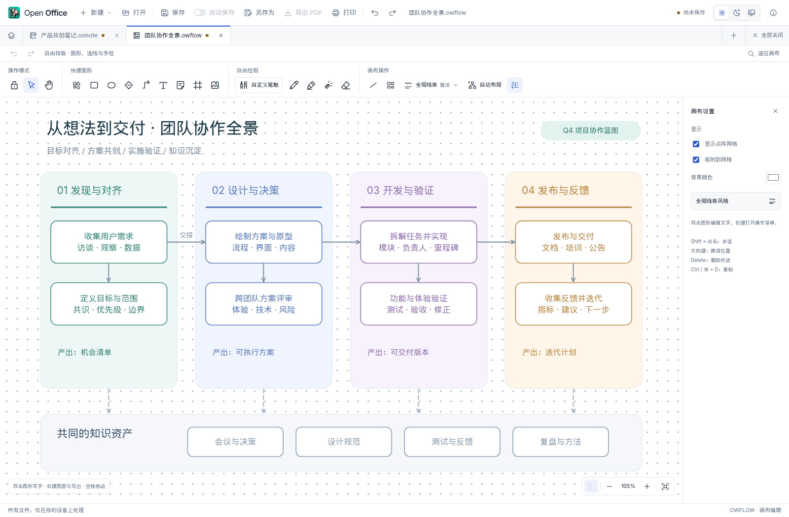
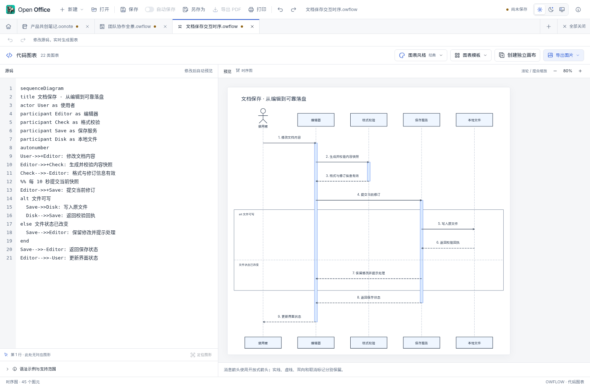

<h1 align="center">
  
  Open Office
</h1>

一个工作台，七种创作方式。

## 文字文档

撰写报告、方案与日常文档。支持文字与段落格式、标题、列表、表格、图片、页面排版和审阅，打开与保存 DOCX，并可导出 PDF。

## 电子表格

整理数据、编制预算、分析经营表现。支持公式计算、单元格格式、图表和多工作表，打开 XLSX、CSV、TSV，保存为工作簿或导出 PDF。

## 演示文稿

制作汇报、提案与课程演示。组合文本、图片、形状和布局，添加备注并放映；内置 100 套不同风格与行业的模板，支持名称搜索，也可将当前文稿存为自定义模板。

## PDF 工作室

阅读、编辑和审阅 PDF。支持文字编辑、高亮、批注、签名、图章、表单填写、搜索和页面整理，把阅读、标记与交付放在同一个工作区。

## 笔记本

用分区、页面与子页面组织知识。文字、待办和图片以独立区域自由排布，支持图片缩放、拖动对齐与网格吸附；搜索结果会在页面中持续高亮，便于回到思路所在的位置。

## 画布

把想法画成流程、架构或视觉笔记。支持图形、连线、便笺、自由笔触、圆角设置、分组对齐和图层管理，配合吸附与连续绘制完成布局，并可导出 SVG、PNG。

## 代码图表

用文本描述关系，让图表随代码变化。支持时序图、流程图、类图、甘特图等 22 类图表，提供 46 个示例与 10 种样式；源码与预览联动，支持鼠标缩放及 SVG、PNG、源码导出。

