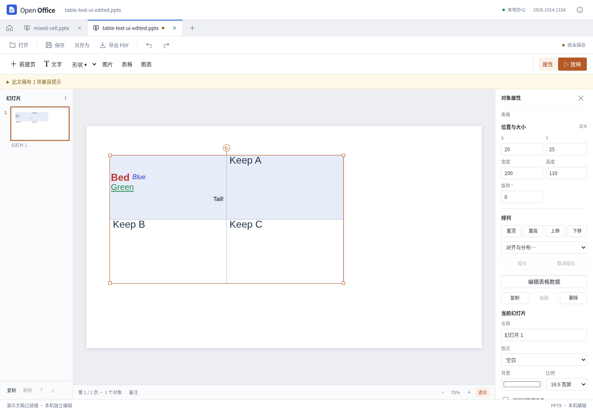
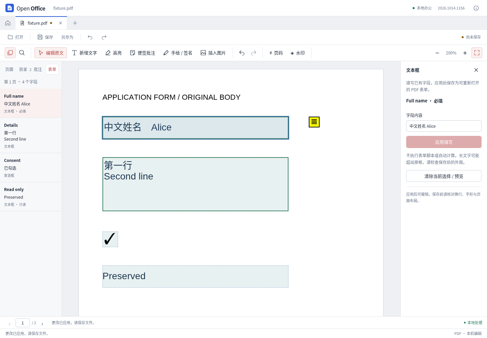

# 文件兼容与表单功能跟进

2026-10-14，当前源码迭代。这里继续记录 REA 研究后真正实现、导出及重开的结果；不代表全部功能对齐，也不是新的桌面安装包发布记录。

后续[表格布局迭代](presentation-table-layout.md)已修复下表当时记录的非等分网格显示问题，并完善明确底纹与尺寸写回。本页及其 JSON 保留本轮历史快照，不覆盖后续源码。

## 本轮变化

| 工作区 | 变化 | 当前边界 |
| --- | --- | --- |
| 演示 | 已有表格逐格、多行改字；保留原文字片段、段落、软换行、邻格和对象属性；基础表格可增减行列 | 合并格、字段等复杂内容受保护；表格主题、边框、底纹和非等分网格的画面仍有简化 |
| 文字 | 关闭嵌入附件的自动格式转换，并对当前 DOCX 导出中可核实的 CFB 附件纠正文件扩展名、关系和类型标记 | 不是嵌入附件编辑器；不从原件回填内容，删除的附件不会被复活；不明共享关系和签名包拒绝归一化 |
| PDF | 当前页表单清单、定位、普通文本/多行文本与独立复选框填写，真实字节撤销、保存重开 | 只处理可确认的简单 AcroForm；脚本、XFA、联动/重名字段及复杂字体等只读；未加入表单设计器、单选组或下拉编辑 |
| 电子表格 | 用真实文件验证候选新内核，修正运行时诊断误读 Emscripten 属性的问题 | 生产计算内核未更换，现有新函数、布尔类型及深度隐藏差异仍未解决 |

具体实现与操作限制见[表格文字](presentation-table-text.md)、[文字附件](word-embedded-preservation.md)、[PDF 表单](pdf-form-filling.md)及[表格内核调查](calc-compatibility-investigation.md)。

实际表格改字后保存重开（整体表格外观仍有简化）：

实际 PDF 表单填写：

## 从研究到修复

REA 6.4.0 继续针对固定 SDK 源 `72b0421c0bbf9d01eed9cf14834ae47eb2df1b50` 的必要函数解析，参考桌面软件版本为 ONLYOFFICE 10.0.0-169。表格专项解析 5 个文件的 8 个函数、2,460 个 AST 节点；PDF 表单专项解析 3 个文件的 7 个函数、794 个 AST 节点，均无解析失败。语义覆盖仍为 unknown，静态解析不当作动态功能验收。

表格研究确认单元格正文与表格属性需要独立处理。修复前，只改一个字会把原有两段、一个软换行和四种文字片段重建成三段。修复后的独立 ZIP/XML 对照确认：目标字改变，其他包部件字节不变。针对大量文字片段的导入再加入段落继承缓存及预算预检，避免逐片段反复扫描整段。

文字研究发现两个相互独立的问题：导入转换会改变部分附件负载；关闭转换后，导出仍可能给 CFB 二进制附件标成现代压缩文档。修复同时处理转换策略和导出容器标记，且只基于当前导出结果工作。完整附件字节、关系、删除行为必须分别核验，单看图标或包内文件名不足以证明保留成功。

PDF 研究确认字段值与可见外观都需要更新。实际保存文件分别由 PDF.js 和 Poppler 读取，核对中文、多行文字、复选框值及页面外观；自定义复选框状态沿用原有外观，文本字段保留非目标字典信息。

## 验证记录

最终自动化结果、产物与源码指纹见 [JSON 记录](office-compatibility-followup-results.json)。报告分别标记修复前快照、最终定向回归、浏览器操作、独立文件检查和参考桌面打开，避免把较早测试覆盖范围延伸到后来所有改动。

最终源码 **540 项 Node 测试、53 项 Python 测试全部通过**，类型检查通过，生产构建成功（12.70 秒）。表格专项为 86 项检查、16 项保护拒绝；最后导入性能修复后又重跑普通正文 92 项检查、13 项保护拒绝。复杂演示 12 份回归发生于最后仅涉及导入缓存的优化之前，范围在 JSON 中单独标明。

- 演示实际界面覆盖改字、撤销重做、下载重开、草稿保护、基础表格尺寸调整和 390/320 像素窄窗；实际下载的两份文件也在参考桌面软件只读打开并渲染。
- 表格保存后用独立 XML 读取器核对未改邻格、文字属性、段落和包关系；复杂演示回归覆盖 12 份文稿、65 次导出、41 次包审计和 36 次重开。
- 文字同时验证附件二进制、内容类型、共享关系、碰撞、数字签名保护，以及真实编辑器中的导出、重开、继续编辑和删除。
- PDF 分别验证后端字段操作、权限/加密、外观、异常结构，以及真实界面的草稿、撤销、保存和重新打开；旧批注与页面功能另作回归。

实际界面检查：表格 6 组、文字 8 组、PDF 表单 9 组、既有批注 9 组、既有 PDF 功能 26 组，均通过。文字独立 ZIP/XML 审计另核对 5 份附件输出与 3 份普通文档；9 个附件在 DOCX/ODT 中保持原字节，删除一个后保存和重开均只剩 8 个。

上述原生检查只是所列文件的打开与渲染，没有原生重保存或逐像素一致性结论。当前环境未完成新增代码的 Windows WebView2、macOS WKWebView 或新安装包验收。

## 当前仍未解决

候选新表格内核在样例中正确完成 `COUNTA(UNIQUE(...))` 的重算与保存重开；布尔常量和深度隐藏仍有差异，直接 UNIQUE 也没有证明完整自动溢出。该候选是滚动实验构建，缺少可固定重现的发行资产及对应源码清单，并出现对象生命周期告警，因此没有替换生产内核。

完整富文本光标、复杂表格视觉、SmartArt 结构编辑、完整动画、高级图表、文字/表格独立内核、OCR、证书签名及复杂表单仍需后续实现。此前已有工作及覆盖矩阵见[全模块记录](office-feature-coverage.md)，不能将本轮通过的测试解释为任意复杂文档无损兼容。
