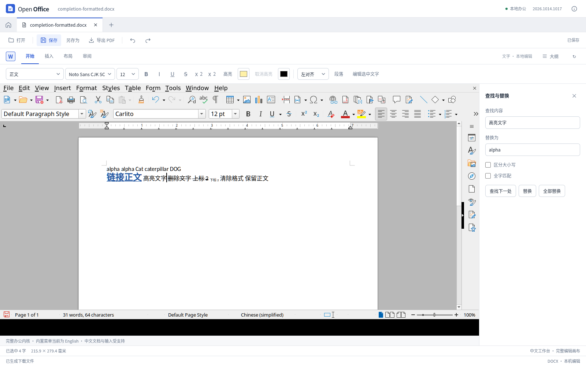
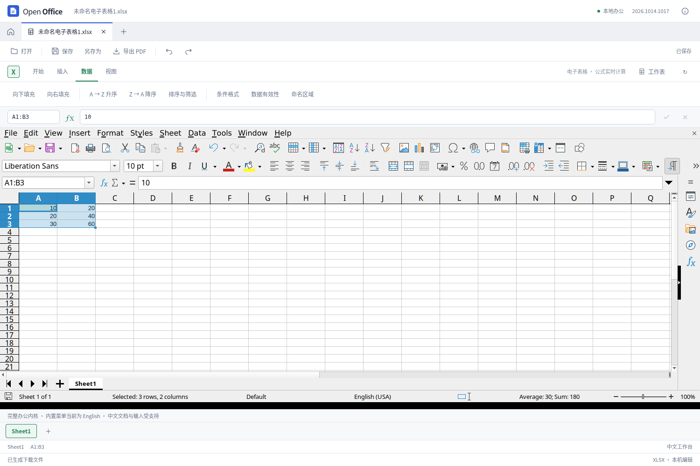
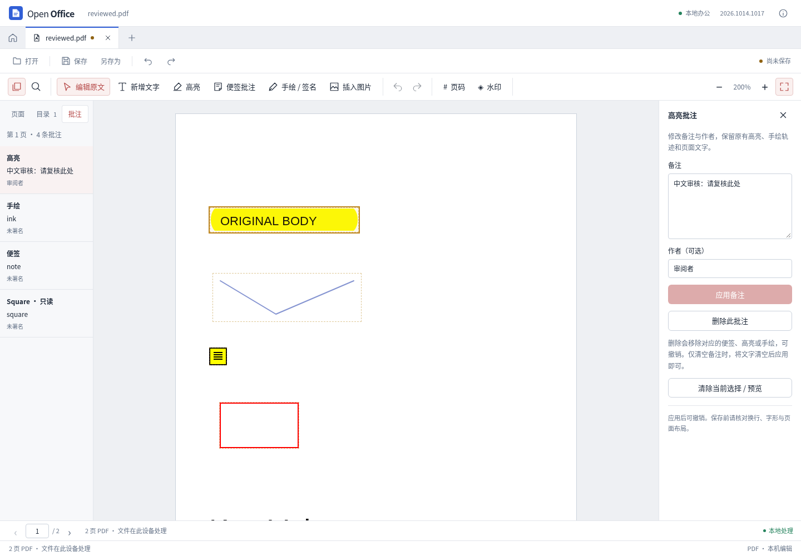

# 四个工作区的功能完善与验证

2026-10-14。本轮根据固定版本公开源码的 REA 定向解析，补齐文字、表格、演示和 PDF 的常用编辑操作。参考的是功能行为与文件语义，未将参考软件源码复制进产品。研究范围见[功能覆盖表](office-feature-coverage.md)，专项源码审阅见[独立审查](office-completion-review.md)。

本文保留四工作区完善时的验收基线；后续源码与测试增量见[文件保留专项](compatibility-preservation-iteration.md)，不要将本页旧指纹和数量当作后续源码的最终验收。

## 实际使用入口

| 工作区 | 本轮新增或修复 | 入口 |
| --- | --- | --- |
| 文字 | 当前匹配项替换并推进下一项；基础超链接设置、改址、移除；删除线、上下标和高亮 | 文字工具栏、链接面板、查找替换 |
| 表格 | 原生公式向下/向右填充；可见行/含隐藏行汇总；单格已有规则查看；修复刷新清空规则与画布过窄 | 数据工具栏、底部选区汇总、规则面板 |
| 演示 | 逐段对齐、行距与段距；文本框换行、垂直对齐和四边内边距 | 选中文字框 → 右侧“段落与文本框” |
| PDF | 当前页批注列表、定位、新建便签、修改备注/作者、单独删除 | 左侧“批注”和顶部“便签批注” |
| 通用 | 选择文件名与导出格式、另存副本保护、重命名后的后续保存、键盘与窄窗操作 | “另存为”或 Ctrl / ⌘ ⇧ S |

文字支持 DOCX/ODT/PDF，表格支持 XLSX/ODS/PDF，演示支持 PPTX/PDF，PDF 工作区保存 PDF。同格式另存成功后使用新文件名；跨格式输出保留原来的编辑窗口及未保存状态。旧 DOC/RTF/XLS 继续以现代格式副本保存。取消保存或外部文件冲突不清除未保存修改。

Word 和表格仍使用当前本地办公内核；PPT 使用独立文档模型；PDF 由本地后端修改真实文件。各项编辑写入对应的文档模型，并检查保存后的文件：Word 检查上下标与超链接 XML，表格检查公式引用及计算结果，PPT 检查选中段落与未修改 XML，PDF 检查批注外观流和其他对象的保留。

## 专项记录

- [文字：当前替换、链接与字符格式](word-completion.md)
- [表格：填充、统计与规则查看](sheet-completion.md)
- [演示：段落与文本框](presentation-completion.md)
- [PDF：批注编辑闭环](pdf-completion.md)

最终源码通过 `npm test`：**486 项 Node、39 项 Python 测试**，失败为 0；类型检查及 `npm run build` 生产构建通过。输出位于 `dist/`。专项验证如下，各组断言有重叠，未相加为总覆盖率：

| 检查 | 通过结果 |
| --- | --- |
| 文字 | 10 组真实内核检查、3 组链接元数据检查、5 组真实界面检查；DOCX/ODT 回读与下载 DOCX 的独立 XML 核验 |
| 表格 | 12 组真实内核、10 组真实界面；XLSX/ODS 回读、另存 ODS、公式引用、规则、非锚点数组保护；画布和 iframe 宽度均为 1500px |
| 演示 | 72 个段落/布局断言、4 组真实界面；原有局部文字格式 447 个断言、33 个拒绝场景及 27 项排版回归 |
| PDF | 9 组新增批注界面、26 组既有界面回归；后端 39 项包含 11 项新增批注检查，保留外观流及页面像素摘要 |
| 另存为 | 4 组生产界面检查，实际 PPTX/PDF 下载、取消与重命名、390px 键盘操作；独立 PDF 读取确认 4 页均有可提取文字 |
| 外部参考软件 | 两份实际导出 PPTX 均成功打开，各 4 页，共 8 页截图；验证打开与渲染，未验证像素等价或原生重保存 |

浏览器界面测试使用 Chromium 和当前本地引擎/后端。原生模型、浏览器界面与外部参考软件的打开检查分别记录，不相互替代。参考软件检查保留了首次超时记录，在释放其他测试实例后进行的一次重试通过。Word/Calc 使用原生文档模型不等于本轮已测试新的原生桌面安装包。可核对[结果与文件指纹索引](office-completion-results.json)。

## 运行界面

以下为测试文档在实际应用中的操作截图，未经合成。

## 仍然存在的边界

本轮没有完成所有高级功能，也不证明任意复杂文档无损兼容。文字的复杂分节与域、表格的动态数组和复杂规则管理、演示的完整动画与富文本内容编辑、PDF 的 OCR/表单/证书签署仍有缺口。已知格式风险和复制保存保护继续保留，具体见各专项文档。

这次更新尚未发布新的 Windows/macOS 安装包。开发模式中的 PDF 编辑使用真实本地后端；单独部署普通生产网页时，PDF 仍限于预览，完整编辑需在包含更新后端的桌面程序内使用。浏览器验收不能替代最终 WebView2/WKWebView 与安装包测试。
