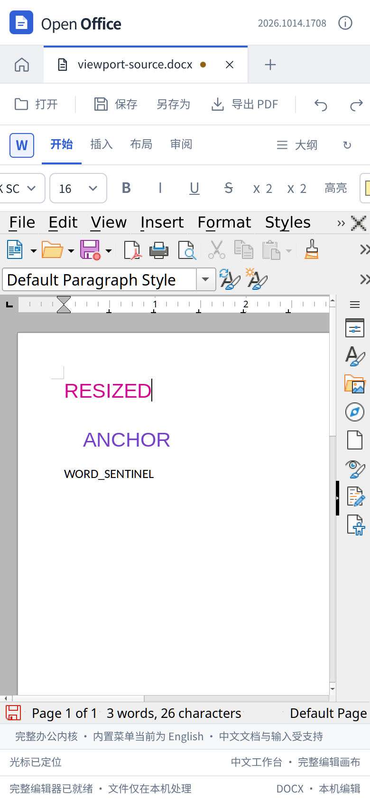
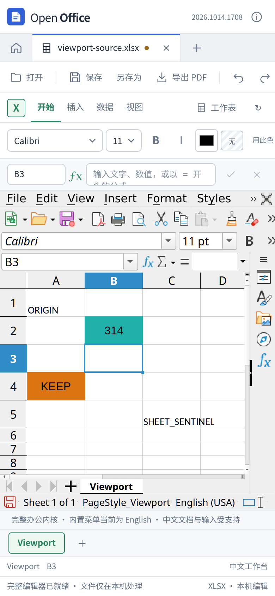

# 窗口缩放、工具栏与实际输入

这一轮修复文字和表格工具栏在窄窗下的控件挤压，同时更正此前对原生画布截图的判断。原生引擎、文档模型和编辑协议没有改动。

## 已确认的产品修复

工具栏原有横向滚动，但只禁止按钮、标签等部分元素收缩。直接放在其中的字体、字号、对齐下拉框和颜色控件仍会被 Flex 布局压窄，导致选中值看不清。现在除弹性空白外的工具栏直接子元素都保留正常宽度；空间不足时横向滚动，继续保持单行，不增加菜单行数。

## 对旧截图的更正

旧 Word/Calc 脚本在 `setViewportSize` 后立即截图。外层布局已变化，而原生引擎仍在处理跨线程尺寸更新，截图拍到了压缩的中间帧。之前据此判断“内嵌画布持续横向压缩”不充分，现撤回该判断。

只读测量确认，原有逻辑能够从宽窗的 `1600×604` 正常更新为窄窗的 `390×454`，再恢复原尺寸；稳定后文字和菜单比例正常。不需要增加 Qt 私有接口调用、重复派发 resize 或直接修改画布像素尺寸。

测试现在用 `office-viewport.cjs` 等待同源 iframe、内部视口、画布 CSS 与物理像素尺寸匹配，并核对 DPR；几何保持稳定后留出绘制帧，再截图。该等待有上限，不是固定休眠，也不发送任何编辑或缩放命令。几何一致只是一项条件，实际鼠标点击与导出内容另行验证。

原生工具栏也可能在画布尺寸稳定后继续出现，改变正文的位置。新的坐标测试还要求截图中的两个独立色块及 iframe 位置连续稳定 1.5 秒，上限 15 秒。用独立 Pillow 检查把截图物理像素换算为浏览器坐标；随后真实点击，核对文档选区，而不是从应用内部取目标位置。

## 验证记录

加入等待后，生产版原有文字列表 **12 组**和表格格式 **9 组**操作重跑通过，实际下载的独立检查仍为 **350 项 XML、300 项 openpyxl**，零失败。它们在工具栏 CSS 修正前完成，验证的是截图等待与现有编辑功能；最终 CSS 由后续实际坐标检查覆盖。

尺寸等待另有 5 个模拟环境检查，覆盖延迟的画布更新、高 DPI、有限超时和非法超时输入。这些检查不冒充真实浏览器或原生引擎证据。

此前完整逻辑回归为 680 项 Node、68 项 Python，均通过。本轮产品变化仅涉及工具栏 CSS，重新执行类型检查和生产构建；没有把旧测试计数写成一次新的全量执行。

## 最终 CSS 的实际输入检查

Word 在 DPR 1 下完成 1560、820、390 像素窗口、侧栏展开/关闭和恢复宽窗，共 7 个检查点，每次点击两个可见目标并核对同一份文档的真实选区。390 像素下通过键盘把 `VIEWPORT` 改为 `RESIZED`，正常保存的 DOCX 独立读回为 `RESIZED`、`ANCHOR`、`WORD_SENTINEL`。窄窗中的屏外段落按钮可通过工具栏横向滚动到达，字体、字号等控件不再被压缩。

Calc 在 DPR 1 下，1560、820、390 像素窗口的两个目标均可正确选中，窄窗实际键入 `314` 并按 Enter 后，原生选区到达 B3，文档 revision 增加。接下来特定的“DOM 画布聚焦 → Ctrl+Home → 点击 B2”流程出现选区停留 A1 的异常，不能算作完整通过。

Word 和 Calc 在 DPR 2 的独立流程也完成 1560、820、390 像素下的双目标点击；Word 另外验证侧栏展开/关闭。390 像素下实际键入新内容，恢复宽窗后正常导出，独立 XML 核对内容及哨兵未变，未出现页面运行异常。这两个流程特意不在编辑后再次聚焦画布、Ctrl+Home 或点击正文，因此仅证明所列操作，不覆盖下面仍失败的链路。

## 保留的输入异常

重复测试验证了鼠标确实落在截图中的 B2，DOM 收到正确坐标的按下、抬起事件，Enter 也已提交。移动鼠标后重新点击、延长按下时间都没有恢复选中。全新文档在 **1560 像素宽窗且完全不调整窗口大小** 时仍复现，因此不能认定为窄窗或 resize 专属问题；目前也没有证据将它与工具栏 CSS 修改关联。

宽窗对照在失败后通过正常保存按钮导出，XLSX 的 B2 仍是数值 `314`，A1、A4、C5 的哨兵文字未变。失败报告保留 `ok: false`，保存正确不代表选中流程通过。应用层静态检查未发现针对这些按键或鼠标事件的拦截，但尚未分别隔离测试辅助函数的 DOM `focus()` 与 Ctrl+Home，因此不声称已经确定原生引擎原因或修复该问题。

原始阶段报告及源文件指纹见[结构化记录](office-viewport-results.json)，六份原始报告保留各自的整体结果和单独工作区结果，没有把部分通过报告重新标为整体通过。

## 实际截图与复现

以下截图来自最终 CSS 构建的 DPR 2 流程。工具栏允许横向滚动，截图不代表所有命令同时可见。

使用带 COOP/COEP 的生产预览服务，然后运行 `node tests/browser/office-viewport-ui.cjs` 可执行完整默认流程；当前 Calc 输入链会失败，报告和截图保留在独立时间目录。`VIEWPORT_FLOW=wide-control VIEWPORT_KINDS=calc VIEWPORT_DPRS=1` 是宽窗对照；`VIEWPORT_FLOW=direct-export VIEWPORT_DPRS=2` 是上述高分屏独立流程。具体样例、独立审计和环境变量见[测试说明](../tests/compatibility/office-viewport/README.md)。

现有原生高级菜单仍保留原有外观。小窗口中，较宽的文档和工具栏需要滚动；截图与坐标检查不代表完整触屏手势、所有移动浏览器或所有输入法均已验证。
