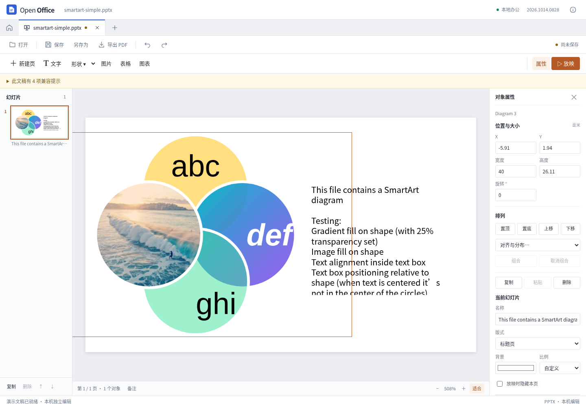
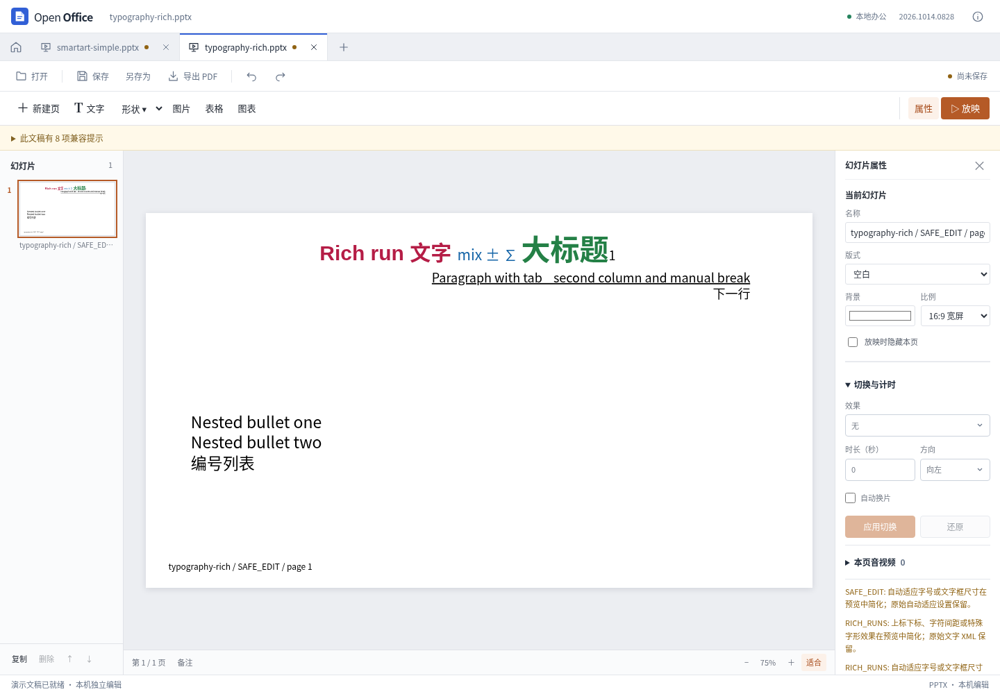

# 办公兼容性迭代：2026-10-14

后续更新：[第二轮](presentation-typography-iteration.md)已增加段落间距与数值上下标。本页保留第一轮范围、计数和当时的边界。

本轮将 REA 分析和官方 ONLYOFFICE 10.0.0 桌面运行观察转成两项实际改进：SmartArt 缓存预览、混合文字片段显示，并修复空白与纯图片 PPT 导出 PDF 挂起。改动已落在 Open Office 源码中，继续使用独立 PPT 内核；没有把官方软件作为产品运行依赖，也没有复制其实现源码。

这是一轮有边界的兼容性改进，不是完成全部办公功能对齐。Word/Excel 内核在本轮未替换，新的 Windows/macOS 安装包也未发布。

## 用户能看到的变化

- 带有效本地绘图缓存的 SmartArt 显示实际图形、文字、渐变和内嵌照片。画布、缩略图、放映和 PDF 共用预览。SmartArt 仍为只读，其尺寸输入禁用，原始结构继续保存在 PPTX 中。
- 同一文字框中的不同字号、颜色、字体、粗斜体可以分别显示；同一行按实际字体度量共享基线，段落对齐也分别读取。
- 格式操作记录用户明确设置的属性。因此“先取消加粗，再设回加粗”会应用到所选文字框内的全部文字片段，保存后不会悄悄恢复原先混合状态；撤销可以恢复原来的样式。
- 双击混合文字时会说明当前为纯文本编辑模式。改动段落沿用首个片段样式，未改段落保留原格式，字段和超链接的未修改内容继续保留。
- 空白页与只有图片的演示文稿可以完成 PDF 导出，修复空字体子集导致的挂起。该修复没有移除原有中文字体加载成本。

实际 Vue 界面：





## 分析如何影响实现

REA 6.4.0 对官方固定版本的 SmartArt 读取、绘制与文字映射，以及混合文字继承、行度量等函数做了定向分析。第一次大范围分析有预算截断，后续缩小到带原始文件哈希与行号的函数片段，保留了可追溯记录。片段外动态依赖仍未完全解析，未把静态分析说成完整运行时证明。

- SmartArt 必须沿 `diagramData`、`dataModelExt` 和关系文件找到对应绘图缓存；不能拿第一个图表部件或按名字猜测。
- 缓存文字框可以有独立变换，实际旋转需要考虑图形旋转。空缓存文字不自动变成文档内容。
- 文字片段的直接格式与段落默认值按属性继承，`b=0`、`i=false` 是显式关闭，不能丢掉；后面的片段也不能继承前一个片段的偶然样式。
- 对照运行发现图片填充还有参考软件自身的边界行为。Venn 样本的正方形图片图形，在参考程序中使用了接近两倍高的绘制边界；这个比例与截图中的额外拉伸吻合。当前按文件保存的几何和 `fillRect` 显示，没有加样例专用拉伸。

研究原始记录位于本工作区 `open-office-research/onlyoffice/`，主要文件为 `rea-smartart-findings.md`、`rea-mixed-run-findings.md`、`fillrect-findings.md` 及其结构化证据。官方源码只用于隔离研究；应用侧实现依据文档数据和行为验收独立编写。

## 验证层次与结果

| 验证 | 本轮结果 |
| --- | --- |
| 类型检查、生产构建 | 通过 |
| Node 前端/协议/模型测试 | 446 项通过 |
| Python PDF 后端测试 | 28 项通过 |
| 复杂 PPTX 固定语料 | 12 个原件，哈希未变，36 次无操作保存重开通过 |
| 独立结构审计 | 65 个实际导出文件、41 份审计报告，全部通过 |
| 原有独立 PPT 浏览器回归 | 24 项通过，含对象编辑、保存、放映、响应式及文件生命周期 |
| 混合文字专项 | 21 项真实浏览器检查通过，含显式 false、字段、继承、工具栏意图、撤销与保存重开 |
| SmartArt 专项 | 3 个样本的 3 轮保存、无关编辑和 PDF 导出通过；另有 8 个缺失缓存、关系、变换、资源和输入边界检查 |
| 新功能实际界面 | SmartArt 可见与受保护，工具栏两次切换后下载 PPTX 并重开，纯文本编辑说明均通过 |
| 独立 PDF 回读 | PyMuPDF 打开 3 份缓存图表 PDF 和混合文字 PDF，验证页数、图像和普通中文文字检索 |
| 官方桌面互读 | 4 份原件及其两种导出，加上 2 份格式修改导出，共 14 次打开通过；保留稳定截图，不作逐像素一致断言 |

跨应用打开和参考截图由 `tests/compatibility/onlyoffice-desktop.mjs` 完成。它启动官方 Desktop Editors 打开原件及本应用导出的文件，检查实际页数和画布，等待至少 5 秒并检查连续截图稳定后再记录；没有直接断言字体与图片加载器已空闲。参考软件有用户级单实例机制，因此测试会先拒绝已有实例，避免把文件误转交给另一个窗口。最终记录位于 `test-results/onlyoffice-iteration-native/report.json`，额外格式修改验证位于 `test-results/onlyoffice-iteration-native-style/report.json`。

本轮曾修复测试本身的过早截图：只看到页数不代表内嵌 JPEG 已加载完成。早期 600 ms 截图没有用于最终视觉判断。自动断言也没有把截图稳定等同于逐像素一致。

结构保留、实际画面和编辑能力分开评价。上述断言不证明任意文档无损，也不证明复杂动画已经播放正确。完整测试输出保留在 `test-results/`，精简指纹记录另见 `onlyoffice-compatibility-results.json`。

## 仍然存在的边界

- SmartArt 是有上限的光栅缓存预览，不支持新增节点、节点文字编辑或重新计算布局；其中的文字在 PDF 中不是可检索文字。缺失或不支持的缓存明确回退为占位。
- 自定义段距/行距、上下标偏移、复杂项目符号、多栏、竖排和自动适配仍有简化，并保留提示与原 XML。当前没有富文本选区编辑器。
- 字体缺失仍可能引起换行与字形差异，PDF 使用随包字体，不保证与安装了所有原字体的电脑完全一致。
- 复杂动画、SmartArt 专用编辑、高级图表和完整母版设计等仍是后续工作；已保留 XML 不代表已经实现交互能力。
- 新功能在 Linux Chromium 与官方 Linux Desktop Editors 上测试。本轮没有新增三平台安装包验证或跨平台性能结论。

## 复现与后续

先启动 `npm run dev`，按需要运行：

```sh
npm test
npm run build
npm run test:browser:ppt-independent
npm run test:browser:ppt-complex
npm run test:browser:ppt-smartart
npm run test:browser:ppt-rich-text
node tests/browser/presentation-compatibility-ui.cjs
```

官方桌面对照需另行准备官方软件和独立 X 显示器，具体环境变量见[测试语料说明](../tests/compatibility/README.md#官方桌面编辑器对照可选)。它不属于应用启动要求。

下一轮优先处理段落行距与上下标、缺失字体的可见提示和替代行为，再推进具有明确映射的 SmartArt 文字编辑；每项都需要增加独立样例、编辑保存重开及参考程序互读，不能仅以导入成功计作完成。
