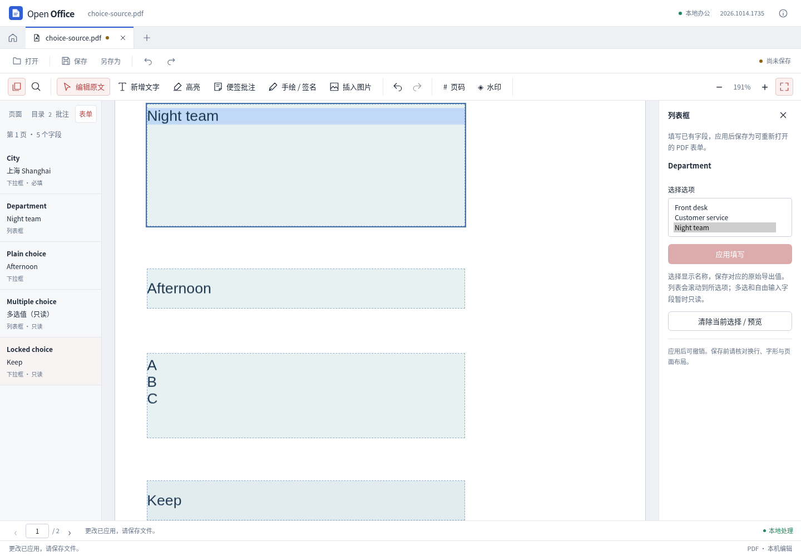

# PDF 普通下拉框与单选列表

本轮在已有文本框、复选框流程上加入普通 AcroForm 下拉框和单选列表：侧栏显示选项名称，写入 PDF 原有导出值，保留选项定义。填写参与原有撤销、重做、未应用草稿保护及保存工作流。

## 可编辑范围

- 独立、名称唯一、无动作或计算脚本的 ComboBox 与单选 ListBox。
- `/Opt` 中的普通字符串，以及 `[导出值, 显示名称]` 配对；支持中文显示名称和空导出值；未选择与选中了空导出值分别表示，界面不会把占位文字当成选择。
- 已验证的普通标准字体和普通外观。一次最多 250 个选项、选项文字合计 40,000 字符。
- 选择列表项时，保存 `/V` 和 `/I`，将 `/TI` 移到所选项，使该项出现在首个可见位置，并绘制淡蓝色矢量选中背景。

多选、可自由输入的组合框、自动排序、选择即提交、脚本、计算链、父子字段、重名字段、自定义或嵌入字体、旋转、含自定义图形/透明资源或非单位矩阵的外观，以及当前引擎绘制不可靠的复杂塑形文字与非 BMP 字符保持只读。只读字段继续显示在列表中，并说明原因。签名与填写权限限制沿用原流程。

## 实际引擎验证与处理

使用 PyMuPDF 1.28.2 实测，直接 `Widget.update()` 存在以下行为：

1. 对配对选项，下拉框的普通外观会画出导出值，而不是显示名称。
2. 列表更新会删除 `/I`，普通外观没有选中背景。
3. 多选数组写入触发类型错误；包含空导出值的配对选项重新序列化也会失败。

因此本实现不重写 `/Opt`。先为所选显示名称生成独立外观，再恢复原字段字典，只转移新 `/V`、`/I`、普通外观和列表滚动位置。按原始 `/BS/W` 重建边框，避免引擎把零宽边框当作一像素边框。共享的 AP、MK、BS 字典在外观生成前隔离，其他字段不会被修改。

列表背景仅加入本次引擎新生成的 AP：先验证文字行数、行位移、裁剪区域和显示高度，才加入矢量背景；无法验证时整次操作拒绝，不返回修改后的 PDF。不会解析并改写输入文档已有的外观指令。只读检查覆盖已列明的资源、矩阵和字段结构，不是任意自定义矢量外观识别器；支持字段的普通外观会重新生成。

## 验证

- PDF 专项回归 83 组全部通过，其中新增 15 组真实 PDF 单元测试：未选择与空导出值、自定义外观和复杂文字保护、零宽边框、中文显示值与导出值、`/V`、`/I`、`/TI`、空导出值、重复显示名称、转义字符、共享外观/样式隔离，以及只读、权限、签名、过期令牌和异常选项保护。
- 独立 pypdf 审计 59 项：重新打开真实输出，核对原始导出值、索引、选项、默认值、样式、私有元数据、选中外观和非目标字段、页面、批注、链接的保留。
- Poppler 独立渲染确认输出的中文显示名称及列表选中背景可见；未以字体替代环境的截图宣称任意阅读器像素一致。

复现：

```sh
pdf-backend/.venv/bin/python -m unittest discover -s pdf-backend/tests -p 'test_choices.py'
pdf-backend/.venv/bin/python tests/compatibility/pdf-choices/make-fixture.py test-results/pdf-choices/backend-final
python3 tests/compatibility/pdf-choices/audit.py test-results/pdf-choices/backend-final/choice-source.pdf test-results/pdf-choices/backend-final/choice-filled.pdf test-results/pdf-choices/backend-final/independent-audit.json
```

实际 Vue + 本地 PDF 后端的 8 组交互已通过，含草稿保护、撤销重做、保存后独立 59 项审计、重开、320/390 像素窄窗和空导出值。该验证针对开发环境，未验证新桌面安装包。

原始输出与审计位于 `test-results/pdf-choices/backend-final/`。浏览器实际交互记录位于 `test-results/pdf-choices/ui-reviewed/`；完整产品功能与任意复杂表单无损兼容不在本轮验收范围内。


