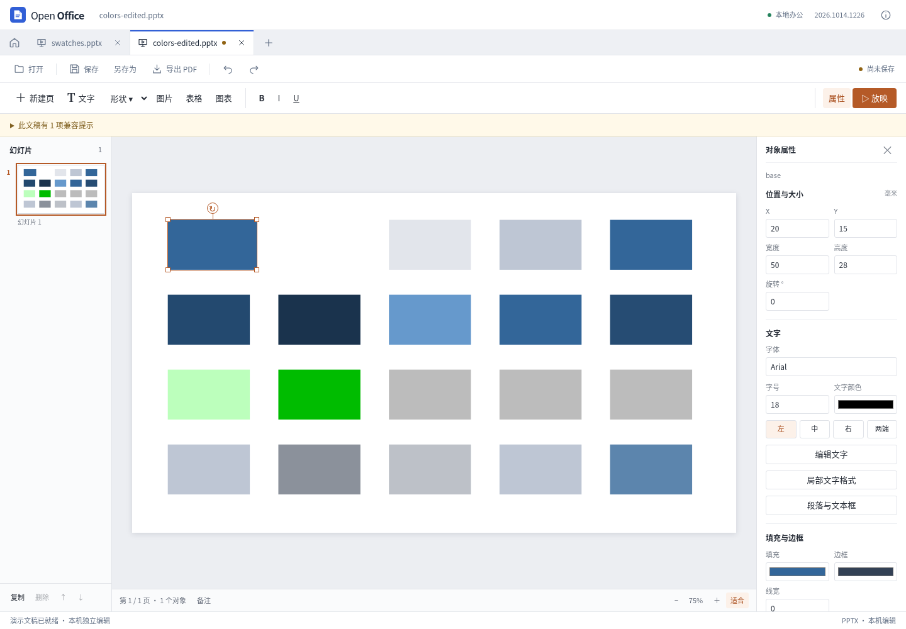

# PPT 颜色变换与 SmartArt 缓存颜色

2026-10-14，当前源码更新，尚未发布新的桌面安装包。

本轮修复导入预览中 tint 方向相反、shade 在错误色彩空间相乘、lumMod/lumOff 直接改变 RGB，以及 scRGB 线性基色被当成 sRGB 等问题。普通形状、文字与主题颜色解析使用共享数学实现；SmartArt 缓存的填充、描边和渐变停止点也使用该实现。

## 支持范围

- `tint` 与 `shade` 先使用标准 sRGB 传递函数转换到线性空间，执行变换，再编码回 sRGB。tint 的 0 为白色、100000 为原色。
- `lum`、`lumMod`、`lumOff` 改变 HSL 明度；保留原有 hue/sat 系列变换能力。hue 使用 1/60000 度单位，其他百分比按各自定义解析。
- `scRGB` 基色按线性到 sRGB 转换。标准示例 50% 灰色显示 `#BCBCBC`，不再显示 `#808080`。
- 整数百分比与合法 `%` 词法分别解析，例如 `50000` 与 `50%`。Mod 可以超过 100%，每次变换后限制输出范围；有序及重复变换不会去重或调整顺序。
- scRGB、主题定义及后续引用都保留浮点 RGB 与 alpha，在最终显示颜色时才转为 8 位 HEX。暗色再经过较大的明度倍数时，不会因中间先取整而丢失。
- SmartArt 缓存的 alpha/alphaMod/alphaOff 按顺序处理，分别作用于填充或描边。主题基色只解析一次，再应用引用节点自身的变换。

未知变换、错误命名空间、缺失数值、无效数值、超过 32 项变换、重复或歧义颜色节点会明确提示预览限制。普通预览不猜一个默认黑色；SmartArt 无法安全解析时使用原有受保护占位流程。源颜色 XML 始终保留。

## 保存与修改

这些计算产生的是显示数据。无修改保存、移动或调整形状尺寸、改文字都不会把算出的 RGB 覆盖到原来的主题引用和颜色变换中。原有 HEX、scRGB、系统色缓存、颜色变换顺序及参数仍存在于源文件中。撤销、重做和重新打开使用同一显示规则。

本轮没有扩大表格底纹支持边界：表格仍只接受前一轮确认的无颜色变换或单 alpha 的明确底纹，其他底纹保留原件并提示简化。

## 已知差异

以下为颜色变换轮的历史边界。后续已完成普通形状填充、边框的独立透明度与编辑，见 [独立透明度更新](presentation-opacity.md)；文字 run、页面背景和完整主题材质的限制继续保留。

普通形状的填充透明度仍使用已有的整对象透明度路径，文字、描边、背景的独立透明度和普通形状完整 alpha 链尚未完成。这类文档会有兼容提示，本轮没有宣称已解决透明度全流程。

原生参考验证中也观察到边界差异：参考程序的 scRGB 50% 为 `#BBBBBB`，与标准舍入差 1；部分 `%` 词法没有按标准解析；系统色会取当前操作系统颜色而不是文档中的 `lastClr` 缓存。本应用按标准解析百分比，并使用文档颜色缓存以便离线显示。SmartArt 的 hue/sat 能力保留，但未据本轮色块测试宣称所有灰色边界、饱和度和色相行为都与参考程序一致。

## 验证证据

REA 6.4.0 对固定源码 `72b0421c0bbf9d01eed9cf14834ae47eb2df1b50` 的两份文件、19 个函数完成解析，包含 3,148 个 AST 节点，零解析失败。源码 Git blob 和 SHA-256 已核验；静态语义覆盖仍为 unknown。

独立生成的 20 色块 PPTX、哈希、原生截图中心采样和差异说明位于 `tests/compatibility/presentation-color-transforms/`。16 个可比较色块按每通道最多 1 的舍入差检查，其余严格百分比、系统色与 alpha 边界分别记录，不伪称一致。

纯数学测试包含标准 scRGB 示例、有序 HSL、透明度链、支持范围、无效输入，以及由独立 Python 计算得到的 scRGB 低亮度多步变换向量。浏览器专项还验证实际 PPTX 导入、原色 XML 保留、文字和几何编辑、撤销重做、保存重开、主题浮点精度、SmartArt 缓存及真实 PDF 导出。报告：`test-results/presentation-colors/report.json`；运行产物也在该目录中。

独立审查、真实 Vue 操作、原生打开导出文件、PDF 色块回读以及全量测试由本轮总验收记录汇总。这些证据覆盖已列出的受限功能和样例，不代表任意复杂文档的完整无损兼容。

最终全量 **550 项 Node、53 项 Python 测试通过**；类型检查与生产构建通过。颜色专项 51 项、独立审查 160 项、实际 Vue 操作 4 组通过。完整结果及源文件指纹见 [JSON 验证记录](presentation-color-results.json)。首次全量测试因沙箱禁止监听本地端口失败，调整测试运行权限后重跑通过，原日志保留。

12 份复杂演示回归通过；最后两项 SmartArt 异常颜色保护之后，另回归三份实际 SmartArt 文稿。真实界面下载的 PPTX 在参考桌面打开，20 个色块中心与原件原生显示一致，证明源颜色定义得以保留；实际 PDF 的 20 个填充由 PyMuPDF 独立回读。原生打开不等于完整像素一致，也不等于原生重保存验证。

百分比词法样例不是完整 Strict OOXML 包，不能据此声称支持 Strict 命名空间。本轮未完成 Windows/macOS 新安装包验收。

算法是根据标准和固定版本公开源码的行为研究独立实现的，未复制参考程序代码。
