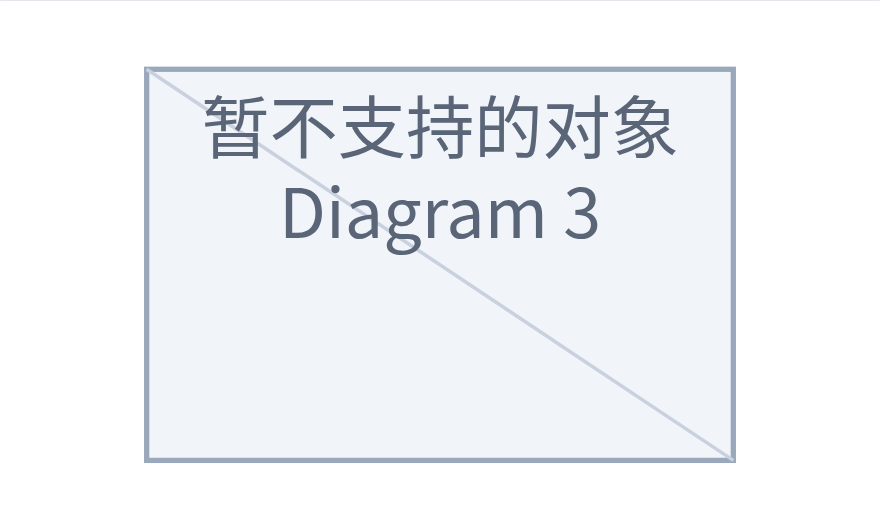
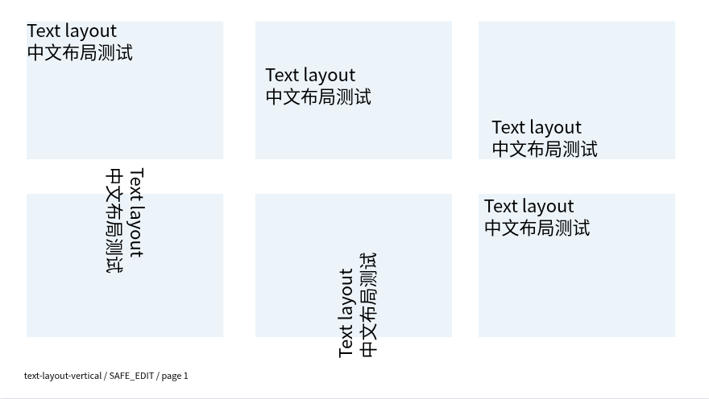
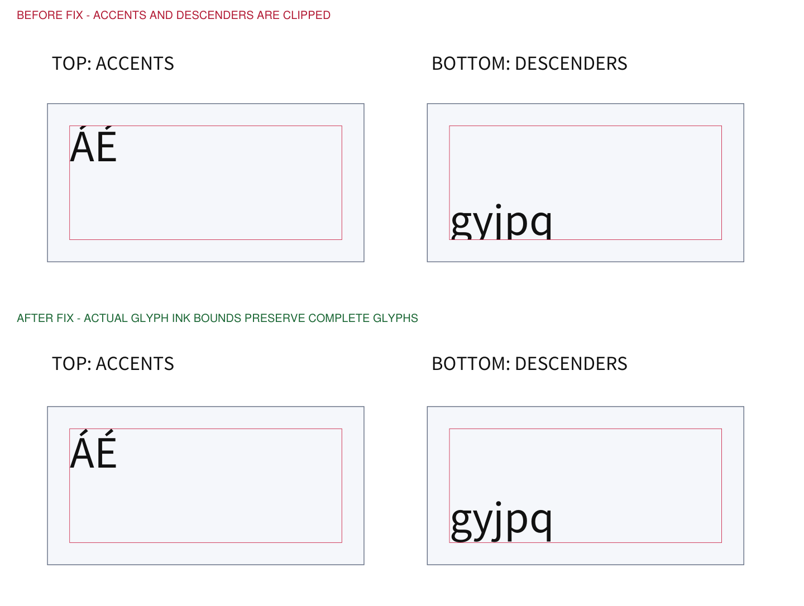

# 复杂 PPTX 兼容性专项

本专项针对独立 PPT 内核，分别检查文件结构、编辑后的保留情况与实际画面。它不将“可以打开”或“XML 仍在”当作完整显示和播放能力的证明。

## 2026-10-13 实测结果

**本批样例的保存、引用和安全编辑检查通过；复杂内容的完整显示与播放尚未通过。** 这次结论只适用于已记录的文件和操作，不能表述为“任意复杂文档无损兼容”。

| 检查 | 实际结果 |
| --- | --- |
| 固定源文件 | 12 份，所有 SHA-256 与语料清单一致 |
| 连续保存重开 | 每份 3 次，共 36 次，已检查模型语义稳定 |
| 实际导出独立检查 | 65 份 PPTX、41 份审计报告，900/900 项断言通过 |
| 无操作保存的原始部件 | 未删除原部件，受保护依赖未改变；首轮有 6–16 个 XML 部件重新序列化，第二、三轮所有部件字节稳定 |
| 原有 PPT 浏览器回归 | 24/24 项通过 |
| 类型、单元测试及构建 | 类型检查、438 项 Node 测试、28 项 PDF Python 测试和生产构建通过 |
| 独立检查器负对照 | 12 项通过；故意破坏时序、文字格式、图片裁剪、连接引用或变换会被检出 |
| 实际画面 | 逐份检查并记录简化或缺失项，未认证任何样例与原作者软件视觉无损 |

测试中纠正了一处检查器误报：修改目标文字颜色需要新增格式包装，移除请求修改的颜色后，空包装与原先没有包装等价。归一化只作用于该目标和该属性；修改文字框设置、子对象变换、其他对象颜色或字段结构的负对照仍必须失败。已重新审计同一批导出，未修改样例或导出产物来通过测试。

随源码保存的[精简结果与文件指纹](presentation-complex-results.json)包含每份样例的审计数量、实际显示限制和生产代码指纹。完整运行记录、导出文件与全部截图位于 `test-results/standalone-presentation-complex/`。本轮没有发布新的桌面安装包。

## 样例与操作

固定语料共 12 份：9 份原创 OOXML 压力样例，以及 3 份来自固定 Apache POI 提交的 SmartArt 样例。上游原件保持原字节、保留许可证并锁定 SHA-256；文件内的作者软件名称仅是元数据声明，本轮没有安装原作者软件进行双向往返。语料与复现说明位于 `tests/compatibility/presentation-complex/`。

覆盖混合字号与字符样式、字段和超链接、项目符号与段距、文字边距与垂直定位、竖排、嵌套分组与旋转、图片裁剪与翻转、透明度、合并表格、组合与圆环图、路径动画、点击触发、连接线、页间链接、自定义放映及母版继承。

每份样例连续进行三轮导入、保存、重开，再检查修改无关文字与备注、复制与重排幻灯片后的结果。补充定向操作覆盖混合文字改色、分组复制，以及删除动画目标或触发对象时的保护。

独立 Python 校验不使用应用的导入器：读取 OOXML、关系文件、图表工作簿与原始依赖，比较动画与触发引用、富文本节点、字段、链接、母版及裁剪数据。实际 Vue 界面则负责记录画布、保护状态、兼容提示与截图。

## 本轮发现与修复

- 文字改色、改字号曾整段重建文字内容，可能丢掉未编辑的富文本属性、字段与超链接；现在按修改的属性更新原节点。
- 复制分组后连接线可能仍指向原对象；现在维护分组内的目标映射。尚不能可靠处理的未分组多选连接拓扑会明确拒绝，并提示先组合后复制。
- 删除动画目标或点击触发对象可能删掉其他动画分支；现在保护相关对象，阻止不能安全重映射的删除、对象复制和解组，保留原内容及未保存状态。整页复制与重排单独验证。
- 仅写了旋转角度的占位对象曾丢掉母版继承的位置与尺寸；现在按属性分别继承。文字边距和垂直定位也读取原文件及继承设置。
- 非等比缩放并包含旋转子对象的分组，重建可能丢掉原变换；现在保留原子对象变换，无法安全处理的解组或内部几何重建会阻止。
- 文字在顶部或底部对齐时可能截掉重音符号或字母下伸部分；使用实际字体与字形指标计算基线，并用独立 PDF 像素对照检查。
- 无颜色的边框曾在重开时丢失预设线宽；保留显式线宽，并检查重新启用颜色后可以显示。
- 编辑侧栏现在显示真实的复杂动画提示；不支持的图表明确标为预览暂不支持，避免误报成数据为空。内部对象剪贴板限定于当前文稿，避免引用另一个文件的错误资源。

## 怎样理解结果

| 结果层次 | 可以证明什么 | 不能证明什么 |
| --- | --- | --- |
| 原始依赖字节一致 | 对应图片、图表、工作簿、SmartArt、主题等部件未被修改 | 当前画面已经绘制了所有内容 |
| XML 语义与引用通过 | 已检查节点、属性、ID 与目标关系符合样例基线 | 任意扩展节点及全部软件版本均兼容 |
| 模型与实际界面通过 | 已检查普通对象可以打开、编辑、保存并恢复 | SmartArt 专用编辑、逐对象动画播放等已实现 |
| 风险操作明确拒绝 | 不会为完成删除或复制而静默破坏动画引用；当前文稿保留 | 该操作已具备完整动画重映射能力 |

源文件与保存重开文件的截图都由当前渲染器生成。二者一致只能证明本轮保存没有新增画面变化，不能证明画面与原作者软件逐像素一致。

## 仍需区分的功能边界

- **SmartArt**：保持原关系、数据、布局、样式与附属文件；编辑画布仍以保护占位显示，未实现专用节点编辑与完整布局渲染。
- **复杂动画**：检查原始路径、触发器、时序和对象引用的保存；内置放映仍显示静态对象，不播放完整逐对象动画。会破坏引用的对象操作会明确阻止，整页复制与重排另行检查。
- **混合文字**：保留原来的多 run 格式、字段与链接；画布仍采用统一文字样式，未逐 run 实现所有字号、上下标、字符间距、项目符号、制表位和段距。
- **特殊排版**：常规文字边距、垂直定位、不自动换行和独立转角另有测试；东亚竖排、多栏、自动适配、极端旋转长行和溢出行为不能据此视为完全还原。
- **复杂图表、合并表格与高级图片效果**：保留原始内容与依赖，部分对象受保护，预览存在简化；未开放完整编辑。
- **字体与平台**：指定字体缺失时画面可能替代字体，PDF 使用随包字体；本轮浏览器与独立解析结果不替代 Windows/macOS 安装包或其他桌面演示软件的实测。

## 实际画面证据

SmartArt 的原始数据保留，但当前画布实际显示如下占位，不能视为完整支持：



文字定位测试中，上方三框覆盖顶、中、底对齐；下方右框原本为东亚竖排，目前仍横排显示。旋转长行也存在超出文字框的情况：



字形裁切修复的独立 PDF 对照：上半部分复现原先重音符号与下伸字母被裁切，下半部分是修复后的渲染。对修复后同一 PDF 分别保留和移除文字裁切操作，使用 PyMuPDF 放大 6 倍渲染，整页像素一致，两个目标区域缺失深色字形像素均为 0。这只验证该字形裁切回归，不代表全部特殊排版一致。



## 复现

先按项目开发说明准备依赖并启动 `npm run dev`，另一个终端执行：

```bash
npm run test:browser:ppt-complex
```

运行产物写入 `test-results/standalone-presentation-complex/`。样例来源、SHA-256、生成器和独立检查器随源码保存；不要覆盖源样例或将导出副本计为新来源。
