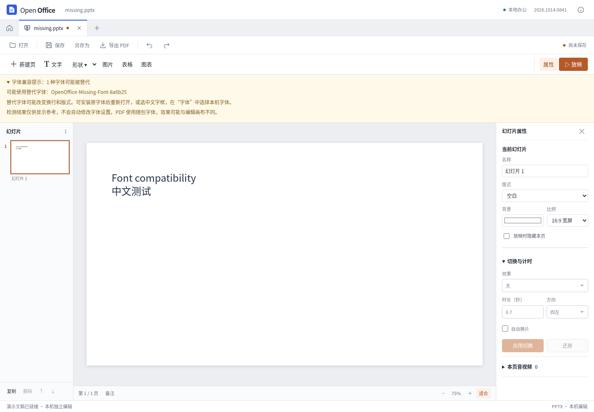

# 第三轮兼容性迭代：字体替代提示

2026-10-14。复杂文档显示差异的一部分来自本机字体。本轮增加只读字体诊断，将可能影响换行和版式的替代情况显示在可折叠提示中；不会自动改变原字体，也不会为了检测主动注册字体或调用加载 API。

## 实际行为

- 收集文稿中当前有效的文字字体，包括混合文字、继承对象与组内文字；已被用户替换的原字体不再列入提示。光栅 SmartArt 缓存的内部字体不在这个检测范围内。
- 在多个中英文样本、三种通用后备字体之间比较 Canvas 度量，给出“可能被替代”或“无法确认”，不声称获得系统字体安装清单或真实替代字体名称。
- 默认检查最多 64 个字体名，并有遍历、文本与深度预算。分批检查、短时防抖；切换文档或关闭时取消旧结果，字体加载完成/失败时清除检测缓存。
- 检测不会把编辑器置为已修改。保存后保留原字体设置；只有用户在字体属性中明确选择新的字体才改变文档。
- 提示同时说明 PDF 使用随包字体，因此与画布显示可能不同。



## 研究依据与限制

REA 定向分析了固定版本的 6 个函数、4 个摘录文件，共 599 个 AST 节点，0 解析失败，证据为 `ev_ec1cda9d4590939655a52539b73287522e2d5f22be2ccf9bfe31cd6aa81f2851`。原软件使用自身的字体目录 API；主题字体名称解析并不是物理字体安装验证，不能直接套用成网页探测接口。

独立 Chromium 实测中，虚构字体名称也让 `document.fonts.check()` 返回 true，计算样式仍保留该虚构名称，而实际绘制已经换用其他字体。因此本功能不使用这些 API 来宣称字体已安装，也不请求本机字体枚举权限。

宽度/边界比较同样是启发式：字体别名、相同度量、单个缺失字形、操作系统字体替代策略都会影响判断。提示只用于提醒用户检查版式，不能证明整份文档或每个字形都使用原字体。浏览器也可能因页面已存在的 `@font-face` 声明自行发起加载；本模块不会新增这类声明。

研究证据位于独立的 `open-office-research/onlyoffice/rea-font-diagnostics-findings.md` 和 `font-diagnostics-targeted/browser/`，未复制官方实现进产品。

## 验证

10 项 Node 专项测试覆盖有效字体收集、显式替换、未知与异常名称、大小写去重、计数/深度/文本预算、循环结构、Canvas 状态恢复及失效重测。

11 项真实 Vue 界面检查通过，含虚构字体识别、原字体保存、检测不修改编辑器、手动替换清除旧提示、文档切换、字体加载事件和 640 像素窗口；页面异常与外部请求均为 0。生成的 PPTX 再独立读取 ZIP/XML 检查字体名。

最终全量检查为 466 项 Node、28 项 Python，全部通过；原有编辑器 24 项真实界面回归与生产构建通过。[结构化结果](presentation-font-results.json)记录本次报告和实现文件指纹。

```sh
node tests/browser/presentation-fonts.cjs
node --test tests/presentation-font-diagnostics.test.mjs
```

本轮没有更换 Word/Excel 内核、改变字体授权或发布桌面包。完整功能对齐和任意复杂文档无损兼容仍未完成。
