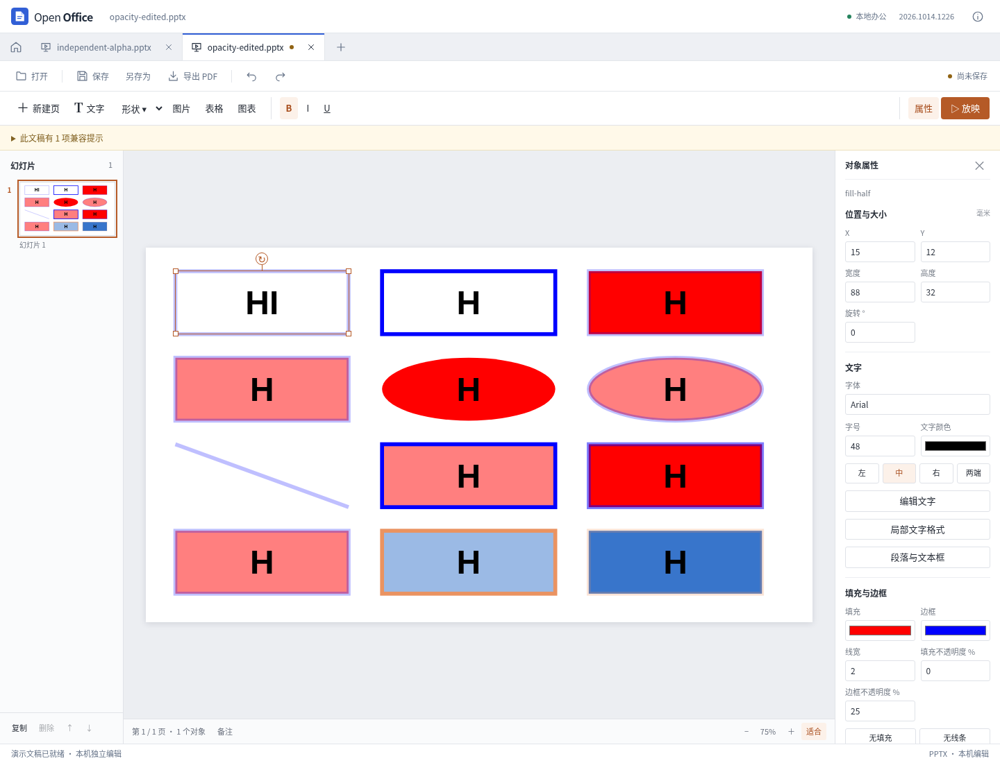

# 普通形状的独立填充与边框透明度

2026-10-14，当前源码更新，尚未发布新的桌面安装包。

这是图形透明度阶段的历史验收；随后已补充[普通文字透明度与保存一致性](presentation-text-opacity.md)，其中记录文字透明度的新支持范围和后续验证。

修复了普通形状导入半透明填充后，文字与边框也一起变淡的问题。填充和边框现在各自拥有不透明度；普通文字保持自身原有颜色。SVG 预览和 PDF 使用同一场景，填充透明度不会施加到整个对象上。

## 可以操作的内容

- 文字框、矩形和椭圆可分别调整填充、边框不透明度；直线可调整边框不透明度。属性栏输入 0–100%，0 为完全透明，100 为完全不透明。
- 普通实色支持直接 RGB、scRGB、文档缓存系统色、已解析的主题颜色，以及已支持的颜色变换。alpha、alphaMod、alphaOff 按顺序计算。
- 新建对象默认完全不透明。显式改色会保留对应画笔的不透明度；撤销、重做、复制、保存和重新打开均保留这两项设置。
- 单独调整透明度，导出只替换该画笔的 alpha 运算，保留原来的主题引用、基色和 tint 等其他变换。修改文字、位置、大小或线宽不会重写未修改的颜色与透明度链。

不透明度在模型中使用 0–1，保存精度为十万分之一，与 DrawingML 一致。输入范围和对象能力在模型层校验，不依赖界面控件拦截；无效操作整笔撤回。

## 高级材质的保护

渐变、未解析的颜色、仅引用完整主题填充/描边样式的对象，暂不能单独调整透明度；表格、图表、图片和组合也不开放这组普通形状属性。界面或操作错误会说明限制，原始内容仍保留。

用户可以明确选择一个普通颜色，再调整透明度。即使选择的颜色与预览相同，也记录为一次明确替换，导出基础实色；这会将该画笔的主题或高级材质转换为选定颜色。若没有明确选择颜色，则继续保留原来的定义。撤销可以恢复原有定义。

公共颜色解析最多接受 32 项变换。若颜色已有 32 项非 alpha 变换，追加透明度将超出预算，因此拒绝单独修改并保留原件；选择明确颜色之后可再修改。31 项非 alpha 变换加一项 alpha 可正常保存重开。

## 本轮边界

- 文字 run 和页面背景的独立透明度还未完整实现，导入时有明确兼容提示，原 XML 保留。
- 完整主题 `fillStyleLst`、`lnStyleLst` 与 `fillRef`、`lnRef` 的组合继承仍是受限预览。直接 `schemeClr` 的透明度已支持，不能据此声称所有主题材质已对齐。
- 表格单元格和 SmartArt 缓存沿用各自已声明的透明度范围，本轮不扩展复杂表格底纹、图片效果或其他材质。
- 内部模型原有 `object.opacity` 继续代表整个对象的场景透明度；新导入不再把填充 alpha 写到此字段。应用实际持久化的是 PPTX，历史文件重开时会重新解析；没有需要猜测迁移的模型 JSON 草稿。正在运行的旧版内存可保存并重新打开文稿。

参考程序对 alpha 链存在可见差异：样例 80% × 50% + 10% 按标准结果为 50%，实测参考显示近 80%。本应用使用完整标准链。单项 alpha 的实际色块可按每通道最多 1 的舍入误差与参考比较，不能把链式差异报告为相同。

## 验证

自制 PPTX 夹具位于 `tests/compatibility/presentation-opacity/`，包含半透明和全透明填充、独立边框、椭圆、直线、透明度链、主题颜色以及尚未支持的文字透明度对照。原生参考截图和采样由本轮总验收记录汇总。

`tests/browser/presentation-opacity.cjs` 验证实际导入、场景透明度、原 XML 不变、透明度属性编辑、局部 alpha 补丁、保存重开、撤销重做、复制、同色显式替换与超预算保护，并输出真实 PPTX/SVG/PDF 到 `test-results/presentation-opacity/`。模型与渲染定向测试还验证非法值、对象类型限制、整笔回滚，以及已有整个对象透明度与独立画笔透明度的组合。

实际 Vue 控件、原生打开导出文件、PDF 像素回读、独立审查和全量回归另由本轮总验收完成；上述范围不代表任意复杂文档的完整无损兼容。

最终结果：**553 项 Node、53 项 Python 测试通过**，类型检查及生产构建通过。首次并行验收时，空白 PDF 的 10 秒测试超时；保留该日志，在其他构建/浏览器任务结束后，不修改测试超时或产品代码，完整串行重跑通过。

- 透明度专项 43 项；独立浏览器审查 151 项；独立 PyMuPDF 检查 81 项，全部通过。
- 实际 Vue 操作 6 组，包含两个透明度控件、改字、撤销重做、真实下载重开、非法草稿阻止保存，以及 390 像素窗口中的实际编辑。
- 对实际界面导出的两份 PDF 另读回 24 组填充/描边和 44 次文字绘制状态，确认不透明正文没有继承填充或线条 alpha；未支持的文字透明控制组单独标明。
- 官方 Linux 桌面打开四份文件：12 对象原件、6 对象样式引用研究样例，以及两份实际界面导出。66 个导出像素采样验证未改画笔与预期透明度修改。没有将打开检查说成原生重保存或完整像素一致。
- 12 份复杂演示完成 65 次导出、41 次包审计、36 次重开；前一轮颜色 51 项、表格布局 52 项回归也通过。

REA 6.4.0 对固定源码版本 `72b0421c0bbf9d01eed9cf14834ae47eb2df1b50` 的 7 个文件、22 个相关函数完成解析，包含 5,725 个 AST 节点，零解析失败。源码 Git blob 与 SHA-256 核验通过；静态语义覆盖仍为 unknown。主题研究证实参考程序对填充和线样式有不同的 alpha 行为，因此完整样式引用继续保留限制，未凭一条公式猜测。

报告、源码及构建指纹见 [JSON 验证记录](presentation-opacity-results.json)。本轮未发布新的桌面安装包，也未完成新增代码的 Windows/macOS 原生验收。
