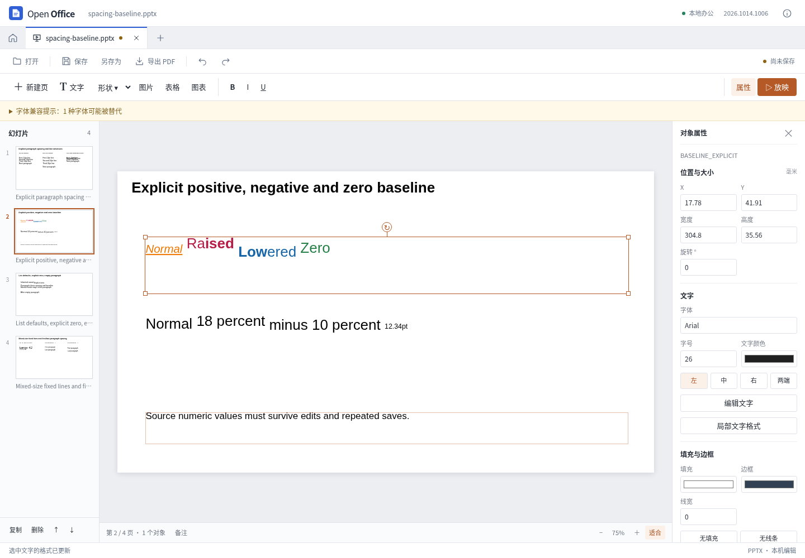

# 局部文字格式：第六轮对照实现

2026-10-14。为普通 PPT 文本增加选区格式操作。在右侧选择“局部文字格式”，选中已提交的文字，再设置粗体、斜体、下划线、字体、字号或颜色。每个控件默认保留原样，只有明确指定的属性才会写入。

这是独立的选区格式工具。原有整段文字输入框仍按段落模板修改文字，不是完整的所见即所得富文本编辑器。

## 实现约定

选区使用 UTF-16 半开区间，必须与打开工具时的文字及文稿版本匹配。拒绝空选区、越界、代理对中间的端点与含特殊 CR 换行的对象。只处理普通文本；字段、超链接和其他无法安全拆分的内容保留原件并提示限制。

写回时复制原 DrawingML 文字片段，按选区边界拆分，只更改所选属性。段落信息、数值上下标和选区外样式应保持原值。持久化的是物化后的文字 XML，不是可能随着后来编辑而失效的旧字符偏移。修改纳入撤销/重做，原始包部件不直接改写。

后续整框格式覆盖指定属性，后续局部格式再覆盖其选区，按操作顺序生效。原有纯文字编辑策略继续适用：没有改变的段落保留原样，改变的段落沿用原首片段样式；编辑器会提示这一限制。

## 研究依据

REA 6.4.0 分析固定 `sdkjs` 提交 `72b0421c0bbf9d01eed9cf14834ae47eb2df1b50` 的 5 个摘录文件、18 个函数：41,866 字节、6,272 个 AST 节点、0 解析失败。证据为 `ev_007a0a259821d1833918585454b2a70ddd345a98098bd8635c70bd0a7595a0a6`。

参考实现的公开格式入口提交单项属性，run 层先复制原属性再拆分范围。其内部序列化不是最终 PPTX 导出证明，因此仍须独立检查输出 XML，并在桌面参考软件中打开。应用采用独立实现，没有复制参考软件代码或增加运行依赖。

## 验证

- 独立范围专项完成 447 个断言、33 个拒绝场景。按每个 UTF-16 字符核对原生 XML，验证三轮修改保存、继承样式、未知合法 run 属性、段落与手动换行、emoji、字号百分之一点量化、操作顺序、撤销重做和复制。
- 真实生产界面完成 5 组检查：选区和单项格式输入、未确认草稿阻止保存、取消、键盘撤销重做、实际下载、独立 XML 核对以及重新打开。不调用开发接口或组件内部方法，未产生外部请求和页面异常。
- 12 份复杂原件的回归通过：36 次不修改内容的保存重开、65 个输出文件、41 次包结构审计，零失败。
- 官方 ONLYOFFICE 实际打开界面下载文件与第三轮编辑文件，两份各四页，共保留 8 页截图。最终生产下载与已在原生软件打开的文件 SHA-256 相同。本轮验证原生打开，未将其表述为原生再次编辑保存或像素一致证明。
- 最终代码的 466 项 Node 测试、28 项 Python PDF 测试、类型检查和生产构建通过。

预算测试针对新格式动作的文字/节点数量限制，不证明大型文稿的导入性能。内核对部分合法但复杂的文字仍采取保守拒绝；未知属性的原件保留也不代表全部能显示。参考软件对上下标的缩放策略与本应用的数值基线显示仍有差异。

结果及文件指纹见 [presentation-range-results.json](presentation-range-results.json)。测试只针对记录的样例与操作，不证明任意复杂文稿的无损或像素一致兼容；本轮未发布 Windows/macOS 安装包。

