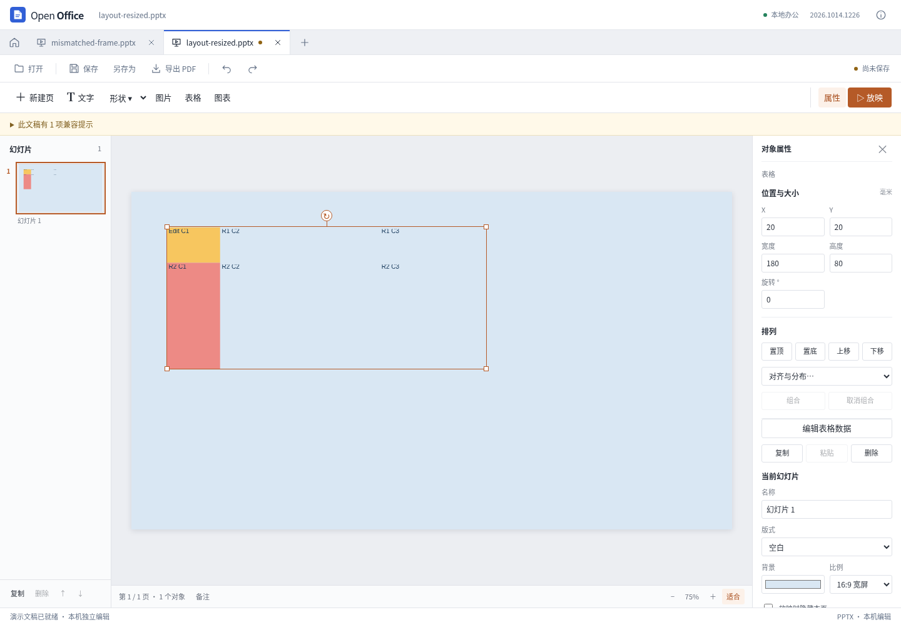

# PPT 表格布局与明确底纹

本轮在逐格改字的基础上，让普通未合并表格按照原有列宽、行高和明确单元格底纹显示。SVG 画布、缩略图和 PDF 使用同一场景数据。

## 行列几何

导入读取 `a:tblGrid/a:gridCol@w` 和 `a:tr@h` 的绝对 EMU 数值，包含上层组合的缩放。列宽和行高的总和作为编辑器的表格边界，不用可能过期的 `p:xfrm/a:ext` 强行等分或拉伸表格。不同宽度的列和不同高度的行因此保留其位置、文字区域及边距。

普通改字只更新目标格正文。原网格、单元格属性和原框架 XML 保留；只移动表格也不改网格。用户调整表格宽高时，预览与导出使用同一整数 EMU 缩放，把新的列宽、行高实际写入 PPTX，保存重开不会退回旧尺寸。整体组合缩放仍保留本地网格；组合内只改文字不重复应用父级缩放。取消组合时记录原坐标空间已脱离，导出把父级缩放写入实际网格与位置，避免重开后缩回原局部坐标。该标记参与复制和历史状态，源 XML 不被改写。

缺失、重复、命名空间不匹配、不等列数、非正数或超预算尺寸不会被猜成均分表格，使用受保护占位并保留原始结构。零行高需要内容自动排版，当前也使用明确提示的保护占位，并不认定这种文件必然无效。合并单元格继续保持保护。

## 单元格底纹

- 明确 `solidFill` 的有效 RGB、可解析主题色及带有效 `lastClr` 的系统色缓存可以显示；单一 `alpha` 只影响背景，文字不随之变透明。
- 明确 `noFill` 显示透明；没有底纹也不再凭空补白色、首行浅蓝或灰色边框。
- 缺少主题色、缺少系统色缓存、渐变、图片、图案及未经核实的 tint/shade/HSL 等颜色变换会提示简化，保留源文件，不用旧 RGB 近似把它们冒充为准确底纹。
- 新建基础表格沿用生成文件的实际底纹，首次保存重开前后完整场景一致。增删基础行列会清除旧坐标绑定的派生数据。

## 尚未覆盖

原生编辑器会根据文字、边距和最小尺寸自动撑高行，并可能在缩小时重新分配列宽；当前使用给定网格，尚未完整实现这类内容布局。导入会提示这一限制，过小单元格仍可能裁切内容。主题表格样式、自动条纹和边框、合并单元格、双向表格排版等仍未完整实现。本轮不声明逐像素等价或完整原生表格样式支持。

几何预算为最多 1,000 行、100 列、20,000 格，每个轴及组合缩放后的总长不超过 5,000 毫米；文字编辑仍遵守原有 30 行、20 列及单格文字预算。场景偏移量预计算一次，避免在每格重复累加前面的行列。

## 验证

自制固定夹具位于 `tests/compatibility/presentation-table-layout/`，由独立的 Python 生成器创建并记录 SHA-256。包含正常框架、框架与网格不一致，以及需要内容撑高的三种样例。原生参考程序确认前两者画布完全相同，说明源网格而非框架尺寸决定此类表格布局；内容撑高样例体现当前保留的差异。

`tests/browser/presentation-table-layout.cjs` 完成 **52 项**浏览器检查，包括六格精确几何、不等宽高、透明与明确填充、颜色保护边界、改字/撤销/重做、三轮放大与保存重开、无效结构保留、新建基础表格完整场景一致和实际 PDF 导出。报告与产物位于 `test-results/presentation-table-layout/`；没有浏览器错误或外部请求。

原有表格正文专项 86 项检查及 16 类保护拒绝通过。另有独立导出 XML 审查、真实 Vue 界面操作、原生打开和完整测试，由本轮总验收记录汇总。这些专项不替代 Windows/macOS 安装包或任意复杂文件的完整兼容性测试。

最终验收：**541 项 Node、53 项 Python 全部通过**，类型检查和生产构建成功（19.85 秒）。独立对抗检查 54 项、实际界面 5 组通过；PDF 下载由另一读取器核对六处文字和色块毫米坐标。12 份复杂文稿回归完成 65 次导出、41 次包审计、36 次重开，零页面、控制台和外网错误。参考桌面软件另打开三份修正后的原始样例、两份实际界面下载及一份取消组合输出，共六份文件；这不是跨软件像素一致或原生重保存证明。

源码、样例与产物 SHA-256、测试层次及排错记录见 [本轮结果 JSON](presentation-table-layout-results.json)。没有新建或发布桌面安装包。

实现来自对标准、固定版本公开源码和实际样例的行为研究，未复制参考程序实现代码。先前表格正文迭代记录见 [逐格改字与格式保留](presentation-table-text.md)。
