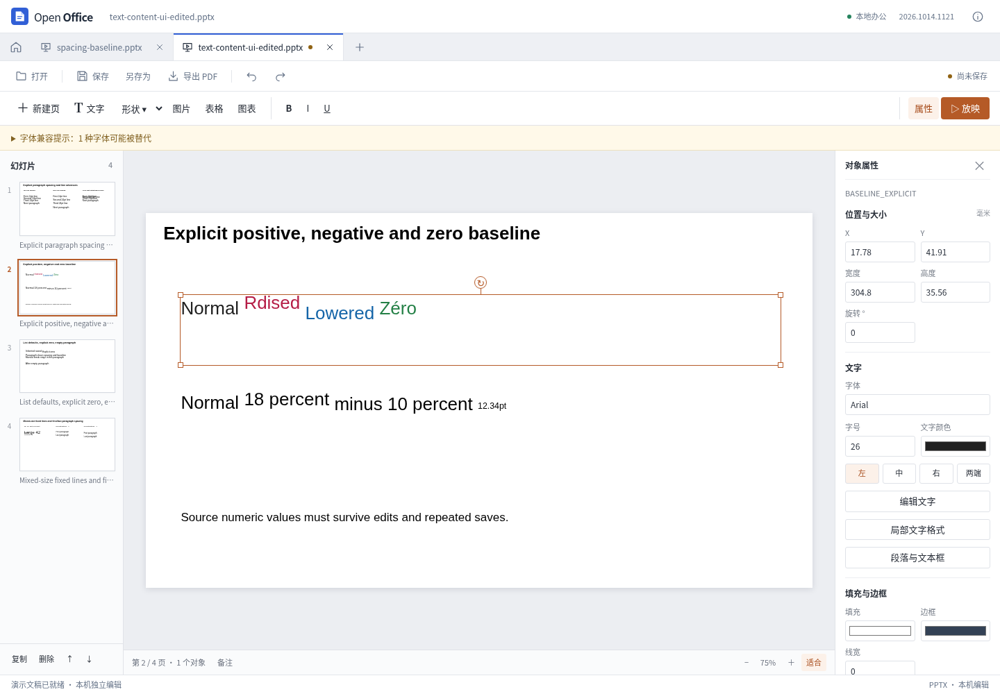

# PPT 普通正文编辑保留

2026-10-14。修复普通正文修改一个字后整段改用首个文字片段样式的问题。既有段落、手动换行、不同字体/颜色/字号、上下标及未实现但可安全保留的普通 run 属性，现在通过同一模型动作保留到显示、撤销和导出流程中。

## 操作与范围

选中文字框后点击“编辑文字”，可在一次输入中修改多个位置。Ctrl/Cmd+Enter 提交，Esc 取消。失败时保留草稿并阻止保存，不以整段扁平化作为回退。

- 以有预算的 Unicode 差异匹配修改原 `a:t`，不重建每个变化段落。中文和 emoji 不切开代理对；修改间匹配到的文字保留原片段属性。
- 替换使用被替换起点片段的样式；零宽插入优先使用同一行左邻片段，行首使用右邻，空行使用段落默认值。
- 既有 `a:br`、真实 `a:p` 和 `a:t` 内嵌 LF 保持原类型；简单统一样式正文仍可增删段落。混合格式、手动换行或独立段落属性的正文，目前只支持原有行内改字。
- 没有 `txBody` 的普通空白矩形、椭圆可首次添加文字。导入时解析其将使用的继承基线，包含行距、段距、上下标和文本框布局；非零值与上层显式零均在首次输入、后续修改、保存重开中保持一致。
- 字段、链接、动画绑定、扩展、符号字体、不可识别结构和超预算内容采用事前保护。原始包字节不修改，失败动作原子回滚。

输入框并非原生富文本编辑器。最终字符串无法恢复用户的光标归属，例如两段不同样式的 `foo foo` 改成 `foo`，本实现稳定保留前缀对应格式，不能判断用户实际删掉哪一段。界面提示检查重复文字，可用局部格式工具调整。表格单元格、图表标题和备注不属于本次改进范围。

## 实现依据

以公开固定源码的 REA 结果研究原生插删、选区替换、run 分割及手动换行/新段落区别；没有复制参考产品代码。证据 `ev_b7eb93f59f8bae3d72a8e53eab241314aef7fd9fcdb23d916dbc0ec7228fa0e4` 包含 16 个函数、4 个摘录文件、8957 个 AST 节点、零解析失败。左邻插入和最终字符串差异属于本应用的明确规则，不宣称完全复现原生光标行为。

## 验证结果

| 验证 | 结果与报告 |
| --- | --- |
| 原问题复现 | 3 组生产动作/导出/重开损失，`test-results/presentation-text-edit-assessment/report.json`；此为修复前记录 |
| 正文独立 OOXML 专项 | 92 项断言、13 个原子拒绝通过，`test-results/presentation-text-content/report.json` |
| 实际 Vue 操作 | 5 组通过，包括实际下载后逐 run XML 核对、重开、撤销/重做、失败留草稿、Esc 和字段/链接保护；`test-results/presentation-text-content-ui/report.json` |
| 定向 Node 回归 | 55 项通过，其中新增差异算法 6 项 |
| 既有浏览器回归 | 选区格式 449 项/34 个拒绝、富文本 22 项、段落 72 项通过 |
| 参考桌面打开 | 两份实际输出各 4 页、共 8 页成功打开并截图；`test-results/preservation-text-native/report.json` |

参考桌面输入为三轮输出 `text-content-cycle-3.pptx` 和实际界面下载 `text-content-ui-edited.pptx`；SHA 及路径记录在 `test-results/presentation-text-content/native-inputs.json`，根验收目录另保留实际输入副本。截图为 `test-results/presentation-text-content-ui/text-content-reopened.png`。

原生检查只证明这两份文件能够打开和渲染，没有执行原生重保存，不代表逐像素等价或任意复杂文稿无损兼容。完整项目测试及构建由根任务执行，发布状态以根任务结果为准。段落与文本框功能详见 [排版补全记录](presentation-completion.md)。
