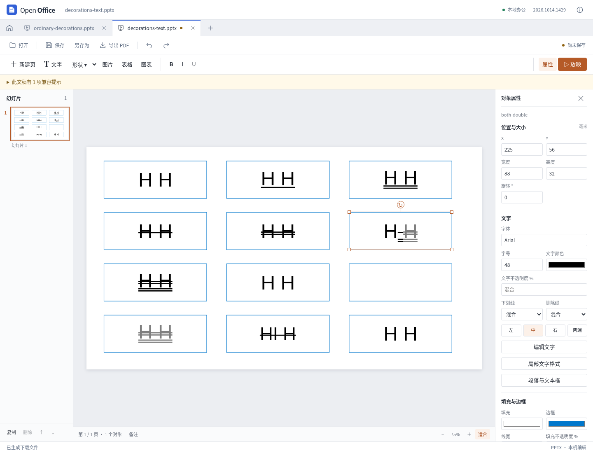

# 文字装饰、页脚字段与 PDF 表单保留

2026-10-14，本轮继续对照固定源码与实际文件完善编辑行为。研究用参考程序没有作为产品依赖，演示工作区仍使用独立模型和读写模块。当前更改尚未发布新的桌面安装包。

## 演示文稿

属性栏和局部文字格式窗口加入单、双下划线及单、双删除线。可仅修改选中文字，也可应用到整个文本框；混合格式显示“混合”。原有 U 按钮仍用于切换普通单下划线。格式支持撤销、重做、保存和重开。

导入分别解析段落默认、文字片段继承以及显式关闭，不把双线转换为单线。改字体、字号或正文时，保留原始装饰线属性；只有明确修改该属性时才写回对应的 XML。未支持的波浪线、按词下划线和自定义线条材质保留原文件定义，并给出显示限制提示。SmartArt 缓存中的装饰线仍属于已知限制。

预览和 PDF 使用相同的矢量线几何。装饰线跟随各片段的透明度、旋转及上下标，完全透明的文字继续参与布局。PDF 将半透明字形和删除线合成一次，避免交叠处变深；仍保留可检索文字，没有改成截图。负内边距与旋转边缘也有单独回归，避免透明合成引入额外裁切。

普通下划线位置使用基线下方 0.1 em，删除线为基线上方 0.27 em；当前并非逐字体精确的下划线度量。因此不能据此声称所有字体和复杂排版均与参考程序像素一致。

## 文字文档

页眉页脚侧栏改字采用原生文字片段内的局部替换，保留相邻页码字段、超链接、段落和字符格式。现阶段允许的改动须落在同一个普通文字片段内；跨字段、链接、格式边界、软换行或段落边界的操作会停止，并引导回到文档画布编辑。

检查先确认原生分段与当前显示文本一致，再验证目标光标范围，最后执行一次替换。无法可靠检查的内容不做整段重建。关闭页眉页脚仍会删除其中内容，因此保留原有的明确删除确认。

## PDF 页面与表单

修复提取、删除和重排页面后丢失表单根信息的问题：普通独立字段现在保留根引用、默认外观和资源，页面操作后可继续填写。

合并时区分空计算顺序数组与真实计算链；不同文件的默认字体、字号和对齐分别落实到各自字段。同名字段独立命名，填写复制或合并后的某一页不会连带修改另一份。复杂父子字段、孤立引用、XFA 或关联动作仍不能安全调整页面，会明确拒绝输出。

电子表格沿用上一轮已验证的数组公式和停止型数据验证写入保护，本轮没有替换表格计算内核。[上一轮记录](presentation-text-opacity.md)

## 对照依据

REA 6.4.0 对固定 SDK 源码 `72b0421c0bbf9d01eed9cf14834ae47eb2df1b50` 的 8 个文件、27 个相关函数进行有界解析，共 10,231 个 AST 节点，零解析失败。原始源码及摘录指纹已核对；静态语义覆盖仍标记为 unknown。

自建 12 对象 PPTX 在官方 Linux 桌面程序中打开，并用固定位置的像素扫描核验。观察到参考程序将双下划线简化成单线、`words` 下划线跨过空格，且完全透明的文字仍残留装饰轮廓。产品按文件定义实现受支持效果，没有复制这些显示差异。

## 最终验收

**573 项 Node、61 项 Python 测试通过，零失败、零取消；类型检查和生产构建通过，构建耗时 8.84 秒。** 全量测试与构建串行执行，避免浏览器和本地字体导出同时争用资源。

- 演示专项 33 项通过；初版独立浏览器检查 148 项、独立 PDF 检查 80 项分别留存。随后发现并修复半透明字形与线条交叠、负内边距裁切和旋转边缘重复抗锯齿，最终 6 个 PDF 场景无缺失深色像素，最大像素误差 2.5，低于预设容差 3。
- 真实开发界面与最终生产界面各完成 8 组操作，包括继承、整框与选区、撤销重做、未支持样式保留、实际下载重开及 390 像素窄窗口。生产下载的 6 份 PPTX 与早先实际界面导出逐字节一致；生产界面下载的两份 PDF 通过 165 项独立文字、矢量线、有效透明度和像素检查。
- 官方桌面实际打开原件及两份真实界面导出，共 3 文件、3 页；21 个未修改对象区域与原生原件像素一致。这里没有进行原生重保存，也不声称跨产品的整页像素一致。
- 12 份复杂文稿完成 65 次导出、41 份包审计和 36 次重开，原件未修改，运行错误、外部请求及旧办公引擎请求均为零。旧选区格式 449 项、文字透明度 50 项、旧选区界面 5 组通过。
- Word 定向单测 43 项、真实界面 12 项、独立 XML 审计 62 项通过；实际 DOCX 重开与 ODT 回转检查了页码、链接及可见文字格式。详见[页眉页脚改字](word-decoration-editing.md)。
- PDF 页面表单新增 5 项回归，纳入全量 61 项后端检查；真实导出还由 Poppler 独立确认 AcroForm 及字段新旧值。详见[表单填写](pdf-form-filling.md)。

旧回归的对象字段顺序比较、文字装饰路径分类以及两处 Word 测试选择器也作了修正；初始失败记录保留，未把这些测试问题当作产品修复。原始 PDF 叠色和裁切缺陷的像素证据同样保留。

实际输出、最终源码与研究指纹见 [JSON 验证记录](presentation-text-decoration-results.json)。各阶段证据分别说明，未把模型检查、界面操作、外部软件打开或像素观察混为“完全兼容”。新版本 Windows/macOS 安装包尚未构建、验收或发布；任意复杂文档无损兼容仍未达到。
