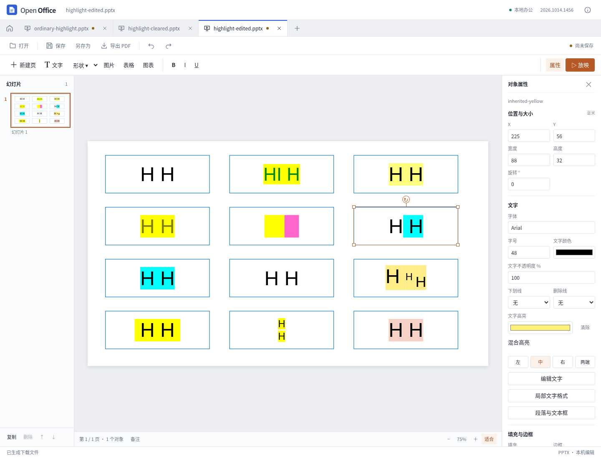

# 演示文稿文字高亮

2026-10-14。本轮为独立演示内核增加普通 DrawingML 文字高亮，并用固定参考源码、独立样例和官方桌面截图核对其语义。参考程序和源码没有作为产品依赖，也没有复制参考实现。

## 支持的编辑与保留行为

属性栏可以给整个文本框设置高亮颜色或清除高亮；局部文字格式窗口可以对选中的字符选择“保留原样”“设置颜色”或“清除高亮”。混合格式会显示“混合高亮”。新选择的颜色为不透明高亮；导入文件已有的高亮透明度可以保留和显示，当前界面未提供独立的高亮透明度滑块。

导入解析普通文字的直接高亮及受支持的默认属性继承，包括可解析的主题颜色和颜色变换。较近的高亮定义整体替换颜色与透明度：没有 alpha 的显式颜色为完全不透明，不继续乘以前一级透明度。

整框与选区编辑沿用现有命令、撤销及重做机制。保存时只更新明确修改的属性；改正文、字体、字号或其他格式时，保留未修改的高亮 XML。选区切分保留相邻片段格式，未选中文字不会被整框重建。字段、链接和复杂结构继续受现有选区写入保护约束；不能由高亮支持推断任意复杂结构均可安全切分。

颜色无法可靠解析、定义重复或结构不明确时，预览不猜测高亮底色，并给出兼容性提示；未修改的原节点仍保留。显式选择新颜色属于用户要求替换该属性。SmartArt 缓存文字的高亮仍是显示限制，原 XML 保留。

## “清除”如何覆盖继承

DrawingML 的 `a:highlight` 使用 `CT_Color`，要求恰好一个颜色子节点。它没有 `none` 枚举，也不允许 `noFill` 或空 `<a:highlight/>`。直接删除本级节点可能重新露出段落、列表或母版中继承的高亮。

因此，界面“清除”写入合法的透明颜色覆盖：

```xml
<a:highlight>
  <a:srgbClr val="000000"><a:alpha val="0"/></a:srgbClr>
</a:highlight>
```

模型中属性缺省与显式清除分别表示“继续继承”和“透明覆盖”，不能混为一谈。官方桌面样例已确认：默认黄色高亮被上述直接覆盖清除，黑色文字保持可见。这是透明颜色的语义，不是一个额外发明的 DrawingML “无高亮”类型。

规范依据为 ECMA-376 Part 1 §21.1.2.3.4 与 Annex A.4.1 的 `CT_Color`、`EG_ColorChoice`、`EG_ColorTransform`。WordprocessingML 的 `w:highlight` 是另一种类型，不能据此推断 PPTX 的清除语义。

## 绘制范围与字体度量

高亮是文字下方的独立矩形层。它与字形、下划线和删除线的透明度分别计算：文字为 0% 不透明度时，高亮仍可见；高亮透明时，文字仍可见。SVG 预览和 PDF 从同一场景生成高亮几何，不能将两者放进仅由文字 alpha 控制的合成组。

矩形宽度按排版后的文字前进宽度计算，包含空格和两端对齐扩展的间距。换行逐行绘制，不用一个矩形填满文本框。

矩形高度采用独立的字体度量带（font band），不使用当前字符的墨迹边界。例如 `H` 的墨迹下降高度可能为零，但字体下降区仍需包含在高亮内。混合字号、上下标的同一行使用共同高度，结合各片段字体上升、下降度量与基线偏移求包络；字形仍保持各自的基线。

参考源码的普通高亮范围为 `baseline − line.Ascent` 到 `baseline + line.Descent + min(0, lineGap)`。当前实现新增高亮字体度量计算，没有把现有文字布局整体换成参考排版器。**已有的文本基线、垂直定位、文本框裁切和超出内边距的处理尚未全面修复**；高亮变高后可能更容易暴露这些原有差异。精确行距、字体替换、复杂脚本、竖排与完整母版继承仍不能承诺像素一致。

## 固定源码与 REA 证据

本轮使用 REA 6.4.0 对官方 `ONLYOFFICE/sdkjs` 提交 `72b0421c0bbf9d01eed9cf14834ae47eb2df1b50` 的 10 个文件、40 个相关函数进行有界静态解析，共 14,604 个 AST 节点，零解析失败。源码 Git blob、SHA-256 与函数摘录指纹已核对。静态解析不是完整编辑器执行，也不能证明所有运行时分支兼容。

研究材料位于独立研究目录，未复制到产品运行时：

- `/workspace/open-office-research/onlyoffice/rea-text-highlight-findings.md`：完整结论、源码位置及边界。
- `/workspace/open-office-research/onlyoffice/rea-text-highlight-evidence.json`：真实 REA 输出；证据 ID 为 `ev_bbe677b72d12940f3210dcd2bf0628f754ffdfcce97470f2b0202e0c38b8faf8`。
- `/workspace/open-office-research/onlyoffice/rea-text-highlight-summary.json`：原始函数与 REA 节点映射。
- `/workspace/open-office-research/onlyoffice/text-highlight-targeted/verified-source-manifest.json`：固定源码指纹。
- `/workspace/open-office-research/onlyoffice/text-highlight-targeted/sample-native-highlight.py` 与 `native-pixel-observations.json`：只读截图采样及结果，可重复运行，不启动参考程序。

这些路径用于当前工作区复核，普通用户安装包无需包含研究工具或参考软件。

## 原生观察及参考程序差异

独立样例位于 [`tests/compatibility/presentation-text-highlight`](../tests/compatibility/presentation-text-highlight/manifest.json)。其 12 个对象覆盖直接颜色、50% 高亮、继承与清除、混合基线、首尾空格、手动换行和一个主题颜色变换。官方 Linux 桌面原件打开记录为 `test-results/highlight-native-baseline/report.json`，截图为 `ordinary-highlight/original/editor.png`。

原生结果确认不透明黄底、半透明黄底、默认继承、直接颜色替换及透明覆盖。常规 48 pt 文字与混合上下标均出现约 47 像素高的整行色带；首尾空格扩大底色宽度。手动换行样例使用 24 pt 文字，两行色带相接，不能把连续像素区域误解成整个文本框只有一条逻辑高亮。

同时发现参考程序的一个缺陷：字形自身为 50% 或 0% 不透明度时，原本完全不透明的黄色高亮反而消失。固定源码中，普通半透明文字进入 `CTextDrawer` 路径；高亮附加属性的参数位置与后续读取不一致，导致背景填充被清空。这与截图现象一致，但没有将安装程序的构建提交与固定源码逐一对应，不能将静态推断称为调试器证实。

产品保持高亮与文字 alpha 独立，没有复制上述异常。原生截图也不是全部功能的规范答案。本轮源码中间绘图协议支持独立 brush alpha，但这不等于已经验证参考程序最终 PDF 的全部像素。

## 最终验证

最终源码通过 **583 项 Node、68 项 Python 测试，零失败、零取消**；类型检查及生产构建通过，Vite 构建耗时 10.65 秒。全量测试与构建串行执行，运行时关闭了测试浏览器。本轮未构建或发布新的 Windows/macOS 安装包。

| 检查层次 | 本轮结果 |
| --- | --- |
| 高亮专项 | 59 项通过；新增 6 项 Node 测试计入上述全量 |
| 实际界面 | 开发与生产界面各 8 组操作，包含桌面、390 px 宽度、撤销重做、实际下载和重开 |
| 独立审查 | 145 项真实 PPTX 浏览器检查、75 项实际 PDF 检查 |
| PDF 合成及资源 | 5 个父组/对象透明度场景、6 个裁剪场景、64 项 Form 资源检查 |
| 生产界面 PDF | 两份实际下载 PDF 的 227 项独立检查 |
| 官方桌面打开 | 原件及两份实际导出，共 3 个文件、3 页；20 个未修改对象区域与原件像素一致 |
| 生产与原生证据关联 | 6 份生产页面导出 PPTX 与先前界面文件逐字节一致，包括原生复核使用的两份 |

初版还发现高亮高度误用字形墨迹，以及半透明父对象下 PDF 重复叠加背景/字形的问题。最终采用独立字体度量与文字块隔离合成；嵌套装饰 Form 只记录实际引用的 XObject，独立检查未发现递归或自引用。负内边距和旋转边缘继续沿用原文字裁切与外扩保护，未将这一局部修复说成通用组合对象透明度重写。

高亮专项见 `test-results/presentation-text-highlight/report.json`，真实生产界面及其下载文件、PDF 审计见 `test-results/highlight-production-ui/`。原生截图只证明记录中的打开和渲染；20 个区域比较是同一参考软件内的未编辑区域对照，不是两个产品整体像素等同，也没有原生重保存声明。早期高亮合成失败证据保存在研究目录 `text-highlight-review/initial-group-opacity/`。

同期完善了两个文件保留边界：表格侧栏先检查全部目标，防止往合并覆盖格写入隐藏值；PDF 正文替换避开字段、批注、链接及同页待处理涂抹。前者通过 33 项定向 Node 与 17 项真实 WASM 检查、XLSX/ODS 保存重开；后者新增 7 项测试并通过完整 68 项后端测试及 Poppler 读取。详见[表格写入保护](calc-content-write-guards.md)和[PDF 对象保护](pdf-text-object-protection.md)。本轮未更换表格内核，Word 此前字段/链接保护仍在全量回归内。

最终源码、测试、文件及构建指纹与旧回归结果见[机器可读记录](presentation-text-highlight-results.json)。这些结果不代表任意复杂文档无损或参考软件全部功能已完成。


