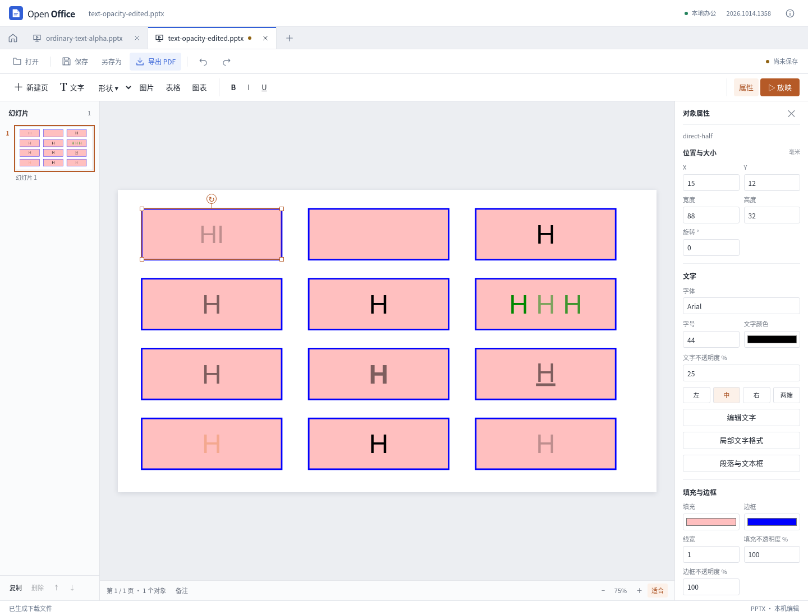

# 普通文字透明度与保存一致性

2026-10-14，当前源码更新，尚未发布新的桌面安装包。

普通 PPTX 文字现在分别保留颜色与不透明度。一个文本框中的不同片段可拥有不同透明度，完全透明的文字仍参与布局；文字不会受到图形填充和边框透明度的影响。预览与 PDF 使用同一文字场景。

## 编辑与文件保留

属性栏可调整整框文字的“不透明度”，范围为 0–100%。混合透明度显示为空并标记“混合”；局部文字格式弹窗可以只修改选中的字符。支持撤销、重做、保存和重开，非法数值会保留为草稿并阻止保存。

改字、字体和字号保留原来的文字颜色定义。明确改文字颜色时，每个片段仍保留自己的透明度；不会把首段的透明度套到所有文字上。单独调整透明度会替换 alpha 运算，保留实色基值、主题颜色引用和其他已支持变换。

继承按 DrawingML 的层级处理：较近的实色定义同时覆盖颜色和 alpha，没有 alpha 的显式实色恢复为完全不透明。段尾属性不反向改变已有文字。非空段中没有可验证本地填充的默认/段尾样式保留原状，不为了调整可见文字而猜测其颜色。

透明度单独编辑限于可以证明的直接或文本体内继承实色。未解析的外部继承、高级填充、异常结构或超预算颜色变换会被拒绝，并提示先明确选择普通文字颜色。选择普通颜色属于明确的材质替换。新的透明度编辑及选区切分继续保护字段、超链接等复杂结构；原有整框改色不切分文字，仍可保留这些节点及其关系，并逐片段保留 alpha。

## 对照研究

REA 6.4.0 对固定源码 `72b0421c0bbf9d01eed9cf14834ae47eb2df1b50` 的 11 个文件、37 个相关函数完成解析，共 13,948 个 AST 节点，零解析失败。Git blob 与 SHA-256 核验通过；静态语义覆盖仍为 unknown。

自制 12 对象样例在官方 Linux 桌面程序中实际打开，验证直接透明度、段落/文本体默认继承、混合片段、加粗和主题颜色。两项参考差异单独记录：参考程序对 80% × 50% + 10% 透明度链显示接近 80%，而标准有序结果为 50%；其半透明文字的下划线带有更深的轮廓。产品按完整透明度链计算，不复制这两个差异。

页面背景、完整主题材质、SmartArt 缓存文字与自定义下划线材质仍有边界；不能由普通文字 alpha 支持推断它们已完整对齐。字体替代、字形度量和复杂排版也仍可能影响最终画面。

## 同轮其他文档修复

电子表格复查发现，侧栏单格及批量改值会破坏数组公式，保存后的文件甚至在重开时又恢复成原数组结果。写入入口增加整批预检，冲突操作在更改任何单元格前停止。带 STOP 错误验证的格子也需要由原表格画布验证，侧栏不再直接绕过规则。

PDF 复查发现，填写一个文本框时，底层生成器会改动多个控件共享的间接边框字典。现在生成外观前隔离可变样式，并避免回写已经取整的样式值。当前生成器无法准确保留虚线文本框外观，因此该类型明确只读，相邻普通字段仍可填写。独立字段旋转、原正文和未编辑页面保持验证通过。

文字文档另外复查了带页码字段的页脚：替换整段页脚会移除字段，界面已有明确提示，本轮未将其误报为已修复的字段编辑能力。

## 最终验收

**560 项 Node、56 项 Python 测试通过，零失败、零取消；类型检查及生产构建通过，构建耗时 9.35 秒。** 全量测试与构建串行执行。

- 普通文字透明度、整体改色及字段/链接保留专项 49 项通过；独立初轮 88 项检查与 23 项 PDF 检查保留，整体改色修复后另完成 20 项独立回归。
- 开发界面与生产构建各完成同样的 9 组实际 Vue 操作，涵盖整框及选区、混合透明度改色、0% 输入、撤销重做、下载重开、非法草稿及 390 像素窄窗。两个真实导出 PDF 由独立阅读器完成 120 项字形、绘制状态和像素检查；生产构建导出的 6 份 PPTX 与开发界面逐字节一致，两份 PDF 的文字状态、绘图状态和渲染像素也分别一致。
- 官方桌面实际打开 12 对象原件及两份真实界面导出，共 3 份文件、3 页。21 个未修改对象区域与原生原件像素一致；5 组修改字形颜色符合混色结果。这里只核验这些区域，不声称两个产品的全部字体度量一致，也没有把打开检查称为原生重保存。
- 12 份复杂 PPTX 完成 65 次导出、41 次包审计、36 次重开；原件未改动，运行错误、外部请求及旧办公引擎请求均为零。
- 既有选区格式 449 项、正文编辑 92 项、表格文字 86 项、形状透明度 43 项、原选区界面 5 组回归通过。拒绝场景分别记录，未混入普通功能通过数量。
- 表格新增写入保护通过 33 项真实 WASM 检查，含实际 XLSX/ODS 保存重开；PDF 表单专项 17 项通过，并纳入全量 56 项后端测试。

回归过程中发现并修复了含字段/链接文本框整框改色被误拒绝的问题。另修正两处旧测试口径：缺省 alpha 与显式 1 按同一语义比较；没有文字的直线不占文字序号，改按对象身份检查透明度。首次失败日志保留在 `test-results/text-opacity-final/`，最终结果对应修复后的代码。UI 最后补测发现数值 0 被当成空输入，已修复并新增实际应用、保存、撤销检查。

源码、样例、实际输出、研究及构建指纹见 [JSON 验证记录](presentation-text-opacity-results.json)。本轮没有更新 Windows/macOS 安装包，也未进行新版本桌面平台验收。任意复杂文档无损兼容仍未达到。
