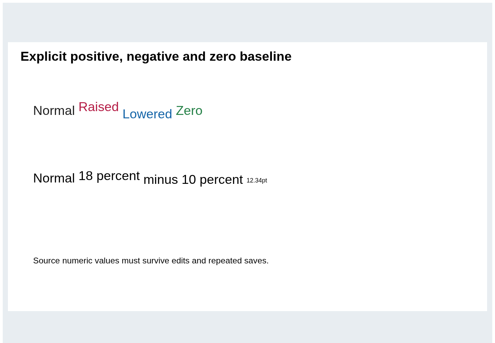
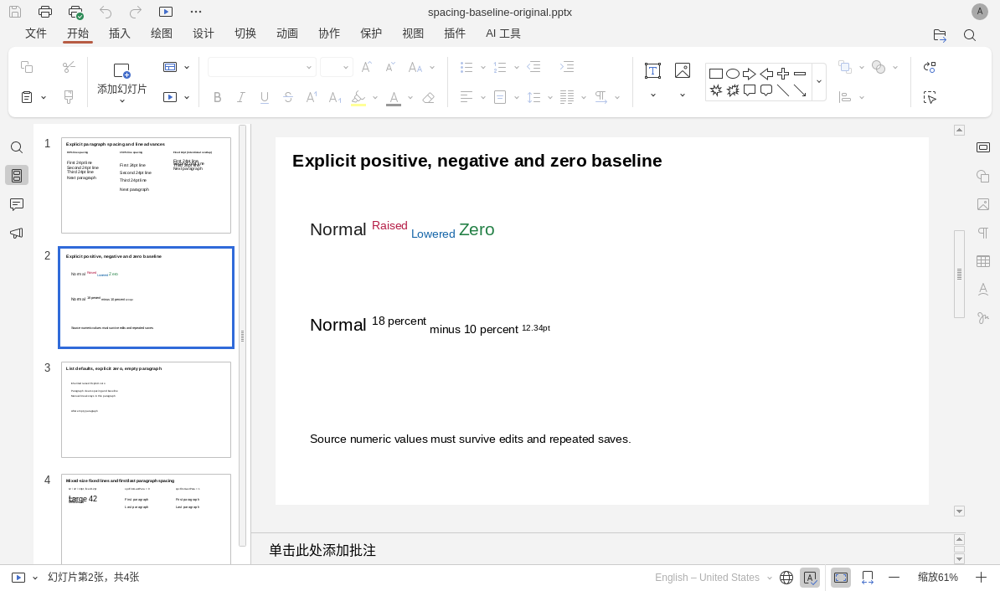

# 第二轮兼容性迭代：段落与上下标

2026-10-14，继续基于固定版本源码的 REA 定向分析、公开 DrawingML 规范，以及官方 ONLYOFFICE 10.0.0 实际运行，补齐独立 PPT 的文字排版。Word/Excel 内核未在本轮更换；本轮没有发布新的桌面安装包。

## 本轮实现

- 分开读取百分比与固定点数行距、段前和段后间距，逐层继承，保留显式 0。
- 百分比值按对应行最大的文字字号计算；固定行距保持指定的基线间隔，即使大字号文字因此重叠。未指定行距时仍使用自然字体度量。
- 段距只作用于段落边界；软换行和手动换行不会重复加段距。相邻段后/段前取较大值以对齐参考软件行为，首尾段距由 `spcFirstLastPara` 控制，默认关闭。
- 上下标保留完整的正、负及零偏移，偏移与字号分开计算。没有将显式 12.34pt 舍入，也没有改写文档中的原始百分比。
- 区分空段落的段末显示属性与输入新文字时使用的默认属性。显式换行保留自身度量，普通空文字片段不污染下一行的字号。
- SVG、缩略图、放映与 PDF 共用场景中的基线和字形范围。居中、底部对齐会考虑重叠行和上下标的实际范围。

## 参考行为与标准数值的差异

REA 第二轮检查了 8 个函数摘录文件、16 处声明，7553 个 AST 节点，解析失败为 0。语义图仍有片段外动态依赖，不能将静态结果当作完整运行证明。原始引用和固定源码行号保存在研究目录 `rea-spacing-baseline-summary.json`，证据 ID 为 `ev_bd12a79cb7358a9383e419ec9a6d1cbb5069fc526349db9258d570440880c6cd`。

核对了 ECMA-376 2006 与 2016 原件以及公开 Open XML 说明。参考软件把上下标数值按正负映射为固定的脚本样式，并按自身常量缩小字形。本应用保留原始数值偏移和显式字号，因此这一部分画面与参考软件会有差别；不能称为像素级复刻。百分比行距按条款中的最大字号计算，参考软件的字体度量口径也可能产生差别。

相邻段距取较大值在参考软件代码中有明确依据；本轮没有找到 DrawingML 本身的强制合并规则，所以只将它记作兼容策略，没有借用 WordprocessingML 条款来宣称通用规范要求。

本应用共享场景的数值基线显示：

同一原件在官方桌面软件中的固定上下标样式：

## 独立验证

新语料是[四页原创 DrawingML 文件](../tests/compatibility/presentation-typography/README.md)，由独立 Python 建包，包含固定行距、不同百分比、混合字号、原始基线、继承零值、空段落与首尾段距开关。

- 27 项真实浏览器检查通过，含三轮保存重开、工具栏改样式和纯文本修改后的再导入。
- 18 项独立 Python 检查通过：所有未改文字体 XML 的属性和内容保留，字号及基线原值保留；PyMuPDF 回读四页 PDF 并验证行基线和上下标坐标。
- 全量类型检查、456 项 Node 测试、28 项 Python 测试通过，生产构建通过。
- 原有混合文字 21 项浏览器检查继续通过。
- 原有 12 份复杂文档、36 次无操作保存重开、65 个导出文件和 41 份独立审计报告通过。
- 官方桌面软件打开原件、三轮保存后的文件、改格式和改文字的文件，共 4 次打开、16 页截图检查通过。

测试明确区分了 XML 数据保留、数值布局和原生截图；不以“文件能打开”代替实际编辑、排版或动画能力。完整结果位于 `test-results/presentation-typography/`；最终复杂语料与原生打开记录在[结构化结果](presentation-typography-results.json)中汇总。

## 仍未完成的功能

当前仍是文字框级格式修改和纯文本编辑，不是完整的富文本选区编辑器。自定义制表位、项目符号缩进、多栏、竖排、自动适应、字符间距、缺失字体替代仍有简化。SmartArt 仍为只读缓存预览，复杂动画和高级图表尚未全面实现。

本轮验证环境是 Linux Chromium、官方 Linux Desktop Editors 和独立 Python 检查器；没有据此得出 Windows/macOS 原生包或任意文档无损兼容的结论。
