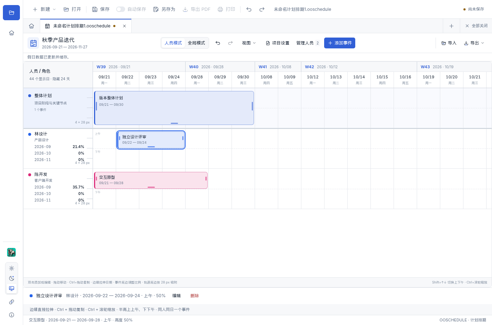
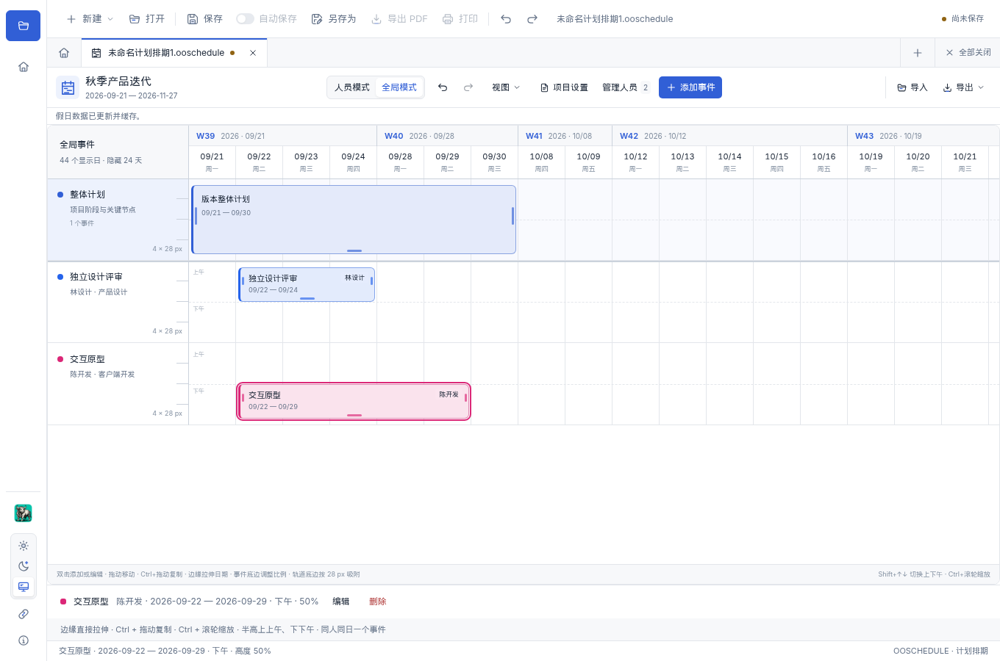
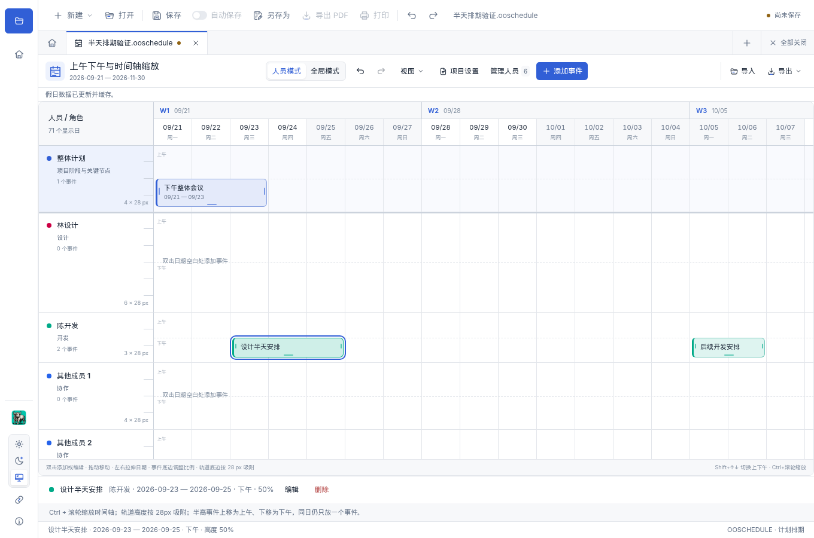
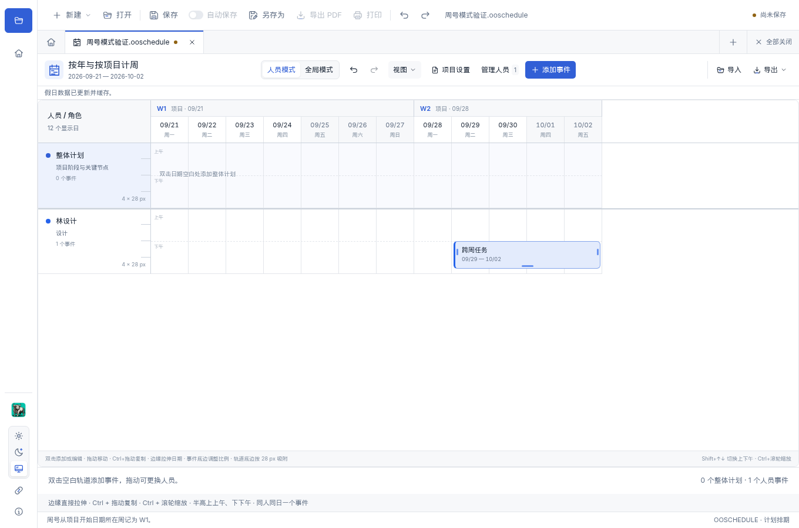
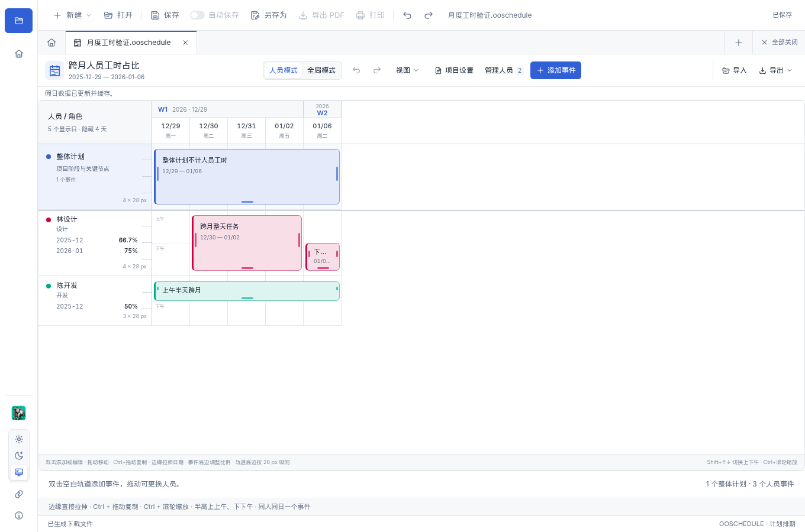

# 计划排期

从工作台点击「计划排期」，或在「新建」菜单中选择「计划排期」。填写项目名称、开始日期和结束日期，即可建立一个独立排期文档。

## 添加人员与事件

1. 点击「管理人员」，填写名称、角色／职能和颜色。每位人员对应一条轨道，事件使用该人员的颜色。
2. 点击「添加事件」，或双击轨道中的空白日期。填写事件名称、负责人、起止日期及可选备注。起止日期都包含当天。
3. 项目阶段、里程碑或整体工作安排可指定到「整体计划」。日期表头和空间足够时的整体轨道在纵向滚动时保持固定，人员标签在横向滚动时保持可见。
4. 双击事件，或选中后点击下方「编辑」，可修改内容、日期和负责人。删除事件可以撤销。有事件的人员需要先移走或删除事件，再移除人员。

## 人员模式与全局模式

| 模式 | 排列方式 | 适用场景 |
| --- | --- | --- |
| 人员模式 | 每位人员一条轨道 | 安排个人任务，查看日期冲突，跨人员调整任务 |
| 全局模式 | 所有人员事件按开始日期混排，每个事件一行，保留负责人和颜色 | 一起查看整个项目的任务时间线 |

两种模式使用同一份数据，切换视图不会改变事件日期或负责人。全局模式可以横向调整日期；修改负责人请打开事件编辑。整体计划在两种模式中都位于顶部。

模式切换、项目设置、人员和事件操作集中在顶部工具栏。「视图」菜单包含周号模式、周末、法定假日、日期列宽及假日更新设置；假日更新结果只显示一条简短状态。

## 拖动、拉伸与冲突

- 拖动事件主体调整日期；人员模式下可拖到其他人员轨道。松开后对齐整天。
- 事件无需先选中：鼠标移到左右边缘即可看到横向拉伸光标，直接拖动调整开始或结束日期。边框也可命中，松开后按整天吸附，至少保留一天。
- 鼠标移到事件底边即可直接调整高度，松开后吸附到轨道高度的 **100% 或 50%**；中间区域保留拖动移动功能。
- **按住 Ctrl 拖动事件主体可以复制**到新日期或另一名人员，原事件保留。拖动期间按下或松开 Ctrl 可在复制和移动间切换，以松开鼠标时的状态为准；预览会标明复制。普通拖动仍移动原事件，Ctrl 拉伸边缘仍只调整边界。
- 副本保留标题、备注和高度，上午／下午跟随落点；全局模式按原负责人复制到新日期，独立行高也会保留。复制可一次撤销、重做，并随文件保存。目标日期冲突或达到事件数量上限时整次复制不生效；Esc／失焦取消、只按 Ctrl 点击都不会新增事件。
- 半高事件可在轨道内上下拖动，上半部代表**上午**，下半部代表**下午**；也可在事件编辑表单中选择时段。选中半高事件后，Shift＋上／下方向键可切换上午／下午。左右移动或拉伸日期会保留时段；恢复为 100% 时回到全天。
- 拖动**轨道底边**可独立调整整条轨道的高度。基础刻度为 **28px**，默认 112px，支持 84–336px；调整时显示刻度和当前倍数，始终吸附到整数格。聚焦底边后可用上下方向键逐格调整，Home / End 调至最小／最大；Esc 可取消拖动。
- 整体计划、人员轨道和全局事件行分别记住高度，随文件保存，也支持撤销、重做。事件继续按所在轨道的 100% 或 50% 显示，调整轨道高度不会改变日期、负责人或容量。
- 当窗口较矮、固定整体轨道会遮住人员时，整体轨道随内容滚动，日期表头继续固定；增大窗口或调小整体轨道后自动恢复固定。
- **上午／下午标记不增加同一天的容量。** 同一人员的两个事件不能占用同一天，即使分别安排上午和下午也不允许。整体计划轨道同样不允许日期重叠；不同人员可在同一天安排各自的任务。
- 拖动和拉伸受项目日期范围约束，不会越过边界。冲突修改或表单中超出范围的日期会被拒绝并显示原因，原事件保留。可用工具栏或快捷键撤销、重做已经完成的修改。
- 拖动中的预览尚未提交。按 Esc 可以取消；拖动过程中保存或切换文档时，预览会取消，保存的是已完成的修改。

## 缩放时间轴

鼠标放在时间轴内，按住 **Ctrl** 滚动滚轮即可缩放日期列；向上放大、向下缩小，尽量保持鼠标下的日期位置不变。普通滚轮仍用于滚动。也可通过「视图 → 日宽」选择紧凑、标准、宽松；滚轮缩放后显示当前比例。缩放仅影响显示，不修改事件日期、时段或文档的未保存状态，PNG 导出会使用当前列宽。

## 周、周末与假日

在「视图 → 周号」中选择编号方式，默认按年。两种模式均从周一开周，设置随排期保存，支持撤销／重做，JSON 和 PNG 导出也使用同一模式。

| 周号模式 | 编号规则 | 示例 |
| --- | --- | --- |
| 按年 | 全年 ISO 8601 周历，包含 1 月 4 日的周为 W1，显示周所属年份 | 2026-09-21 为 W39；2027-01-01 属于 2026 年 W53，2027-01-04 进入 2027 年 W1 |
| 按项目 | 项目开始日期所在周为 W1，每经过一周递增，跨年继续累计 | 项目从 2026-12-30 开始，该周为 W1；2027-01-04 为 W2 |

隐藏整周假期不会重新编号；如果项目第一周被完全隐藏，首个可见周可能从 W2 或之后开始。修改项目开始日期只会重算「按项目」的周号；切换模式和隐藏日期都不会修改事件的真实日期。窄列将年份或「项目」与 Wxx 上下排列，PNG 同样保留完整周号。

默认隐藏周六、周日和中国大陆官方放假日期。打开排期或调整日期范围时，自动获取相关年份的假日安排；有效数据缓存 24 小时，之后再次检查，长时间打开的当前项目也会定期刷新。可点击「更新假日」立即重试。断网或接口异常时继续使用最近有效缓存，2025、2026 年另有内置数据兜底。调休上班的周六、周日仍受周末开关控制，默认也隐藏。

- 在「视图」中勾选「显示周末」或「显示法定假日」可以展开相应日期。
- 「假日设置」支持新增假日和排除已收录的假日，每行填写一个 `YYYY-MM-DD` 日期。
- 未获取到有效安排的年份会在界面提示；尚未发布的空表不会当作全年无假日，也不会覆盖已有缓存。之后自动检查，也可手动更新或补充。
- 手动新增、排除假日优先于自动获取的数据；正在拖动事件时，新的假日数据会等待拖动结束后显示，避免日期列突然改变。
- 隐藏日期只影响显示，不改写事件的真实起止日期。完全落在隐藏日期中的事件会在时间轴下方列出，仍可打开编辑。
- 横向拖动以可见日期列为步长，并保留事件占用的可见日数；只更换负责人而不横移时，原始起止日期保持不变。

自动数据来自 `NateScarlet/holiday-cn` 对国务院公告的整理，优先从 GitHub 获取，失败时使用 CDN 备用源。请求只携带年份，不上传项目名称、人员、事件或文件；详细来源、缓存规则及授权见[日历说明](schedule-calendar.md)。

## 月度工时占比

人员模式下，左侧每位人员名称与角色下方会显示月度小列表，例如 `2026-03 40%`。悬停某个月可查看已排／可排天数和计算口径；月份较多时在该列表内滚动，也可聚焦后使用方向键查看。调高轨道会展示更多月份，不额外占用工具栏或打开统计表。

当前按项目日期范围内的工作日计算每月容量：工时占比 = 当月已排工作天数 ÷ 当月项目范围内工作日 × 100%。全天事件每天计 1 天，上午／下午事件每天计 0.5 天；跨月事件分别归入各月。例如当月项目覆盖 10 个工作日，安排 3 个全天和 2 个半天，即 4 / 10 = 40%。整体计划不重复计入人员工时。

统计始终剔除周末及法定假日，沿用自动获取、缓存及手动假日规则；显示周末／假日、日期列宽和周号模式都不改变结果。未知年份沿用已有日历数据，顶部仍显示当前假日数据状态。百分比最多保留一位小数；无可排工作日时显示「—」，有工作日但未安排事件时显示 0%。

统计根据当前排期和假日数据自动计算，事件修改、移动、拉伸、复制或撤销后实时更新。查看列表或滚动月份不修改排期文件和保存状态；切到全局模式时收起人员统计，切回人员模式后恢复。月度工时在交互侧栏查看，PNG 继续导出排期时间轴。

## 保存与边界

使用顶部「保存」或「另存为」保存 `.ooschedule` 文件，可再次打开继续编辑。桌面端支持现有自动保存机制和最近文件；浏览器预览通过下载和文件选择器保存、打开。导入内容符合排期格式的 JSON 后，首次保存会另存为 `.ooschedule`，保留原 JSON。

顶部「导入」支持 `.ooschedule` 和本工具导出的 JSON。文件会先完整校验，再打开新标签，不替换当前排期；无效文件不会改变正在编辑的数据。

当前版本可读取旧排期。包含下午事件的文件需要使用支持上午／下午的新版本；0.20.0 不支持 `slot: 1`，会拒绝打开这类文件。

「导出 → 排期数据（JSON）」保存完整的项目、人员、事件、周号模式、手动日历设置和轨道高度，可再次导入继续编辑。自动下载的假日缓存属于本机，不写入 JSON。导出副本不会清除当前排期的未保存状态，也不会改变其原来的保存位置。

「导出 → 整张排期表（PNG）」按当前人员／全局模式、周号模式和周末／假日显示设置生成图片，包含所有日期列、全部轨道和项目标题，包括滚动区域之外的内容；保持人员颜色、事件比例及调整后的轨道高度。完全隐藏的日期和事件不会强行展开，图片底部会标注隐藏情况。通常使用两倍清晰度，超大表格按最大边 16384 像素、总像素 2400 万的上限等比缩小，保留完整范围。

每份项目最多覆盖 1096 天、100 名人员、2000 个事件；文件上限 4 MiB。缩小项目范围时，已有事件必须仍在范围内，否则设置不会生效。应用本地处理排期，没有新增运行时依赖。自动假日缓存属于本机，事件日期和手动假日设置保存在排期文件中。

## 实现与验证

交互参考 [Open Media](https://github.com/ecojust/open-media) 视频剪辑的轨道、边缘拖伸和吸附方式，使用现有 Vue 工作台实现。

日期、冲突和文件校验：`node --test --experimental-test-isolation=none tests/schedule.test.mjs`。

真实浏览器交互：`npm run test:browser:schedule`。测试会启动独立 Vite 服务，使用 Playwright 驱动 Chromium，检查拖动、整天吸附、半高冲突、全局模式、保存重开、多标签及异常导入等流程，并将报告和截图写入 `test-results/project-schedule/`。可通过 `PLAYWRIGHT_CHROMIUM_EXECUTABLE` 指定浏览器路径。

轨道高度、紧凑菜单、JSON 往返和完整 PNG 导出的专项验收：`OFFICE_SCHEDULE_FOCUS=layout-export npm run test:browser:schedule`。PNG 检查会解码真实下载文件，验证滚动区域外的最后一行、最后日期和人员颜色。

上午／下午及鼠标锚点缩放专项验收：`OFFICE_SCHEDULE_FOCUS=daypart-zoom npm run test:browser:schedule`，覆盖真实拖拽、时段往返、PNG 下半位置、连续滚轮缩放与多标签隔离。

未选中边框拉伸与 Ctrl 拖动复制专项验收：`OFFICE_SCHEDULE_FOCUS=resize-copy npm run test:browser:schedule`，覆盖最小事件块、动态按松 Ctrl、原事件保留、复制撤销及冲突保护。

按年／按项目周号专项验收：`OFFICE_SCHEDULE_FOCUS=annual-weeks npm run test:browser:schedule`，覆盖模式切换与撤销、文件保存重开、跨年与项目起点、隐藏整周跳号、窄列表头及对应的 PNG 周标题。

月度工时专项验收：`OFFICE_SCHEDULE_FOCUS=monthly-workload npm run test:browser:schedule`，覆盖跨月拆分、半天工时、假日规则、编辑与撤销后的实时更新、最小轨道及长月份列表滚动。
