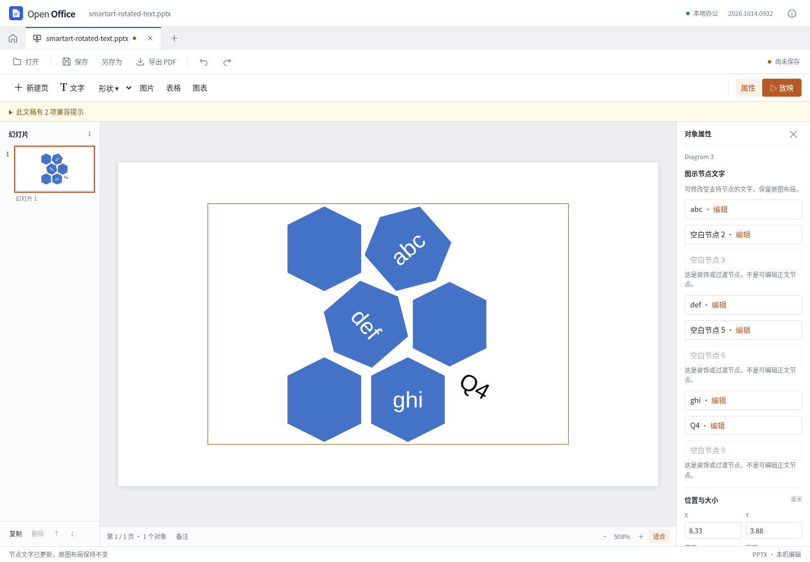

# SmartArt 父布局与子文字：第五轮兼容修正

2026-10-14。本轮修正一类合法图示被第四轮保守判为只读的问题。它仍属于有限的文字编辑能力，没有增加节点或重算布局。

在固定 Apache POI `smartart-rotated-text.pptx` 中，显示 `jkl` 的缓存形状通过唯一 `presOf` 指向子数据点，但 `presAssocID` 指向父数据点 `ghi`。另外两个空白子节点也采用同样结构。布局归属和文字来源在这里不同，不代表文件损坏。

## 实现与边界

文字写回仍仅根据 `presOf`。当布局归属指向直接父节点时，必须存在唯一父子连接，祖先链的节点和方向可验证、无多个父关系或环；否则保持只读。省略连接 `type` 按规范默认值 `parOf` 处理，也接受显式 `type="parOf"`。这项验证只针对新放开的父级布局关联，不是对所有图示结构进行完整模式验证。

改子节点时只更新子正文及它的绘图缓存，父正文、父缓存、布局和关系不变。真正空白的子文字节点可以填入文字，`sibTrans` 等过渡装饰仍不能编辑。字段、多段、多样式、图片节点、共享部件等第四轮限制继续适用。

连接数量在构造父索引前限制为 8000；索引用线性累积，避免重复父边导致数组反复拷贝。属性集合和连接采用严格命名空间校验。

## 研究依据

REA 6.4.0 对固定 `sdkjs` 提交 `72b0421c0bbf9d01eed9cf14834ae47eb2df1b50` 中 3 个文件、7 个相关函数做了静态分析：1222 个 AST 节点，0 解析失败。证据 ID：`ev_10dcfe55650c8db0c8b4564a920ca9761cbb6ceac719cb3b78dc180f3925e457`。

函数调用关系与独立原件 XML 核对一致：`getRelationOfContent` 获取真正文字源，`getRelationOfContent2`/`initDataTree` 确定父子关系，普通写回作用于子 `contentPoint`。规范 `CT_Cxn` 的默认值是 `parOf`，不能只匹配显式属性。研究材料位于隔离研究目录，应用未复制参考源码。

## 验证

- 5 个正例各 3 次编辑、导出和重开：缺省父连接、显式父连接、两个空子节点、父子原文相同。独立检查固定节点 ID 与 XML，证明不是按文字相等猜测目标。
- 15 个负例拒绝编辑：缺失/反向连接、多个或重复父关系、祖先歧义、两节点及三节点环、错误命名空间、错误连接类型、多个文字来源等。
- 3 个过渡缓存节点仍为只读；修改失败时源部件保持未变。
- 原有 3 个图示样例的 9 次改字往返及 21 个异常场景回归全部通过。
- 生产构建界面完成子节点编辑、撤销/重做、实际下载和重开，另核对下载文件中父节点仍为 `ghi`。
- 官方桌面软件打开首次子节点编辑、第三轮编辑及空子节点填写三份文件，均正常加载并留存截图。
- 全量 466 项 Node、28 项 Python PDF 测试通过；类型检查和生产构建通过。

无外部请求或页面异常。原件指纹保持不变。测试不证明完整 SmartArt 格式、自动布局或任意文档无损兼容；本轮未构建或发布 Windows/macOS 安装包。

结果及文件指纹见 [smartart-child-results.json](smartart-child-results.json)。实际产物分别位于 `test-results/smartart-child-text/`、`smartart-child-regression/`、`smartart-child-production/` 和 `smartart-child-native/`。

复现开发检查：`node tests/browser/smartart-child-text.cjs`。生产构建后启动 `npm run preview`，运行 `SMARTART_PRODUCTION_CHILD=1 node tests/browser/smartart-production.cjs`。官方重开使用 `ONLYOFFICE_CASES=poi-smartart-alternating-hexagons`、`ONLYOFFICE_VARIANTS=edited,edited-cycle-3,empty-child-edited`、`ONLYOFFICE_EXPORTS=test-results/smartart-child-text`，其他环境要求见测试 README。
