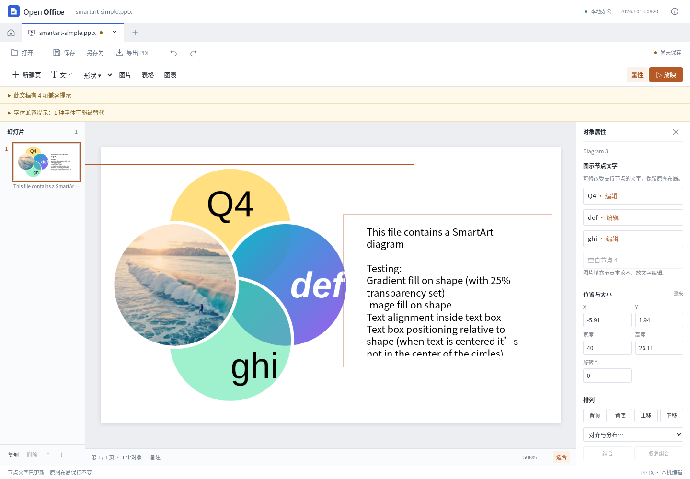

# SmartArt 节点文字编辑：第四轮兼容性迭代

这是第四轮记录；第五轮已进一步支持[经过验证的父布局与子文字关联](smartart-child-layout.md)。

2026-10-14。参考研究工具为 REA 6.4.0，桌面参照为官方 ONLYOFFICE 10.0.0-169。应用继续使用独立 Vue/PPTX 实现；没有复制参考程序源码，也没有把它作为应用运行依赖。

## 本轮能力

选中带有效缓存的图示后，右侧列出节点。受支持节点可单独修改文字、取消、应用、撤销及重做。应用前同时准备图表数据与缓存预览，成功后作为一次历史操作提交；未确认输入会阻止保存。通用的拖动、缩放或纯文本操作仍不能修改受保护图示。

支持范围是：包内关系完整、数据独占、正文与缓存相符、有明确 `presOf` 映射的单段单样式普通文字节点，含真正的空白文字节点。输入限单行 1000 字，保留节点原字体、颜色、几何与布局。文字过长可能溢出；没有自动扩大图形或重新计算布局。

改字会同时写回逻辑数据与绘图缓存，更新原有且能证明归属的文字镜像，不为原本没有文字体的展现节点凭空添加文字。实际编辑会关闭该节点的 placeholder 标记；保存后再清空，标记仍保持关闭。撤销或将尚未保存的修改恢复为原文，则恢复原始数据。

原包字节在内存中保持不可变。与相同文件的无操作导出相比，新增的文字编辑仅改变对应 `data` 和 `drawing` 两部件；媒体、布局、样式及图表关系保留原字节。现有通用导出器仍会规范化部分常规 XML/关系文件，因此不宣称整个 ZIP 除两文件外与输入逐字节相同。

## 保守限制

多来源聚合、多段/多样式、字段、超链接、图片填充、映射不明确、源文与缓存不一致的节点保持只读。本轮也暂不编辑 `presAssocID` 与文字来源不同的父子布局节点；这是支持范围的限制，不表示原件损坏。

共享数据或缓存的图示、嵌套组及母版图示保持只读。已修改节点的图示不能直接复制；保存重开后可复制整页，但共享后的节点仍不能单独改字。跨页对象粘贴暂被拒绝。源包保留的共享关系可能继续触发只读保护，不能保证删除副本后一定解除。普通对象复制不受这些专用保护影响。

预览仍为缓存 PNG，图示文字在 PDF 中不能检索。本轮不包含新建/删除节点、布局重排、完整图示格式编辑或像素级对齐。

## 对照证据

固定 `sdkjs` 提交 `72b0421c0bbf9d01eed9cf14834ae47eb2df1b50` 的 4 文件、17 个相关函数经过 REA 惰性分析：3118 个 AST 节点、0 个解析失败。范围限这些函数，未声称整个程序已分析完成。证据 ID：`ev_98c492583acb0847526cb2e1ec27449241081aca4a3b9914647247db48116d26`。

实际桌面操作验证了 `presOf` 对应、普通输入的双部件写回及 placeholder 行为。还观察到该版本的一次查找替换只更新缓存；本实现没有采用该不一致行为。

完成了一次双向编辑：本应用把 `abc` 改为 `Plan Q4` 并保存；参考桌面程序读到新内容，用普通输入改为 `Native Q4` 再保存；本应用重新打开，节点、兄弟节点和预览正确，仍可打开节点编辑器。原始样例和输入文件未被改写。

## 测试结果

- 3 个固定 Apache POI 样例，9 次真实编辑、保存、重开；另测多节点连续修改、撤回单节点、空白输入、首尾空格和清空。
- 21 个异常输入场景，包括共享缓存但第二图无法解析、重复 ID、聚合映射、外部关系、字段、多样式与错误命名空间。
- 撤销/重做、过期或伪造准备操作、旧剪贴板、复制保护、预览失败和超预算时均保持事务完整。异步预览准备最多 4 项、总字符串预算 12 MB，过期/消费/界面取消后释放；单条超限直接拒绝。
- 5 项真实 Vue 节点编辑检查；3 项生产构建页面编辑、撤销、下载及重开检查。
- 6 次官方桌面打开与截图检查：每个样例的首次编辑文件和第三轮保存文件。专项最终产物与这 6 个输入的 SHA-256 完全一致。
- 双向回存文件在本应用中的 3 项读回检查。
- 全量 466 项 Node、28 项 Python PDF 测试，以及 24 项完整编辑界面检查通过。类型检查与生产构建通过。
- 12 份复杂文档回归通过：36 次无操作保存重开、65 个导出文件、41 份独立审计。无外部请求或页面异常。

各项是独立范围，不把截图、XML 保留与完整功能支持混为同一结论。这些样例通过不证明任意复杂文档无损，Windows/macOS 安装包本轮未构建或验证。



摘要与指纹见 [smartart-text-results.json](smartart-text-results.json)。详细产物在 `test-results/smartart-text-final/`、`smartart-text-ui/`、`smartart-text-production/`、`smartart-text-native/`、`smartart-text-bidirectional/` 和 `smartart-text-complex-regression/`。

## 复现

开发服务器 `npm run dev` 启动后：

```sh
node tests/browser/smartart-text.cjs
node tests/browser/smartart-text-ui.cjs
npm test
npm run build
```

专项输出可用 `SMARTART_TEXT_OUTPUT` 设置。`npm run preview` 启动生产页面后运行 `node tests/browser/smartart-production.cjs`。可选的原生测试通过 `tests/compatibility/onlyoffice-desktop.mjs` 运行，参见兼容性测试 README；原生回存读回测试需把 `SMARTART_NATIVE_RETURN` 指向真实参考软件修改保存的文件，不能用本应用生成文件代替。
