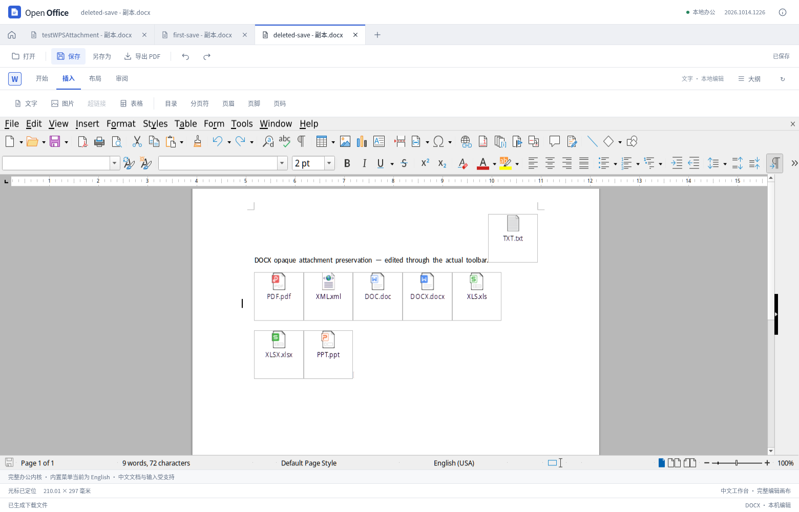

# DOCX 内嵌附件：容器保留与导出标注修正

本轮针对一个已复现的实际数据丢失路径：外层 DOCX 的 `Word.Document.12` / `Excel.Sheet.12` 对象，内部实际是 CFB（复合二进制文件）包装的 OOXML 附件。旧导入设置将其自动转换为本地对象，首次保存后附件正文或工作表变为空。本轮将这些对象保留为不透明附件，并修正导出器对 CFB 外壳的错误文件类型标注。**这不是任意 OLE 编辑器，也不承诺所有复杂 DOCX 无损。**

## 实际定位

原始样本：`tests/compatibility/fixtures/upstream/apache-tika/testWPSAttachment.docx`，SHA-256 `f9373ab9c763603ce72e4a5490c727be745bf48a98d703bab1c9f98ff9cc8a36`。它包含 9 个附件。本地研究先从该文件构造仅保留其中两个对象的最小样本，保留原始预览、关系和附件原字节。

- 原 Word 附件是 13,824 字节的 CFB，Package 流中有正文 `docx_content`；原 Excel 附件是 12,800 字节的 CFB，Package 流中有 3 张表和 `xlsx_content`。
- 默认 Import 的 `WinWordToWriter=true`、`ExcelToCalc=true` 导致原生模型选用 Writer/Calc 类别。第一次 DOCX 保存后，两者被输出为 OOXML ZIP，正文/工作表内容为空。ODT 同样包含空的本地对象。换用 `MS Word 2007 XML` 导出过滤器没有改善。
- 关闭这两个导入转换后，DOCX 与 ODT 的附件负载可逐字节保留。然而 DOCX 导出器仅按 ProgID 将 CFB 流标成 `.docx` / `.xlsx` / `.pptx`、`package` 关系和 OOXML MIME，实际外壳仍是 CFB。
- 同时关闭导出转换设置也不能纠正上述标签。只改导入设置不是完整修复。
- 仅根据**当前导出包**将真实 CFB 负载标成 `.bin`、`oleObject` 和 OLE MIME 后，重开仍保留所有负载。再次保存会重新产生错误标签，因此规范化必须应用于每次 DOCX 导出。
- 先在原生模型删除一个附件再导出、规范化、重开，删除状态保持。无需、也不应从原文件补回附件。

研究没有激活对象：只读对象 CLSID 和文档存储目录；没有调用 `EmbeddedObject`、`Model`、`Component` 或 `StreamName` 等可能触发运行状态的属性。活动文档内的存储被内核锁定，无法安全直接读出，因此不能断言“导入瞬间所有原字节已经消失”。准确结论是导入选择了有问题的转换路径，语义损失已在首次导出出现。默认 ODT 中有未被对象使用的原 CFB 残留流，这不等于实际对象内容保存成功。

完整只读证据位于研究目录 `onlyoffice/word-objectembed-native/`：`report.json`、`round2/report.json`、`audit.json`、最小样本、原始/修正后的 DOCX 与 ODT，以及非激活诊断脚本。

## 产品实现

1. `public/office/offline-policy.js` 的私有启动配置关闭 `WinWordToWriter`、`ExcelToCalc`、`PowerPointToImpress` 三项 Import 转换。其他导出选项不变。对象在文档中仍可显示原预览，附件内部不自动载入编辑器。
2. `src/office/docx-embedded.ts` 仅接受本次导出 bytes，不接受原文档或历史附件。它识别合法 Word 命名空间 `w:object` 的直属 `o:OLEObject` 或 `w:objectEmbed`，校验真实关系、已知 ProgID 与对应扩展名/MIME、CFB 完整魔数与基本容器头。
3. 只有 `.docx` / `.xlsx` / `.pptx` 的错标 CFB package 被改为 `.bin`。负载字节不变；所有已证明的共享关系一起改为相同命名空间族的 `oleObject`；只改该 part 的 ContentType Override。正文、页眉页脚等 story XML 不重写，不改全局 OOXML Default MIME。
4. `OfficeEditor.exportFile` 在引擎导出并核对当前文档后，对 Word/DOCX 结果执行该步骤；完成全部校验后才返回、允许下载/记为已保存。ODT/PDF/XLSX/PPTX 不经过 DOCX 规范化器。

识别范围包括由主文档关系到达的正文、页眉、页脚、脚注、尾注和批注，支持 Transitional 与 Strict 的 Word / 文档关系命名空间。modern 对象读取规范的 `w:progId`，兼容无前缀 `progId`，两者冲突时停止保存。

全部 `.rels` 先枚举，候选 part 若存在未知共享关系、非对象用途、未知类型、相互冲突的 ProgID、自己的 outgoing `.rels`、相对 External 同名目标、已有 `.bin` 或类型记录冲突，均原子停止本次保存，不猜测。外部对象不改写、不下载。数字签名包需要修正时也停止，避免修改后仍带着失效的原签名。有效但不属于这三种对象的附件保持原样。

ZIP 检查限制输入 40 MiB、展开总量 128 MiB、XML 单文件 8 MiB / 总量 24 MiB、XML 深度 128、最多 400,000 个解析步骤/节点和 4 秒预算；复用原有 ZIP 的路径、重叠、重复、加密、CRC 等检查，实际流式展开另计大小。拒绝 DTD、实体定义和不明确的 URI 编码。普通 `../` 与 UTF-8 百分号路径可解析；编码分隔符、点段、重复百分号等歧义路径停止保存。

修改的 XML 仅替换相应属性跨度/增加所需 Override，其他 XML 原字节保持。附件负载、预览和其他未改 part 使用原 compressed bytes。重建 ZIP 的容器目录元数据（例如额外字段/注释）不保证逐字节保留。CFB 检查仅用于识别外壳和修正负载标注，不等于验证内部完整语义。

## 验证

- `tests/docx-embedded.test.mjs`：三种真实 CFB 负载、legacy/modern、Strict、全 story、共享目标、Default/Override、目标转义、幂等、删除、原件不变；以及坏关系、错误 ProgID、碰撞、未知共享用途、嵌套关系、DTD、资源预算、签名等原子拒绝用例。
- `tests/office-editor-presentation.test.mjs`：执行实际 Vue setup，核对仅 Word/DOCX 使用**当前导出**数据；其余格式不进该路径；失败不记为已保存，不改原导入数据。
- `tests/offline-policy.test.mjs`：三项启动配置明确为 false。
- `tests/browser/docx-embedded-preservation.cjs`：实际 Vue 的上传、保存、另存 ODT、重开、工具栏正文编辑及后续保存；固定测试诊断仅读取配置并在原生模型删除一个对象，绝不载入附件内容。正式结果记录于 `test-results/docx-embedded-preservation/report.json`；删除步骤明确属于测试注入，其他文件出入口使用真实界面。

2026-10-14 的实际 UI 回归完整通过 **8 项检查，0 个页面运行错误**。首次 DOCX、ODT 及正文修改后的 DOCX 均保留原始 9 个附件的 SHA-256；三个 modern 对象的 CFB 外壳正确使用 `.bin`、`oleObject` 和 OLE MIME。删除原生模型中的 `Object9` 后，连续保存、重开、再保存均只有 8 个附件，未从原件补回删除内容。新建普通 DOCX、ODT，以及 ODT 重开后继续输入中文也通过。

独立 Python `zipfile` / `lxml` 核对了这 **5 份附件文档、3 份普通文字文档** 的真实 UI 下载结果：对象关系均可到达当前负载，无孤立或重复附件引用；类型标注、负载哈希及删除状态与 UI 检查一致。结果为 `test-results/docx-embedded-preservation/independent-audit.json`，复现脚本保留在研究目录 `onlyoffice/word-container-review/audit-ui-exports.py`。这些检查没有激活附件，也不代表附件内部可编辑或完成其他桌面软件原生保存往返。

保留现有导入风险提示及另存副本保护。本例成功不能据此取消所有内嵌附件风险提示，也不能证明原生桌面 WebView、其他来源的 OLE、宏或未知类型都已兼容。

## 参考源码与结论范围

原生复现使用项目现有 WASM。公开参考源使用 LibreOffice `libreoffice-24.2.7.2`，不是声称与供应商 WASM 完全一致的源码版本：

- `writerfilter/source/dmapper/OLEHandler.cxx`：`importStream`（200 行）按 ProgID 将流交给原生过滤器；`getCLSID` 用上述导入设置决定对象类别；`copyOLEOStream`（280 行）保留不透明流。
- `oox/source/export/shapes.cxx`：`lcl_ConvertProgID`（114 行）仅按 ProgID 设置 OOXML MIME/后缀/package；`GetOLEObjectStream`（288 行）在原有流路径复制原流，解释了“CFB 字节保留但元数据错标”。
- `sw/source/filter/ww8/docxexport.cxx`：调用上述流与元数据写出对象。

ONLYOFFICE 固定 core commit `3250a848ee4ef20c2fb8c38dc86350ec579124b8` 的 `OOXML/DocxFormat/Media/OleObject.cpp` / `Media.cpp` 提供不透明媒体复制与 package/OLE 类别分离的可参考路径。本轮只做公开源码只读定位，没有将这两份 C++ 的静态阅读冒充 REA 完整调用链或 ONLYOFFICE 原生往返验证；没有复制官方实现进产品。
