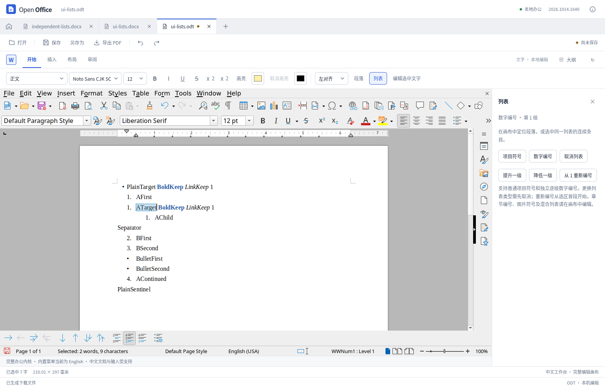
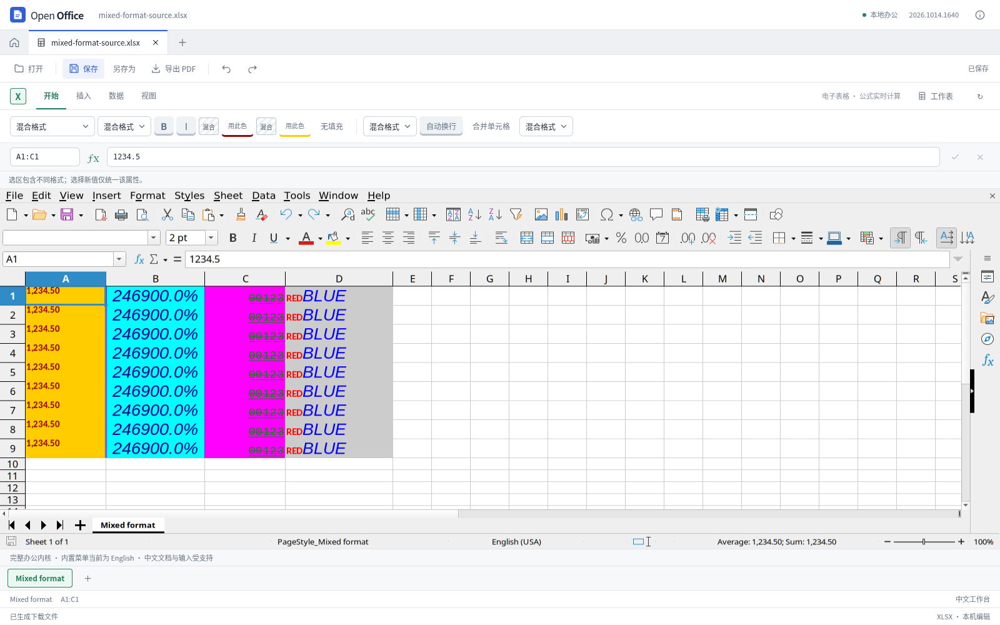

# 文字列表与表格格式一致性

本轮继续完善文字和表格工作区的常用编辑。演示文稿与 PDF 的前序成果见[文字高亮与对象保护](presentation-text-highlight.md)；本轮没有替换文字或表格内核，也没有构建、发布新的桌面安装包。

## 文字列表

“开始”工具栏内增加一个“列表”入口，操作集中在侧栏：项目符号、数字编号、取消列表、提升/降低层级、从 1 重新编号。使用实际段落与编号模型，不向正文插入字符作为假编号。

新建普通列表使用独立编号实例。调整已有列表时使用原生层级命令或目标段落的重启属性，避免修改共用编号定义而影响其他段落。编号重启从选区首段开始，后续条目继续由原文档的列表关系决定；本轮没有增加“接续前一列表”按钮。

实测发现直接设置段落或文字光标的 `NumberingLevel` 都不能正确撤销：撤销栈变化了，实际层级却不恢复。最终改用不包含子级的原生层级命令，定向验证了降低、撤销、重做及相邻子项保留。点击按钮时在有界窗口内重新核对同一文档、选区和段落，取得稳定状态后发送一次带精确版本的操作；不自动重放被拒命令。

新建规则还需要独立的历史与生命周期处理。单独记录工厂创建会留下额外历史项，直接把创建并入用户撤销组又可能在重做时恢复默认数字模板。最终仅在同步的内部规则初始化期间暂停原生撤销记录，`finally` 恢复；之后的段落绑定正常进入一次撤销组。临时规则对象按当前文档保留，上限 512，不淘汰仍可能被历史引用的对象；达到上限需保存重开，已有列表可继续编辑。原生文档成功关闭后释放，失败关闭不释放。诊断性主动回收、连续两次撤销/重做与实际导出已另行验证。

功能限定于正文中的普通列表。标题/章节、图片符号、复杂编号和不同列表混选不能由此侧栏简化覆盖，需在原生画布编辑。选区绑定当前文档版本与真实范围，先检查全部目标，再提交一次撤销组。

DOCX 与 ODT 会对普通圆点采用不同的回读表示：前者可能使用 Symbol 字体字符，后者可能使用当前层占位符。本轮仅接受经过实际往返验证的普通表示；其他层引用、组合占位符、未知符号和图片编号继续保护。保存重开后再次升降级也纳入测试，避免只验证第一次编辑。

## 表格格式

已确认旧侧栏将选区左上格的格式显示成整个选区的格式。现在不同的字号、字体、数字格式和开关状态明确显示为混合；不能从原生模型可靠确认的局部文字格式显示为未确认。选择新值只修改指定属性。

另外修复两类“显示成功但文件未改变”的问题：

- 对含局部字体设置的富文本单元格，字号、颜色和粗斜体等操作同时作用于真实文字范围，保留没有修改的属性、正文和公式。
- 混合数字格式设置为“常规”时，原生 setter 的第一次写入可能仅统一语言。本轮在同一撤销组内再次明确应用目标格式，并检查实际导出结果。

不连续选区不会再静默只修改第一块。一次最多检查 1 万个单元格；涉及富文本字体写入时最多处理 256 个富文本单元格。最终条件格式外观、完整样式继承与所有语言字体的显示一致性仍不属于本轮验证范围。

## 研究与验证口径

REA 6.4.0 分析固定的 SDK 源码版本 `72b0421c0bbf9d01eed9cf14834ae47eb2df1b50`，本轮列表摘录共 6 文件、35 函数、5,963 个 AST 节点，零解析失败。静态研究记录实例编号、共享定义、重启覆盖及取消继承的不同语义；真实 UNO 行为与导出文件另行验证，未把参考源码作为产品运行依赖。

撤销问题另查本地内核对应公开分支的固定源码快照 `dced3bc711d18407a2cc2400eb46e8261b663d95`，17 个文件散列及 14 个代码段已核验：属性 setter 与原生层级命令采用不同撤销路径。该快照不是已证明与 WASM 构建逐字一致的提交，也不是 REA 对 C++ 的解析结果；实际修复效果以本产品的真实引擎、撤销和导出检查为准。

官方桌面 10.0.0-169 打开独立编号样例时，两个不同编号实例若共用定义、没有重启覆盖，显示为接续编号；加入起始值覆盖后显示随之变化。原件与编辑结果因此需要分别观察，不能仅根据 `numId` 是否相同推断可见编号。两份原件均实际显示一页；其中一份未在截图等待窗口内达到像素静止，另一份达到。记录了各自的截图、等待结果和文件散列，不据此声称跨软件像素一致。

最终测试计数、源码指纹和实际导出文件记录在同名结果文件中。分项实现与限制见 [文字列表](word-list-editing.md)和[表格格式](calc-formatting.md)。

## 验证阶段

全量测试完成 **680 项 Node、68 项 Python，零失败、零跳过**；类型检查与生产构建通过。第一次受限环境运行因本机监听权限失败，保留日志后在允许本机测试服务的环境重跑，未修改测试预期。

文字实现还经过多个独立阶段：早期核心版本完成 59 个浏览器步骤与 2,922 项 XML 检查；生命周期修正后完成 34 步、68 项原生历史检查和 332 项 XML 检查；最终开发页面完成 12 组实际操作和 350 项文件检查。这些阶段分别保存源码散列，不把早期结果当作最终源码全量复跑。主动回收与引用计数只用于生命周期诊断，未证明所有回收时序或关闭被拒的运行时路径。

表格最终原生专项的 252 项文件断言、开发页面 9 组操作，以及另一套 openpyxl 读取的 148 项原生输出和 300 项界面输出检查通过。合并覆盖格、数组与 STOP 规则保护另外复跑 17 项。

生产页面验证的全部写操作通过可见控件完成，状态核对通过已有的同源只读协议。初次脚本依赖开发版 Vue 属性而失败，已保留记录；修正的是测试读取方式，没有为生产程序增加调试入口或绕过编辑限制。

窄窗的早期截图没有等待原生尺寸更新，不能据此判断画布持续横向压缩。后续测量与稳定截图已更正此判断，见[窗口缩放与实际输入验证](office-viewport-validation.md)。原生高级菜单的外观未改为独立扁平界面，完整移动端编辑体验也尚未穷尽验证。

最终生产页面完成 **文字 12 组、表格 9 组**操作，实际下载文件的独立检查为 **350 项 XML、300 项 openpyxl**，全部通过。已有页眉页脚功能另完成 **12 组界面回归、62 项文件检查**。生产静态资源与冻结源码逐文件散列一致。

参考桌面软件实际打开两份编辑后 DOCX/ODT，均为一页；另打开一份未编辑 ODT 基线。**ODT 分段列表的跨样式接续编号仍有跨软件差异**：参考软件中未编辑基线的 BFirst/BSecond 已显示 1/2，原始 DOCX 显示 3/4；编辑后 DOCX 显示 2/3，ODT 仍显示 1/2。本地引擎中编辑后 ODT 显示 2/3。文件内的 `continue-list` 关联仍在，不能把“能够打开”写成编号无损兼容。结果包含实际截图、手动读取的编号和各自像素稳定等待结果；没有原生重保存或像素一致性结论。

完整的阶段、源码指纹与实际文件清单见 [验证结果](word-list-and-sheet-format-results.json)。未重新执行的前序演示专项仍以其当轮报告为准。
